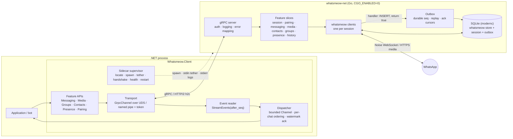

# Architecture

> **Status:** v1 design, frozen for implementation.
> Changes go through an ADR (see [Decision log](#decision-log)).
> **Name:** Whatsmeow.NET.
> Identifiers are in [Naming](#naming).
> **Background:** the full research behind every decision here is in [`RESEARCH.md`](RESEARCH.md).
> This document states *what we do*.
> The research explains *why*, with sources.
> **How to write the code:** [`guidelines/`](guidelines/README.md).
> Coding rules that used to live here (§6 proto style, §7.9, the idiom half of §8.3, §8.9 table, §8.10, test discipline) moved there; each spot keeps a pointer.
> **House rules win:** where this document and the house guidelines (shared with bridge, compras, chrominal) disagreed, the house rule was applied, except where a measured reason made this library opt out (BCL time, `IWhatsAppClient`).
> Both kinds are ADRs in the [Decision log](#decision-log).

Whatsmeow.NET gives .NET applications full access to WhatsApp's multi-device protocol by wrapping the Go library [whatsmeow](https://github.com/tulir/whatsmeow). It has two parts, released together from one repo:

1. **`whatsmeow-net`**: a thin, CGO-free Go sidecar. It hosts one or more whatsmeow clients and serves the `whatsmeow.v1` gRPC API over a private local socket.
2. **The .NET library** (`Whatsmeow.Client` and friends): spawns and supervises `whatsmeow-net`, and exposes an idiomatic, AOT-safe C# API. gRPC and protobuf never leak into the public surface, except through an explicitly unstable `Raw` escape hatch.

The bot built on top is **out of scope** for this repository.

## Naming

The product is **Whatsmeow.NET**, the same name as the repo.
Code identifiers follow the Akka.NET and Quartz.NET pattern: the brand keeps the `.NET` suffix, and packages, namespaces and types drop it.
An earlier draft called the project Wameow.
That name is retired, including in the Go layer.

The sidecar is not a second product.
Its names still land in the contract, in process listings and in generated code, so they use this identity instead of a leftover codename.
Upstream whatsmeow stays lowercase `whatsmeow` in prose, so the two stay easy to tell apart.

| Kind | Name | Notes |
|---|---|---|
| Product, repo, docs | Whatsmeow.NET | not a C# namespace |
| NuGet and C# root | `Whatsmeow` | `Whatsmeow.Client`, `WhatsmeowSidecar`, `WhatsmeowException` |
| Proto package | `whatsmeow.v1` | `proto/whatsmeow/v1/`. Our contract. Upstream packages stay `WAWebProtobufs*` |
| Generated Go package | `whatsmeowv1` | `go_package` is `github.com/tcortega/Whatsmeow.NET/sidecar/gen/whatsmeow/v1;whatsmeowv1`, so it does not collide with `go.mau.fi/whatsmeow` |
| Go module | `github.com/tcortega/Whatsmeow.NET/sidecar` | case matches the GitHub repo. Do not lowercase it in `go.mod` |
| Sidecar binary | `whatsmeow-net` | `whatsmeow-net.exe` on Windows. Not `whatsmeowd`, which reads as an upstream daemon |
| Env var | `WHATSMEOW_NET_SIDECAR_PATH` | overrides binary location |
| ErrorInfo domain | `whatsmeow.net` | reason-code namespace, not a DNS claim |
| Default DB file | `whatsmeow-net.db` | avoids colliding with a whatsmeow or mautrix database in the same directory |
| Windows pipe prefix | `\\.\pipe\whatsmeow-net-` | plus a 128-bit random suffix |
| ActivitySource, Meter | `Whatsmeow.Client` | public constants |
| Sidecar log category | `Whatsmeow.Sidecar` | stderr is forwarded here |

---

## 1. Goals and non-goals

**Goals**

- Feature parity with whatsmeow for personal and group messaging, media, contacts, groups, presence, receipts and history sync.
- **No lost messages.** Delivery is at-least-once from WhatsApp all the way into user handlers, and survives a crash of either process, for every stanza kind whose answer to the server whatsmeow lets a handler withhold: decrypted messages (answered with a delivery receipt), non-retry receipts and `w:gp2` group notifications (answered with an ack). Undecryptable messages are answered early by design, and their content is recovered by the retry protocol: a resend from the sender arrives later as a normal, gated message; the copy the account's phone sends back is not gated (§7.2 `AutomaticMessageRerequestFromPhone`, ADR 0022). The remaining kinds (retry receipts, calls, app state, history-sync receipts, most notifications) are acked by whatsmeow regardless of our handler, so for those the guarantee is best effort. This matches how whatsmeow's maintainer runs it in production (§14 question 8).
- Absorb whatsmeow's weekly churn. A whatsmeow bump changes Go adapter code only. It never changes the `whatsmeow.v1` contract or the public C# API.
- Modern and strict: `net10.0` / C# 14, Native AOT and trimming compatible, no runtime reflection, latest stable toolchains.
- Zero setup for consumers. `dotnet add package` is enough; the sidecar binary ships inside NuGet.

**Non-goals (v1)**

- Bot framework features: commands, middleware, conversation state. Those belong to the bot.
- Long-term message storage. The application owns history; the sidecar keeps only an operational cache.
- Media processing in Go. Thumbnails, transcoding and waveforms are done in .NET.
- Calls (whatsmeow only does call signaling), newsletters/channels, business features. Possible later.
- Being a network service. `whatsmeow-net` is a local child process. "External mode" (separate container) comes in Phase 4.

---

## 2. System overview



**Process model:** one `whatsmeow-net` process per host application, many sessions (WhatsApp accounts) per process, one SQLite database for all sessions.

---

## 3. Code organization: feature slices end-to-end

Vertical-slice thinking applies to this library. A **slice is a WhatsApp capability**, and it is cut the same way through all three layers:

| Slice | Proto file | Go package | .NET folder | Public entry point |
|---|---|---|---|---|
| Sidecar (process) | `sidecar.proto` | `internal/sidecar` | `Sidecar/` | `WhatsmeowSidecar` |
| Sessions | `session.proto` | `internal/session` | `Sessions/` | `WhatsmeowSidecar.Sessions` |
| Pairing | `session.proto` (`Pair`) | `internal/session` (`pair.go`) | `Pairing/` | `client.PairWithQrCodeAsync`, `client.PairWithPhoneNumberAsync` |
| Events | `events.proto` | `internal/events` + `internal/outbox` | `Events/` | `client.On<T>`, handlers |
| Messaging | `message.proto` | `internal/messaging` | `Messaging/` | `client.Messages` |
| Media | `media.proto` | `internal/media` | `Media/` | `client.Media` |
| Contacts & LID | `contact.proto` | `internal/contacts` | `Contacts/` | `client.Contacts` |
| Groups | `group.proto` | `internal/groups` | `Groups/` | `client.Groups` |
| Presence & receipts | `message.proto` (presence RPCs) | `internal/presence` | `Presence/` | `client.Presence` |
| History sync | `events.proto` (history events) | `internal/history` | `History/` | events + `client.Messages.RequestHistoryAsync` |
| Chat state (Phase 3) | `chatstate.proto` | `internal/chatstate` | `ChatState/` | `client.Chats` |

**Rules**

- A slice owns its proto messages, Go service implementation, event mapping, .NET public types, proto↔record mapping and tests. Adding a capability means adding or extending **one** slice in all three layers.
- Slices do not call each other's internals. Shared needs go into the **core**, which is deliberately small:
  - Go core: `internal/server` (gRPC plumbing, interceptors, error mapping), `internal/transport`, `internal/outbox`, `internal/store`, `internal/log`.
  - .NET core: `Core/Transport`, `Core/Dispatching`, `Core/Errors`, `Core/Telemetry`, `Core/Primitives` (`Jid`, `MessageId`, `SessionId`, `MediaRef`).
- Slices may depend on core. Core never depends on a slice.

---

## 4. Repository layout

```
/AGENTS.md                         # agent entry point, progressive disclosure
/CLAUDE.md                         # symlink to AGENTS.md
/LICENSE                           # MPL-2.0, the repository's licence (ADR 0016)
/NOTICE                            # what the sidecar binary owes: GPL-3.0-only as a whole, Corresponding Source per release (ADR 0016)
/.editorconfig                     # house VsaTemplate file, tabs (see docs/guidelines/csharp.md)
/.gitattributes                    # LF everywhere, so generated and copied files are byte identical on Windows
/global.json                       # exact .NET SDK pin and the Microsoft.Testing.Platform runner; at the root so every cwd sees it
/mise.toml                         # exact pins for Go, buf, golangci-lint, protoc and shellcheck
/nuget.config                      # nuget.org only
/build/ci.sh                       # every CI check, one subcommand per job; ci.yml and AGENTS.md call only this
/.golangci.yml                     # lint rules for both Go modules (docs/guidelines/go.md)
/tools/                            # Go module github.com/tcortega/Whatsmeow.NET/tools: repo tools, not product code
  check-repo/                      # allowlists for analyzer configs, MSBuild files, csproj elements, build tags; suppression rules
  sync-protos/                     # checks (default) or rewrites (-write) third_party/whatsmeow against VERSION
  check-licenses/                  # sidecar/licenses.allow equals the licence files of every module whatsmeow-net links (ADR 0016)
  stub-sidecar/                    # stands in for whatsmeow-net in the integration tests, for startup failures the real one never produces
  check-parity/                    # whatsmeow Client method coverage report
/docs/ARCHITECTURE.md              # this document
/docs/RESEARCH.md                  # research report (reference only)
/docs/guidelines/                  # how to write code: csharp, options, tests, go, proto
/docs/adr/                         # decision records, NNNN-title.md
/buf.yaml                          # buf v2 workspace; upstream protos excluded from lint/breaking
/buf.gen.yaml                      # whatsmeow.v1 to Go (sidecar/gen) and C# (Whatsmeow.Protocol); managed mode
/buf.gen.whatsapp.yaml             # upstream protos to C# (Whatsmeow.Protocol.WhatsApp); a separate template, since one plugin has one out dir
/proto/whatsmeow/v1/*.proto           # OUR contract, one file per slice
/proto/whatsmeow/fake/v1/fake.proto   # the fake WhatsApp's control service: test builds only, not the contract (ADR 0019)
/third_party/whatsmeow/            # *.proto and LICENSE copied byte for byte from the EXACT pinned module + VERSION (a go.sum line)
/sidecar/                          # Go module github.com/tcortega/Whatsmeow.NET/sidecar
  licenses.allow                   # every licence file linked into whatsmeow-net, with its sha256 and reviewed licence
  cmd/whatsmeow-net/                     # entry point: flags, stdin token + tether, ready line, signals
  internal/<slice>/                # one package per slice (see §3)
  internal/fakewhatsapp/           # the fake WhatsApp behind the fakewhatsapp build tag, and its control service (ADR 0019)
  internal/{server,transport,outbox,store,log}/   # core
  gen/                             # buf-generated Go for whatsmeow.v1 and whatsmeow.fake.v1 only (never for upstream protos)
/dotnet/
  Whatsmeow.slnx  Directory.Build.props  Directory.Build.targets  Directory.Packages.props
  BannedSymbols.txt  .globalconfig  # banned APIs; generated code exempt from the ban list
  src/Directory.Build.props        # everything under src/ ships: IsAotCompatible, IsTrimmable
  src/Whatsmeow.Protocol.WhatsApp/    # committed generated upstream C# (Whatsmeow.Proto.*) in Generated/, unstable
  src/Whatsmeow.Protocol/             # committed generated whatsmeow.v1 C# (internal where possible)
  src/Whatsmeow.Client/               # public API: Core/ + one folder per slice
  src/Whatsmeow.Extensions.Hosting/   # DI, options, keyed sessions, hosted supervisor
  src/Whatsmeow.Testing/              # FakeWhatsAppClient, in-memory transport
  src/Whatsmeow.Sidecar.Native.{Linux,MacOS,Windows}/   # pack-only: runtimes/{rid}/native/whatsmeow-net[.exe] (ADR 0023)
  src/Whatsmeow.Sidecar.Native.targets            # buildTransitive in each native package: never bundled in a single file
  tests/Whatsmeow.Client.Tests/       # vital unit tests only: dispatcher, supervisor (FakeTimeProvider)
  tests/Whatsmeow.IntegrationTests/   # default: real whatsmeow-net in fake-WhatsApp mode; Generated/ is the fake control's C#
  tests/Whatsmeow.LiveTests/          # real WhatsApp; opt-in, never in default CI
  tests/AotSmoke/                  # PublishAot console app, zero warnings required
  tests/SidecarHost/               # parent process for the kill-parent integration test; with "events", the process the events kill test kills
  samples/EchoBot/
/build/package-smoke/Program.cs    # the new consumer build/ci.sh install builds from the local feed (ADR 0023)
/.github/workflows/  ci.yml  whatsmeow-bump.yml  release.yml
```

Generated code is **committed** and regenerated by CI (`buf generate` plus a diff check). Consumers never need protoc.

Scaffolded in Phase 0, with the contract from #3 (`buf.gen.yaml`, `proto/`, `gen/`, `Whatsmeow.Protocol/Generated/`), the walking skeleton from #4 (`cmd/whatsmeow-net`, `internal/{server,transport,sidecar}`), and the fake WhatsApp mode from #5 (`proto/whatsmeow/fake/v1`, `internal/fakewhatsapp`): everything above except the other `internal/` packages (Phase 1 slices), `tools/check-parity/` (Phase 4), `Whatsmeow.Extensions.Hosting` and `Whatsmeow.Testing` (Phase 3), `Whatsmeow.LiveTests` (#7), `samples/EchoBot/` (Phase 3), `whatsmeow-bump.yml` and `release.yml` (Phase 4); the native packages came with #43 ([ADR 0023](adr/0023-native-packages-build-pin-and-find.md), which drops `.goreleaser.yaml`).

---

## 5. Technology baseline

Re-verify exact versions on nuget.org and proxy.golang.org when scaffolding. "Latest stable" wins over the numbers below.
Each version has one pin: the Go toolchain in the `toolchain` line of `sidecar/go.mod` and `tools/go.mod`, which `mise.toml` must match (`build/ci.sh` checks it); the .NET SDK in `global.json`; packages in `dotnet/Directory.Packages.props` and the Go modules; buf, golangci-lint, protoc and shellcheck in `mise.toml`; CI actions by commit SHA and mise itself in `.github/workflows/ci.yml`.
Last verified as latest stable on 2026-10-31 [observed: go.dev/dl, builds.dotnet.microsoft.com, nuget.org, proxy.golang.org, GitHub releases]: Go 1.27.3, .NET SDK 10.0.403 (runtime 10.0.14), buf 1.75.0, protoc 36.2, golangci-lint 2.15.0, Google.Protobuf 3.36.2, Meziantou.Analyzer 3.0.318, BannedApiAnalyzers 5.6.0, PublicApiAnalyzers 5.6.0, xunit.v3 4.0.2, golang.org/x/mod 0.42.0, shellcheck 0.11.0, mise 2026.10.25.

| Area | Choice |
|---|---|
| Go | 1.27.x toolchain (1.27.3 current, `toolchain go1.27.3`); `go 1.26.0` module floor, matching whatsmeow's `go 1.26.0` (toolchain `go1.27.2`) at the pin |
| whatsmeow | exact pseudo-version, bumped weekly by CI |
| gRPC (Go) | grpc-go latest 1.8x, protobuf-go APIv2 (`google.golang.org/protobuf`) |
| SQLite | `modernc.org/sqlite` (driver `"sqlite"`), no CGO. DSN: the database's plain path, then `?_pragma=foreign_keys(1)&_pragma=journal_mode(WAL)&_pragma=busy_timeout(30000)&_pragma=synchronous(FULL)&_txlock=immediate` (§14 question 3; whatsmeow's `Upgrade` refuses to run without foreign keys). A plain path, not a `file:` URI, needs no escaping on Windows; modernc strips the query and applies the underscore keys (driver.go:90-108). `busy_timeout` was 5000 until #8, where Windows CI writers starved for more than 5 s under the integration suite's load; it is 30000 (ADR 0022). One file per sidecar, `--database`, default `whatsmeow-net.db` in the current directory ([ADR 0020](adr/0020-sessions-and-the-store.md)). The sidecar's own tables are numbered steps tracked in `PRAGMA user_version`, run in one transaction on open; a step is never edited, a schema change is a new one ([ADR 0022](adr/0022-outbox-event-stream-and-dispatcher.md)) |
| Go logging | zerolog, the same logger whatsmeow uses through `waLog.Zerolog` |
| Proto tooling | buf v2 (managed mode), protoc-gen-go 1.36.12 and protoc-gen-go-grpc 1.6.2 (pinned in `mise.toml`), protoc's built-in C# generator (protoc 36.2, paired with Google.Protobuf 3.36.2), and `grpc_csharp_plugin` from the Grpc.Tools 2.85.0 package (paired with Grpc.Core.Api 2.85.0); all pinned in `mise.toml`, none remote |
| .NET | `net10.0` only, C# 14 (`LangVersion latest` on the pinned SDK), `.slnx`, Central Package Management with transitive pinning, artifacts output in `dotnet/artifacts/` |
| gRPC (.NET) | `Grpc.Net.Client`, `Google.Protobuf`, `Grpc.StatusProto`. **Never** `Grpc.Core` |
| Resilience | Polly v8 (`Microsoft.Extensions.Resilience` where appropriate) |
| Time (.NET) | BCL: `DateTimeOffset` (UTC) and `TimeSpan`, from an injected `TimeProvider`; Google.Protobuf's built-in WKT conversions. No NodaTime in shipped packages (opt-out from the house rule, Decision log 0009) |
| IDs (.NET) | Vogen for primitive wrappers (`SessionId`, `MessageId`); `Jid` hand-written |
| Analyzers (.NET) | `AnalysisLevel latest-all`, `Meziantou.Analyzer`, `Microsoft.CodeAnalysis.BannedApiAnalyzers`, house `.editorconfig` with this repo's deltas ([guidelines/csharp.md](guidelines/csharp.md) Build baseline) |
| Lint (Go) | golangci-lint v2 with gofumpt and goimports ([guidelines/go.md](guidelines/go.md)) |
| Tests | xUnit v3 (4.x, Microsoft.Testing.Platform v2, selected in `global.json`), `FakeTimeProvider` (`Microsoft.Extensions.TimeProvider.Testing`); Go `testing` with `-race` |
| Versioning / release | MinVer 8.0.0 from `v<semver>` tags, one version for every package and binary; the binaries from a plain `go build` in `build/ci.sh package`, not GoReleaser ([ADR 0023](adr/0023-native-packages-build-pin-and-find.md)); NuGet Trusted Publishing (OIDC) |

---

## 6. The `whatsmeow.v1` contract

The contract is the most important artifact in the repo. Both sides are generated from it.

**Rules**

- Proto style (proto3, buf STANDARD, AIP-191, `_UNSPECIFIED` zero values, WKTs, field numbering) and the `Timestamp`/`Duration` mapping: [guidelines/proto.md](guidelines/proto.md).
- **Independent of whatsmeow's Go API.** No field mirrors a whatsmeow Go struct by accident. Mapping happens in Go slice code.
- whatsmeow's own protos (`WAWebProtobufsE2E.Message` etc.) are imported **unmodified** from `third_party/whatsmeow` and embedded as **typed fields**. On the wire, a typed field is identical to a `bytes` field holding the serialized message.
- The Go server uses a lenient codec (`AllowPartial` both ways) installed with `grpc.ForceServerCodecV2`, never a global `encoding.RegisterCodec`. With grpc-go's default codec, a message missing a proto2 `required` field fails to decode before any interceptor runs, as a bare `Internal` with no `ErrorInfo`; with the lenient codec it reaches the slice, whatsmeow's send-path `proto.Marshal` rejects it, and the slice maps that to `INVALID_ARGUMENT` (§14 question 1).
- From the first published `v<semver>` tag (pre-releases and build metadata included) on, `whatsmeow.v1` never breaks: a break means a new package `whatsmeow.v2` with its own ADR, every additive change increments `protocol`, and `buf breaking` gates `whatsmeow.v1` against `main`.
  Before that tag, `protocol` keeps its initial value, 1, and `buf breaking` only reports ([ADR 0015](adr/0015-buf-breaking-gates-from-first-published-tag.md)).
  `buf breaking` covers `whatsmeow.v1` only; upstream wire changes are reported but don't block.
- `GetInfo` reports `version`, `protocol` (an integer contract revision), `whatsmeow_version`, `wa_web_version`, `go_version` and `commit`.

**Service shape** (full outline in the research report):

| Service | Kind | Notes |
|---|---|---|
| `SidecarService` | unary | `GetInfo`, `Shutdown`; `grpc.health.v1` is also served |
| `SessionService` | unary + `Pair` (server stream) + `WatchSessionState` (server stream, snapshot first) | app-chosen session IDs |
| `EventService` | `StreamEvents` (server stream) + `AckEvents` (unary) | durable `seq`, resume with `after_seq`, per-consumer cursor |
| `MessageService` | unary | raw `SendMessage` plus typed helpers (text, media, reaction, edit, revoke, poll, read, presence) |
| `MediaService` | `UploadMedia` (client stream), `DownloadMedia` (server stream), `RequestMediaRetry` | path handoff or 64 KiB chunks |
| `ContactService`, `GroupService` | unary | includes LID↔PN resolution |
| `ChatStateService` | unary | Phase 3 |

**Error model:** every error is a gRPC status plus `google.rpc.ErrorInfo{ reason, domain: "whatsmeow.net", metadata }`. `reason` is a stable `SCREAMING_SNAKE` code: `NOT_LOGGED_IN`, `SESSION_NOT_FOUND`, `RECIPIENT_NOT_ON_WHATSAPP`, `RATE_LIMITED`, `TEMPORARILY_BANNED`, `INVALID_ARGUMENT`, `SIDECAR_SHUTTING_DOWN`, and so on (`MEDIA_EXPIRED` comes with media in Phase 2). Clients map on `reason` only, never on message text. The list of reasons is part of the contract: `enum ErrorReason` in `proto/whatsmeow/v1/error.proto`, sent without its `ERROR_REASON_` prefix.

---

## 7. Go sidecar (`whatsmeow-net`)

### 7.1 Responsibilities

A protocol adapter, nothing more: session lifecycle, pairing, event capture into the outbox, send queue, media transfer, history download. **No business logic and no media processing.**

### 7.2 whatsmeow configuration (mandatory)

The reference is the maintainer's own production bridge, mautrix-whatsapp `5dd621f` (`pkg/connector/client.go:81-93`), which sets the same core flags. Where we differ, the row says why.

| Setting | Value | Why |
|---|---|---|
| `SynchronousAck` | `true` | ack WhatsApp only after our handler succeeded, for the gated kinds only (§1, §14 whatsmeow source review) |
| `EnableDecryptedEventBuffer` | `true` | redelivery after a crash is decryptable and deduplicated, for DM and group Signal messages only (not bot `msmsg` or newsletter messages; message.go:605, 625, 653). mautrix turns it on only when its portal handling is synchronous (`PortalEventBuffer == 0`; the default is 64, so it is off by default), which is our mode (§14 "Measured for Events (#8)") |
| handler registration | `AddEventHandlerWithSuccessStatus` | returning `false` withholds the ack, for the gated kinds only |
| `ManualHistorySyncDownload` | `true` | history blobs aren't deleted from the server before we have them; we call `DownloadHistorySync` and then `DeleteMedia` ourselves (§7.7) |
| `UseRetryMessageStore` | `true` | retry receipts can be answered after a restart. mautrix defaults this to `false` ("by default, the bridge only stores messages in memory, and therefore can't accept retry receipts if the bridge is restarted"); we choose robustness |
| `AutomaticMessageRerequestFromPhone` | `true` | an undecryptable message gets a retry receipt to the sender and, with `SynchronousAck`, at once a re-request to our own phone (retry.go:493-497; `RequestFromPhoneDelay` applies only without `SynchronousAck`). The sender's resend is a normal, gated message, with the same id when the sender is whatsmeow (retry.go:371) [inferred for other senders]. The phone's copy is dispatched from inside the phone's protocol message, with the id of the response's key (message.go:863-881, client.go:1039), and a failed handler on it does not withhold the receipt (message.go:1172-1175): best effort. Whether the recovered id equals the original is checked live in #10. mautrix sets it |
| `InitialAutoReconnect` | `true` | retry when the first connect at startup fails; mautrix's default (`initial_auto_reconnect: true`) |
| `EnableAutoReconnect` | `true` (whatsmeow's default, `client.go:307`), with no `AutoReconnectHook`: mautrix sets none, and a hook that returns false leaves the session `Reconnecting` with no event (`client.go:673-675`); whatsmeow's own backoff is 2 s more per failed attempt (`client.go:653`) | with it off, a dead socket only emits `KeepAliveTimeout` and is never closed: the keepalive loop forces a reconnect only when auto reconnect is on (`keepalive.go:46`). This is the mechanism behind the "zombie socket" report; no "zombie" appears in the code |
| `store.DeviceProps`, `SetOSInfo`, `SetWAVersion` | set **once** at startup | process-global in whatsmeow; never mutated per session |
| libsignal's `logger.Setup` | set **once** at startup, to the sidecar's zerolog | libsignal sets its default logger lazily on first use, a data race between goroutines that create devices at once, and that default prints to stdout, where the sidecar writes only its ready line (libsignal v0.2.2 `logger/Logger.go:34-38`, `logger/DefaultLogger.go:16-28`) |

### 7.3 The event handler contract (critical)

whatsmeow runs most handlers **synchronously, in order, on one node queue per client**, but not all (§14 whatsmeow source review):

- Connection events are dispatched off the queue on their own goroutines (`LoggedOut`, `StreamReplaced`, `Disconnected`, `KeepAlive*`, `IdentityChange`, `TemporaryBan`, `Connected`, `PairSuccess`, automatic-mode `HistorySync`). They can run concurrently with message handlers.
- When the queue is full (2048 nodes), whatsmeow logs that ordering is no longer guaranteed and enqueues from a goroutine (`client.go:900`).
- A node that takes over about 5 minutes is left running in the background and the queue moves on (`client.go:954-970`).

Therefore the handler stays fast (milliseconds, never near the 5-minute cutoff), and:

1. Converts the event to a `whatsmeow.v1` event (pure mapping, no I/O except the next step).
2. Runs **one short transaction**: `INSERT INTO outbox … ON CONFLICT DO NOTHING` on the event's natural key (kind, chat, sender, message id), so the redispatch whatsmeow does from its decrypted-event buffer after a crash keeps its seq; the seq comes from SQLite (`AUTOINCREMENT`) inside that transaction, never from memory, and the session's highest seq is kept in `session.last_seq` (ADR 0022).
3. Signals waiting stream goroutines without blocking.
4. Returns `true` only after the commit. It returns `false` on a DB error or a panic; it uses its **own** `recover()`, because whatsmeow's `dispatchEvent` recovers a panic and returns "not failed", so the answer goes out, and the remaining handlers are skipped (`client.go:999-1013`).

The handler is `events.(*Service).Handler`, attached to every session's client by `cmd/whatsmeow-net`. Its only wait is SQLite's `busy_timeout`; a write that fails returns `false`, and WhatsApp redelivers the stanza later [unknown: when; #10 measures it].
An event is deleted only once every consumer of its session acked it; a session with no consumer keeps everything, and an abandoned consumer pins its session's rows.

The handler **never** calls gRPC, never waits on .NET, never downloads media, and never returns `false` just because no consumer is connected.

`UndecryptableMessage` is written to the outbox like any event (mautrix shows it as a placeholder), so .NET can show "waiting for this message". The recovered message arrives later as a `MessageEvent` in the same chat, and the dedupe key (§8.4) ties the two together if it carries the same `MessageId` [inferred for the phone's copy; verify in the Phase 1 live test, #10].

Ephemeral high-volume events (presence, typing) bypass the outbox. They go into a bounded in-memory ring buffer with `seq = 0` and emit a `QueueOverflowEvent` when items are dropped.

### 7.4 Session state machine

Every whatsmeow signal maps to exactly one state. Each transition goes through one function (`session.(*Service).transition`), which writes it to the outbox as a `ConnectionStateEvent`, in the same transaction as the state a restart keeps, and publishes it to `WatchSessionState`. A restart that moves a paired session (to `Disconnected`, or to `LoggedOut{0}` when its device is gone) is recorded as a transition at load.

`Created → Pairing → Connecting → Connected → CaughtUp`, with transient `Reconnecting`, the idle `Disconnected` (paired but offline, after `Disconnect` or a sidecar restart; the sidecar never connects a session on its own), and the terminal or blocking states `LoggedOut{code}`, `Replaced`, `TempBanned{code, expire_time}`, `Outdated`, `Error{code, message}`.
After a sidecar restart, a never-paired session is `Created`; the states that stop a session, `LoggedOut`, `Replaced`, `Outdated`, `TempBanned` and `Error`, come back as they were, with their fields; and a session that was `Connecting`, `Connected`, `CaughtUp`, `Reconnecting` or `Disconnected` comes back `Disconnected`.
The .NET client then connects again only the sessions the application had connected that came back `Disconnected`, so a `Replaced` session never fights the client that replaced it ([ADR 0020](adr/0020-sessions-and-the-store.md)).
Connection events arrive on their own goroutines, so each applies only from the states it belongs to: `Connected` from `Connecting` or `Reconnecting`, `OfflineSyncCompleted` (`CaughtUp`) from `Connected`, `Disconnected` (`Reconnecting`) from a live state; a PermanentDisconnect from any state but `LoggedOut`.
While a `Pair` call is open the session is `Pairing`, and the pairing owns the state: before the phone links the device a `PermanentDisconnect` ends the pairing with `PAIRING_FAILED` and the previous state comes back (there is no account to stop yet); after the link, `Connected` with the pre-keys uploaded makes it `Connected`, a stopping state is the session's, and a failed login leaves it `Disconnected`. Once the login ended, events are the state machine's again ([ADR 0021](adr/0021-pairing.md), §9).
`LoggedOut{code}` is the connect failure reason, 401 for a stream-error logout (`connectionevents.go:40`); `TempBanned.expire_time` is the receive time, kept to the second, plus `TemporaryBan.Expire`, a `time.Duration`.
whatsmeow's `events.PermanentDisconnect` implementations at the pin are `*LoggedOut`, `*StreamReplaced`, `*ClientOutdated`, `*CATRefreshError`, `*TemporaryBan` and `*ConnectFailure` (`types/events/events.go:118-128`); each maps to one of these states (`CATRefreshError` and `ConnectFailure` to `Error`).

Actions the sidecar itself starts (`Connect`, `Disconnect`, `Logout`) produce no whatsmeow events for them (a self-initiated `Logout()` emits no `LoggedOut`), so the sidecar synthesizes those transitions: `Connecting` while `ConnectContext` runs, which returns after the websocket handshake (the login answer comes later as an event), and the previous state again when it fails; `Disconnected`; `LoggedOut{0}`.
On a server-side `LoggedOut`, whatsmeow dispatches the event on a goroutine and deletes the device rows concurrently (`go cli.dispatchEvent(...)` then `cli.Store.Delete(ctx)`, `connectionevents.go:43-44`), so the handler may see the rows before or after deletion.
The `LoggedOut` handler must not read or write the device rows and must not delete them itself; it only records the transition.
Each SQLite file has a single owner, enforced with an OS lock on `<database>.lock` that the OS releases when the process dies ([ADR 0020](adr/0020-sessions-and-the-store.md)).

### 7.5 Sending

- Per-session FIFO queue with a token bucket and jitter, pacing sends while the session is connected. A WhatsApp 429 is retried with backoff within the call's deadline, then fails with `RATE_LIMITED`.
- Sends never wait for a connection: a session that is not logged in, not connected or `TempBanned` fails at once (`NOT_LOGGED_IN` or `LOGGED_OUT`, `NOT_CONNECTED`, `TEMPORARILY_BANNED`). Queued sends fail when the session leaves `Connected` (`NOT_CONNECTED`, or `LOGGED_OUT`).
- Idempotent sends: .NET supplies `client_message_id`, which is used as the WhatsApp message ID through `SendRequestExtra.ID`. The send is recorded before the hand-off to whatsmeow and its result after, so a repeat returns the recorded result; the rules are in `message.proto`.
- **A send whose outcome is unknown is never automatically replayed.** It surfaces as an error.
- Responses report `SendResponse.Chat`, because whatsmeow redirects a phone-number user JID to its LID, fetching it with `GetUserInfo` if needed; with no LID it returns `ErrRecipientNotOnWhatsApp` (`send.go:340-363`), which maps to `RECIPIENT_NOT_ON_WHATSAPP`.

### 7.6 Media

- Upload uses `UploadReader(ctx, io.Reader, io.ReadWriteSeeker tempFile, MediaType)` (constant memory through a temp file). whatsmeow does **not** retry uploads: `rawUpload` makes one POST to the first host (`upload.go:243-302`). The media slice owns upload retry with backoff, rewinding the temp file. Download uses `DownloadToFile`, which retries up to 5 times with an `(n+1)`-second or `Retry-After` backoff (`download-to-file.go:164`); its `File` must implement `ReaderAt`, `WriterAt`, `Truncate` and `Stat`. Never use the in-memory `Upload([]byte)` / `Download` variants for user media.
- Same host: hand files over by **path** under a configured root, validated against path traversal. Otherwise use **64 KiB chunk streams**. Never put whole files inline in a message.
- `MediaRef` (`direct_path`, `media_key`, `file_sha256`, `file_enc_sha256`, `file_length`, `mimetype`, `streaming_sidecar`) is enough to download lazily or to forward without re-uploading.
- Expired media returns `MEDIA_EXPIRED`. The caller then calls `RequestMediaRetry`, and the new path arrives as a `MediaRetryEvent`.

### 7.7 History sync

Notifications (`ProtocolMessage.HistorySyncNotification` inside `events.Message`) are persisted to a queue table. After `OfflineSyncCompleted`, a low-priority worker downloads each blob with `DownloadHistorySync(ctx, notif, synchronousStorage)`, parses messages with `ParseWebMessage`, writes **batched** `HistoryMessagesEvent` rows plus progress events, and only then calls `DeleteMedia` (in manual mode whatsmeow deletes nothing itself). whatsmeow still sends the `hist_sync` receipt unless `DisableManualHistorySyncReceipt` is set. Live traffic always has priority.

### 7.8 Process conventions

- `stdin`: first line is the 32-byte auth token. The rest is the tether: **EOF means shut down gracefully.**
- `stdout`: exactly **one** JSON line, the ready line: `{"event":"ready","version","protocol","whatsmeow","listen","nonce"}`.
- `--fake-whatsapp`: only a test build (`-tags fakewhatsapp`) accepts it; it replaces WhatsApp with a scripted fake and serves its control service. A release build refuses it with exit code 2 (ADR 0019).
- `stderr`: JSON log lines (zerolog), at info level and above for every component, whatsmeow's and libsignal's included; there is no option. whatsmeow's debug lines carry every node it sends (client.go:990), phone numbers in them, and each QR code with the device's ADV secret (qrchan.go:97, pair.go:125-130). Every log line includes `session_id` where applicable. Info lines carry the account's own JID and LID, which hold its phone number ("Successfully paired", pair.go:155; "Updated LID", connectionevents.go:182): operator data, not a secret, so they stay; other people's numbers and JIDs appear at debug level only, so never.
- `--parent-pid`: the client's process id. The sidecar stops once it is no longer its parent, on the same graceful path as stdin EOF, also when another process keeps stdin open; without the flag it takes its parent at start ([ADR 0024](adr/0024-tether-backups.md)).
  - Linux: `PR_SET_PDEATHSIG` with SIGUSR1, then a parent check right away and on every signal. The signal also comes when only the thread that forked the sidecar exits, a .NET thread-pool thread for example, so it only wakes the check; a signal while the parent lives is logged at info. A wrapper script as `SidecarPath` does not work: the sidecar's parent would be the script, not `--parent-pid`.
  - macOS: the parent check right away and every second.
  - Windows: nothing in the sidecar; the client's Job Object (§8.5).
  - The stop cause is logged at info with `parent_pid`.
- SIGPIPE is ignored: a dead parent takes the read ends of stdout and stderr along, and the graceful stop's first log line would otherwise kill the sidecar.

### 7.9 Go code conventions

Moved to [guidelines/go.md](guidelines/go.md): `context.Context` first, `%w` errors mapped to `ErrorInfo` only in `internal/server`, no `reflect`/`unsafe`/cgo/mutable globals, small per-slice whatsmeow interfaces, `whatsmeowv1` import name, owned goroutines.

---

## 8. .NET library

### 8.1 Packages

| Package | Contents | Stability |
|---|---|---|
| `Whatsmeow.Client` | public API, supervisor, transport, dispatcher, mapping | stable |
| `Whatsmeow.Protocol` | generated `whatsmeow.v1` messages and client stubs | internal use; no stability promise |
| `Whatsmeow.Protocol.WhatsApp` | generated upstream WhatsApp protos (`Whatsmeow.Proto.*`) | **unstable**: changes with every whatsmeow bump |
| `Whatsmeow.Extensions.Hosting` | `AddWhatsmeow(...)`, options validation, keyed sessions, hosted supervisor | stable |
| `Whatsmeow.Testing` | `FakeWhatsAppClient`, `Raise(event)` | stable |
| `Whatsmeow.Sidecar.Native.{Linux,MacOS,Windows}` | `whatsmeow-net` binaries under `runtimes/{rid}/native/` | pinned to the exact `Whatsmeow.Client` version |

`Whatsmeow.Client` depends on the native packages with exact versions (`[x.y.z]`). Do not use a `runtime.json` pointer package.

### 8.2 Public API shape (indicative)

```csharp
await using var sidecar = await WhatsmeowSidecar.StartAsync(options, cancellationToken);
IWhatsAppClient client = await sidecar.Sessions.GetOrCreateAsync(SessionId.From("main"), cancellationToken);

await foreach (PairingUpdate update in client.PairWithQrCodeAsync(cancellationToken)) { … }

using IDisposable subscription = client.On<MessageReceived>(static async (e, ct) => { … });

SendResult result = await client.Messages.SendTextAsync(chat, "hello", cancellationToken: cancellationToken);
```

- **One `IWhatsAppClient` per session.** The session's lifecycle and its pairing are members of the client itself (#6, #7; [ADR 0021](adr/0021-pairing.md) amends ADR 0012). Whether the later slices (`Messages`, `Media`, `Contacts`, `Groups`, `Presence`, later `Chats`) become feature groups is decided with Messages: a group needs a second public interface, or a class `FakeWhatsAppClient` cannot substitute.
- `WhatsmeowSidecar` owns the process and the single shared `GrpcChannel`. Clients are lightweight views over it.
- `IWhatsAppClient` is the one deliberate exception to the house rule "no interface just to mock it": `Whatsmeow.Testing` ships `FakeWhatsAppClient` to consumers. Library internals get no interfaces for testability.
- Core behavior lives on real members. C# 14 extension blocks are used only for convenience (`jid.IsGroup`), never for logic that must be mockable.
- Works without DI (`WhatsmeowSidecar.StartAsync`) and with DI (`services.AddWhatsmeow(...)` in namespace `Whatsmeow.Extensions.Hosting`, **not** `Microsoft.Extensions.DependencyInjection`).

### 8.3 Modeling rules

- Events: `public abstract record WhatsAppEvent` with `sealed record` cases (`MessageReceived`, `ReceiptReceived`, `ConnectionStateChanged`, …). Message content is a separate `abstract record MessageContent` hierarchy with sealed cases (`TextContent`, `ImageContent`, …, `UnknownContent`). These are shaped so they can become C# `closed`/`union` types later without breaking users' `switch` statements.
- Identifiers: `MessageId` and `SessionId` are Vogen value objects; `Jid` is a hand-written `readonly struct Jid : ISpanParsable<Jid>`. `Jid` carries both PN and LID forms where known. Events always include `Sender`/`SenderAlt` and `Chat`/`RecipientAlt`. Rules and rationale: [guidelines/csharp.md](guidelines/csharp.md) IDs.
- **Generated protobuf types never appear in the stable public API.** The only exception is the opt-in `Raw` escape hatch: `MessageReceived.Raw` (an `[Experimental]`-attributed property) and `client.Messages.SendRawAsync(WAWebProtobufsE2E.Message …)`. These live in `Whatsmeow.Protocol.WhatsApp` types and are documented as unstable.
- Time is BCL: `DateTimeOffset` (UTC) and `TimeSpan` in public members, "now" and every timer from one injected `TimeProvider`, never `DateTime`.
- Idioms (immutability with `required`/`init` and `ImmutableArray<T>`/`IReadOnlyList<T>`, `Task` vs `ValueTask`, `CancellationToken` last, `Async` suffix, time): [guidelines/csharp.md](guidelines/csharp.md) Public API modeling and Time.

### 8.4 Event pipeline and delivery guarantee

```
gRPC StreamEvents ─► reader loop ─► bounded Channel<Envelope> ─► dispatcher ─► handlers
                       (decode only,                (per-chat lanes,          (isolated
                        never awaits user code)      concurrent across chats)  try/catch)
                                                         │
                                       ack watermark ◄───┘  AckEvents(up_to_seq)
```

- The **reader** only decodes and writes to the channel. Backpressure flows into gRPC flow control and the sidecar's durable outbox; nothing is dropped.
- The **dispatcher** orders events per chat (a session's state changes have a lane of their own) and runs different chats concurrently.
- **Ack by watermark:** the cursor sent with `AckEvents` is the highest `seq` such that every event at or below it has finished all its handlers. Events are acked in batches on a timer (every second, when the watermark moved) and at shutdown.
- **Start and stop:** a session's events flow from its first successful `ConnectAsync` in the process, under one fixed consumer name (`client`; External mode, #49, may make it an option), so handlers are registered first. Disposing the sidecar stops the readers, cancels the handlers' token and waits for them, then acks the watermark while the sidecar still runs; a handler that ended because of the cancellation has not handled its event, which comes again (ADR 0022).
- **Bounds:** the reader writes to a channel of 64; the dispatcher keeps at most 64 events received and unfinished, and runs at most 16 chat lanes at once. These are internal constants.
- **Handler failures do not block the stream.** An exception is caught, logged, counted in metrics (later, with #40), and raised on `OnHandlerError`. The event still counts as handled; a failing event that blocked the stream forever would be worse. Users who need retries implement them in the handler.
- **The consumer contract is at-least-once:** handlers must be idempotent, and `MessageId` plus `SessionId` is the dedupe key. This is documented on every handler interface.
- Three consumption styles, all fed by the same dispatcher:
  1. DI handlers: `IWhatsAppEventHandler<TEvent>.HandleAsync(TEvent, CancellationToken)` (Phase 3, #39).
  2. Delegates: `client.On<TEvent>(handler)`, which returns `IDisposable` (#8).
  3. Opt-in `IAsyncEnumerable` reader (single consumer, mainly for scripts and tests; not built).
- `WaitForAsync<TEvent>(predicate, timeout, ct)` supports request/response-style flows; it is a handler in the same dispatcher, so it sees events in their chat's order. `OnHandlerError(callback)` reports a handler that threw.

### 8.5 Sidecar supervision

- **Locate the binary** in this order: `options.SidecarPath` or `WHATSMEOW_NET_SIDECAR_PATH`; then `AppContext.BaseDirectory`; then `AppContext.BaseDirectory/runtimes/<rid>/native/`. The RID is the OS and `RuntimeInformation.ProcessArchitecture`, and Linux is always `linux-<arch>`: the CGO-free Linux binary runs unchanged on Alpine (musl) and Debian (glibc) (§14 question 6), so a musl host uses the glibc RID's binary, and a `linux-musl-*` publish gets it through the RID graph [observed: #43, ADR 0023]. Never use `Assembly.Location`.
  A portable build, `dotnet run` or portable publish finds it under `runtimes/<rid>/native/`, and copies all six binaries (about 148 MB [observed: `du -sh`, osx-arm64, ADR 0023]) into its output; a RID-specific, self-contained, Native AOT or single-file publish puts the one binary of its RID beside the app. The native packages set `ExcludeFromSingleFile` on it, so `IncludeNativeLibrariesForSelfExtract` never bundles it; `IncludeAllContentForSelfExtract` (a .NET Core 3.1 compatibility mode) moves `AppContext.BaseDirectory` to the extraction directory, so such an app sets `SidecarPath` ([ADR 0023](adr/0023-native-packages-build-pin-and-find.md)).
  The execute bit NuGet gives is the owner's only (0744 with umask 022), so an app restored or published by one user and run by another (a Docker image built as root that runs as `USER app`) cannot chmod it and takes the copy fallback below on every start [observed: the copy, in an Alpine container; inferred: every start; ADR 0023]; such an image sets the mode at build time.
- **Make it executable:** call `File.SetUnixFileMode(+x)` before every start. If the binary still cannot be executed (the chmod failed, or it sits on a `noexec` mount), copy it to `LocalApplicationData/whatsmeow-net/<version>/` and start the copy (never `/tmp`, which may be mounted `noexec`).
- **Socket directory:** the client creates it (`Directory.CreateTempSubdirectory`, `0700`) once per `WhatsmeowSidecar`, passes it with `--socket-dir`, reuses it for every restart and deletes it on dispose; on every launch the sidecar makes it owner-only again and removes the socket a killed sidecar left behind ([ADR 0017](adr/0017-sidecar-process-conventions.md)).
- **Start:** redirect stdin/stdout/stderr, write the token as the first stdin line, wait for the ready line within `StartupTimeout`, verify the nonce, then call `GetInfo` for the version check, which also proves the socket and the token work. The client does not call `grpc.health.v1`; the sidecar serves it for other callers (ADR 0017). If startup fails, the exception includes the tail of stderr, and the process is gone.
- **Tether:** keep stdin open for the sidecar's whole lifetime, and pass `--parent-pid` (§7.8). On Windows the backup is a Job Object with `KILL_ON_JOB_CLOSE`, one per launch, assigned right after the start (hand-written `[LibraryImport]`, `Sidecar/KillOnCloseJob.cs`); only the client holds its handle, which cannot be inherited, so the client's death kills the sidecar at once: a hard kill by design, graceful only when stdin EOF wins. If Windows refuses the job, the start fails ([ADR 0024](adr/0024-tether-backups.md)).
- **Stop:** `Shutdown` RPC, then close stdin, then a 5 s grace on the `TimeProvider`, then `Kill(entireProcessTree: true)`. No SIGTERM step: the sidecar handles SIGTERM on the same path as stdin EOF, and Windows has none (ADR 0017).
- **Restart:** a supervisor loop with a hand-written deterministic backoff: 1 s, doubling, capped at 30 s, back to 1 s after a run that stayed up 60 s. No jitter and no Polly: one local child has no herd to spread, and a fixed schedule is exact under `FakeTimeProvider` (ADR 0017). The loop never lets an exception escape.
- **Version check:**
  - Embedded mode requires `sidecar.version == client.version`.
  - Every mode requires `sidecar.protocol` to be within `[MinProtocol, MaxProtocol]`.
  - A mismatch is a hard `SidecarVersionMismatchException`.
- After a sidecar restart, the client calls `Connect` again for the sessions the application had connected that come back `Disconnected` (it reads `ListSessions`; a stopped session keeps its state, §7.4), a `WatchStateAsync` reopens with the restarted sidecar's current state first, and the event reader reopens `StreamEvents` with `after_seq` = the highest `seq` it received in this process (0 in a new process, so the server-side cursor decides). Users see a `SidecarRestarted` diagnostic event, not a gap.

### 8.6 Transport

- `GrpcChannel.ForAddress("http://localhost", new GrpcChannelOptions { HttpHandler = new SocketsHttpHandler { ConnectCallback = … } })`.
- Unix domain socket by default on every OS, Windows included (§14 question 2: stable on both transports).
  AF_UNIX was about 2-4x faster for server streams of 64 KiB messages and about 1.5-3x for bidi.
  Client-stream upload was comparable, with the named-pipe range equal or higher (328-469 vs 308-390 MiB/s) [inferred: ratios from the range ends across the three hosts, not paired per host].
  On Windows the named-pipe transport stays selectable as a fallback; it passed the same soak.
- An auth token is added to every call by an interceptor, together with `ThrowOperationCanceledOnCancellation = true`.
- `MaxReceiveMessageSize` and `MaxSendMessageSize` are set explicitly to 16 MiB on both sides.
- Never call `GrpcChannel.ConnectAsync` or read `GrpcChannel.State`; both throw `InvalidOperationException` ("doesn't support client-side load balancing or connectivity state tracking") when `ConnectCallback` is set (§14 transport spike). Readiness comes from the handshake.

### 8.7 Errors

- `WhatsmeowException` (base) carries `ErrorCode`, the public enum `WhatsmeowErrorCode` mapped from `ErrorInfo.reason` by an explicit switch (`Unknown` for no reason, a local failure, or a reason the client does not know), and the `RpcException` as `InnerException`.
- Each subtype exists from the slice that first returns its reason: Sessions (#6) added the validation, session-not-found, not-logged-in, logged-out, not-connected, temporarily-banned and outcome-unknown ones; Pairing (#7) added `PairingException` and `RateLimitedException`.
  Until a later slice adds its subtype, a reason maps to `WhatsmeowException` with its `ErrorCode`.
- Subtypes:
  - `SidecarUnavailableException`, `SidecarVersionMismatchException`
  - `NotLoggedInException`, `SessionLoggedOutException`, `SessionNotFoundException`
  - `NotConnectedException`, `PairingException`, `OutcomeUnknownException`
  - `RateLimitedException`, `TemporarilyBannedException` (`Until`, a `DateTimeOffset?`; null when WhatsApp sent no end)
  - `RecipientNotFoundException`, `MediaExpiredException`, `WhatsmeowValidationException`
- `RateLimitedException` has no `RetryAfter`: whatsmeow's `IQError` has no delay field, only `Code`, `Text` and the raw nodes (`errors.go:179-184`), so there is no source for one; whether the raw node carries one is [unknown].
- Each `ErrorReason` (`proto/whatsmeow/v1/error.proto`) maps to one exception; a transport failure with no `ErrorInfo` (`UNAVAILABLE`, the socket gone) is `SidecarUnavailableException`; any other status without `ErrorInfo`, or a reason the client does not know, is a plain `WhatsmeowException`:

| Reason | Exception |
|---|---|
| `INTERNAL`, `CONSUMER_REPLACED`, `WHATSAPP_ERROR` | `WhatsmeowException` |
| `INVALID_ARGUMENT` | `WhatsmeowValidationException` |
| `UNAUTHENTICATED`, `SIDECAR_SHUTTING_DOWN` | `SidecarUnavailableException` |
| `SESSION_NOT_FOUND` | `SessionNotFoundException` |
| `NOT_LOGGED_IN` | `NotLoggedInException` |
| `LOGGED_OUT` | `SessionLoggedOutException` |
| `ALREADY_PAIRED`, `PAIRING_IN_PROGRESS`, `PAIRING_TIMED_OUT`, `PAIRING_FAILED` | `PairingException` |
| `NOT_CONNECTED`, `CONNECTION_FAILED` | `NotConnectedException` |
| `TEMPORARILY_BANNED` | `TemporarilyBannedException` |
| `RECIPIENT_NOT_ON_WHATSAPP` | `RecipientNotFoundException` |
| `RATE_LIMITED` | `RateLimitedException` |
| `OUTCOME_UNKNOWN` | `OutcomeUnknownException` |

- Cancellation surfaces as `OperationCanceledException`, and deadlines as `TimeoutException`.
- `RpcException` never escapes the public API. No Result types for I/O failures.
- Exceptions are raised through per-type static throw helpers, never `throw new` at a call site ([guidelines/csharp.md](guidelines/csharp.md) Control flow). `WhatsmeowValidationException` is also the Vogen `throws:` type.

### 8.8 Observability

- Logging: `ILogger` with `[LoggerMessage]` source-generated methods only. Sidecar stderr is forwarded into category `Whatsmeow.Sidecar` with level mapping.
- Tracing: one static `ActivitySource("Whatsmeow.Client")`, with spans for sends, media transfers and event processing.
- Metrics: one `Meter("Whatsmeow.Client")` via `IMeterFactory`, covering messages sent and received, handler duration, dispatcher queue depth, errors, and restarts. Source and meter names are public constants.
- **PII:** JIDs and phone numbers appear only at `Debug` level or below, or redacted.

### 8.9 Reflection policy

**No runtime reflection in library code.** Everything that would normally use reflection is either generated at build time or written explicitly, and the shipped projects are AOT- and trim-clean with zero warnings (`tests/AotSmoke`).
The per-need table (protobuf, logging, options validation, JSON, native interop, event dispatch, handler registration, IDs) and the enforcement (`IsAotCompatible`, `IsTrimmable`, BannedApiAnalyzers with `BannedSymbols.txt`, AotSmoke) are in [guidelines/csharp.md](guidelines/csharp.md) Reflection.

### 8.10 Concurrency rules

Moved to [guidelines/csharp.md](guidelines/csharp.md) Async and concurrency: `Channels` and `System.Threading.Lock` (never across `await`), no sync-over-async or `async void`, `ConfigureAwait(false)` everywhere (CA2007 as error), every background loop owned by a `CancellationTokenSource` awaited in `DisposeAsync`.

---

## 9. Key flows

**Inbound message:** WhatsApp → whatsmeow decrypts (decrypted-event buffer) → sidecar handler maps and inserts into the outbox, then returns `true` → whatsmeow sends WhatsApp the delivery receipt → the `StreamEvents` goroutine sends `seq=N` → .NET reader → dispatcher (chat lane) → handlers → watermark reaches N → `AckEvents(N)`. A crash at any step causes a replay from the last durable point, never a loss.

**Send:** `SendTextAsync` → `MessageService.SendText` with `client_message_id` → per-session queue (pacing) → `whatsmeow.SendMessage` → the response carries the server timestamp and the actual `chat` JID (which may be a LID) → `SendResult`.

**Media send:** .NET prepares metadata (thumbnail, dimensions, waveform) → `UploadMedia` (path or chunks) → `UploadReader` → `MediaRef` → `SendMedia(MediaRef, metadata)`. Re-sending an existing `MediaRef` skips the upload.

**Pairing** ([ADR 0021](adr/0021-pairing.md); whatsmeow at the pin):

1. `Pair` checks the state (`Created` or `LoggedOut`, else `ALREADY_PAIRED`, or `PAIRING_IN_PROGRESS` while one is open), and in phone mode the number, as whatsmeow does (pair-code.go:97-102), before anything connects.
2. The session gets a new device and client, as mautrix-whatsapp's logins do (login.go:157-158): a logged-out device is deleted (store/store.go:286-299). It becomes `Pairing`.
3. The sidecar calls `GetQRChannel`, then `ConnectContext`, both with the sidecar's lifetime, never the call's: the QR channel disconnects when its context ends (qrchan.go:125-131), which would race the 515 reconnect after a link. `GetQRChannel` must come first (qrchan.go:221-228).
4. Each QR code the channel sends is streamed. In phone mode the first code is the cue for `PairPhone(digits, true, PairClientChrome, "Chrome (Linux)")` (pair-code.go:78-92; mautrix's values, login.go:223), whose code is sent once; the channel goes on rotating unseen, and its timeout, about 160 s in, ends the pairing (pair-code.go:83-85).
5. The phone links the device: whatsmeow saves it and dispatches `PairSuccess` (pair.go:148-158, 222-226); the session records the JID. WhatsApp sends a 515 and whatsmeow logs in again (connectionevents.go:26-38), uploads the pre-keys, then dispatches `Connected` (connectionevents.go:187-204).
6. At that `Connected`, `Client.PreKeysUploaded` (a field, set by the first successful upload, prekeys.go:95) says whether the device is usable: yes makes the session `Connected` and sends `success`; no disconnects, leaves it `Disconnected` (paired) and fails with `PAIRING_FAILED`. No login within 60 s of the link fails the same way: a failed 515 reconnect is only logged. A login that still comes after the session was left `Disconnected` (whatsmeow's 515 reconnect ignores our `Disconnect`) is disconnected again.
8. The application keeps the session connected after `success` until it is `CaughtUp`: a device that went offline about a second after pairing stayed "connecting" on the phone, and one held online was `CaughtUp` 5 s after `Connected` [observed: the owner's phone, 2026-11-01]; that a new device must stay online through its first sync is [inferred].
7. The QR channel's `timeout` is `CONNECTION_FAILED` when a `Disconnected` came first (the session's handler runs before the channel's, client.go:1008-1012; qrchan.go:196-197), else `PAIRING_TIMED_OUT`; any other item that is not a code, passkey ones included, is `PAIRING_FAILED`, and so is a `PermanentDisconnect` before the link, which the QR channel does not always end on. Before the link, a cancel or a failure puts the previous state back and disconnects; after it, a cancel never disconnects, the login goes on without the call, and `Disconnect` stops it. A client a session no longer uses (deleted, or replaced by a later Pair) that dispatches again, as after a 515 reconnect a Delete could not stop, is disconnected.

**Startup:** locate the binary → chmod → spawn → write the token → ready line → nonce check → `GetInfo` version check → `Connect` for the sessions the application had connected → `WatchSessionState` and `StreamEvents(after_seq = the highest seq received in this process, 0 in a new process)` for each session.

---

## 10. Security

- The socket lives in a `0700` directory with a short random name, created by the client for each `WhatsmeowSidecar` and reused by its restarts; the sidecar removes a stale socket file before `Listen` (ADR 0017). Linux abstract sockets are never used.
- Windows named pipes use a random name, a DACL for the current user only (go-winio, `D:P(A;;GA;;;<current user SID>)`, read back by the `sidecar/internal/transport` Windows test), and `PipeOptions.CurrentUserOnly` on the client. The spike's `OW` (owner rights) connected in the soak [observed: tag `spike/windows-transport`, `spikes/windows-transport/go/server/pipe_windows.go:16`, `spikes/windows-transport/dotnet/Program.cs:50`; §14 question 2]; #4 names the user's SID instead, for the owner reason in the next item.
- On Windows, `os.Chmod(dir, 0700)` does not set an ACL, so on every launch the sidecar replaces the socket directory's DACL with one protected entry, `D:P(A;OICI;FA;;;<current user SID>)`, which the socket file inherits [observed: `sidecar/internal/transport` Windows test]. The token stays the real gate.
- Before that, the directory carries the `%LOCALAPPDATA%\Temp` ACL it inherits from `CreateTempSubdirectory`: full access for `SYSTEM`, `BUILTIN\Administrators` and the user, nobody else, and a file created in it is owned by `BUILTIN\Administrators`, not the user [observed: GitHub Actions run 41288693033, windows-2025, build 26100, user `runneradmin`, an elevated member of Administrators; throwaway PR #23]. That owner is why the DACL names the user's SID instead of `OW` (owner rights). The ACL of a non-administrator desktop user is [unknown]; the explicit DACL does not depend on it.
- A per-launch 32-byte token is delivered on stdin (never argv or environment variables). It is checked in constant time by a gRPC interceptor. A nonce echo guards against connecting to a stale sidecar.
- The SQLite database holds long-term private keys. It is created `0600` before SQLite opens it, and its `-wal` file inherits that mode; the lock file next to it is `0600` too.
  One sidecar at a time owns it (§7.4).
  The docs recommend disk encryption. Backups use `VACUUM INTO` and must be encrypted by the user.
- Media paths are confined to a configured root, and path traversal is rejected.

---

## 11. Testing strategy

Integration tests are the default (house rule).
Every slice gets a FullCycle through the public `IWhatsAppClient` against a real sidecar in fake-WhatsApp mode.
.NET unit tests exist only for the short vital list below; proto-to-record mapping and error mapping are covered through integration.
How to write each test, what is banned, and the can-it-fail check: [guidelines/tests.md](guidelines/tests.md).

| Layer | What | Where |
|---|---|---|
| Integration (default) | real `whatsmeow-net` built with the test-only tag `fakewhatsapp` and started with `--fake-whatsapp`: `*whatsmeow.Client` is replaced by a scripted fake behind the slices' own interfaces, the store stays real, and the `whatsmeow.fake.v1` control service scripts the fake and observes what the sidecar sent, receipts included, on the same socket and token (ADR 0019); one shared fixture (`FakeSidecar`) for the run; one FullCycle per slice through the public API, covering proto ↔ record mapping and error mapping; kill-either-process tests for delivery guarantees | `tests/Whatsmeow.IntegrationTests` |
| Go unit | every slice, with whatsmeow faked behind the slice's small interface; event-mapping tables covering every event type; outbox replay/ack/crash semantics; `-race` always | `sidecar/internal/**` |
| Contract | `buf lint`; `buf breaking`. From the first published `v<semver>` tag (pre-releases and build metadata included) on, `whatsmeow.v1` never breaks: a break means a new package `whatsmeow.v2` with its own ADR, every additive change increments `protocol`, and `buf breaking` gates `whatsmeow.v1` against `main`. Before that tag, `protocol` keeps its initial value, 1, and `buf breaking` only reports ([ADR 0015](adr/0015-buf-breaking-gates-from-first-published-tag.md)); generated-code diff check | CI |
| .NET unit (vital only) | dispatcher per-chat ordering and watermark acking; supervisor restart/backoff state machine with `FakeTimeProvider` | `tests/Whatsmeow.Client.Tests` |
| Live | real WhatsApp with a dedicated test number; manual pairing; `[LiveFact]` tests run only when `WHATSMEOW_LIVE_PHONE_NUMBER` is set, and `build/ci.sh` never sets it; the fake-mode tests' own checks ([ADR 0021](adr/0021-pairing.md)) | `tests/Whatsmeow.LiveTests` |
| Packaging | `build/ci.sh package` builds the six binaries and packs every package on win-x64; `build/ci.sh install` restores that feed into a new console app and runs it portable, RID-specific framework-dependent and self-contained, single-file, and single-file with `IncludeNativeLibrariesForSelfExtract`, on win-x64 (plus win-x86, which ships no binary and must fail naming both paths), linux-x64 (glibc; Alpine in Docker, portable and a `linux-musl-x64` publish; a noexec mount) and osx-arm64; it checks the exact pins, the exact files of each native package, that every packaged binary is a CGO-free `-trimpath` build of its target without the fake tag, and that the host's packaged binary refuses `--fake-whatsapp` ([ADR 0023](adr/0023-native-packages-build-pin-and-find.md)) | CI `package` and `install` jobs |
| AOT | `tests/AotSmoke`, zero warnings | CI |

---

## 12. Release and upstream tracking

- One git tag (`vX.Y.Z`) drives MinVer, and `build/ci.sh package` builds the binaries at MinVer's version and packs every package at it. The versions are always equal; untagged, they are one pre-release ([ADR 0023](adr/0023-native-packages-build-pin-and-find.md)).
- No Developer ID signing, notarization, or Authenticode (§14 questions 2 and 6).
  A binary restored by `dotnet restore` from nuget.org carries no `com.apple.quarantine` attribute, and an ad-hoc signed one runs even though `spctl` rejects it (§14 question 6) [inferred: Gatekeeper assesses only quarantined launches, which matches what we saw].
  Apple Silicon needs arm64 code to be signed at all [inferred: Apple platform rule, not measured here], and the Go linker ad-hoc signs `darwin/arm64` itself.
  An app that embeds us and ships as a notarized `.app` signs its embedded binaries as part of its own release [inferred: standard macOS app signing, not our concern].
- **Weekly `whatsmeow-bump` workflow:**
  1. Bump the whatsmeow pin.
  2. Copy the protos from the **exact** module directory (`go mod download -json`).
  3. Regenerate the code.
  4. Run all tests.
  5. Post a non-gating upstream wire-diff comment and a parity report.
  6. Open a PR.
- The whatsmeow pin is an implementation detail; a bump that passes CI is a patch release.
- A release build never passes `-tags fakewhatsapp`: `build/ci.sh` fails when the untagged `whatsmeow-net` links the fake, when `go version -m` on any packaged binary shows the tag, or when a shipped assembly contains its control (ADR 0019, ADR 0023).
- From the first published `v<semver>` tag (pre-releases and build metadata included) on, `whatsmeow.v1` never breaks: a break means a new package `whatsmeow.v2` with its own ADR, every additive change increments `protocol`, and `buf breaking` gates `whatsmeow.v1` against `main`.
  Before that tag, `protocol` keeps its initial value, 1, and `buf breaking` only reports ([ADR 0015](adr/0015-buf-breaking-gates-from-first-published-tag.md)).
- `whatsmeow-net` statically links `go.mau.fi/libsignal` (GPL-3.0-or-later), so we convey each released binary under GPL-3.0-only as a whole ([ADR 0016](adr/0016-sidecar-binary-gpl-3-corresponding-source-per-release.md)).
  The repository and the .NET packages are MPL-2.0.
  From the first release (Phase 4), each GitHub release attaches the Corresponding Source, `whatsmeow-net_<version>_source.tar.gz` (the whole tagged repository plus `go mod vendor`), and is never deleted.
  From the first release, each native package carries `COPYING`, `NOTICE` and `THIRD-PARTY-NOTICES.txt`.
  `NOTICE` says where the source is.
- `sidecar/licenses.allow` lists every licence file of every module linked into `whatsmeow-net`, and of the Go standard library, with its sha256 and a reviewed licence.
  `build/ci.sh go` fails when the linked graph or a licence file differs from it (`tools/check-licenses`), so a bump that adds a module waits for a reviewer to read its licence.

---

## 13. Invariants

Any change that violates one of these is wrong unless an ADR changes the invariant first.

1. The whatsmeow event handler never blocks on .NET, the network, or media. It only writes to the outbox.
2. A WhatsApp stanza of a gated kind (§1) is answered to the server (a delivery receipt for a message, an ack for a receipt or notification) only after it is durably in the outbox ([ADR 0022](adr/0022-outbox-event-stream-and-dispatcher.md)). Ungated kinds are answered by whatsmeow regardless; we never claim otherwise.
3. An event is acked by .NET only after all of its handlers have completed. Acks follow the watermark.
4. Every whatsmeow `PermanentDisconnect` (six types at the pin, §7.4) maps to an explicit session state and is delivered to .NET. "Silent" sessions are a bug.
5. From the first published `v<semver>` tag (pre-releases and build metadata included) on, `whatsmeow.v1` never breaks: a break means a new package `whatsmeow.v2` with its own ADR, every additive change increments `protocol`, and `buf breaking` gates `whatsmeow.v1` against `main`.
   Before that tag, `protocol` keeps its initial value, 1, and `buf breaking` only reports ([ADR 0015](adr/0015-buf-breaking-gates-from-first-published-tag.md)).
6. Generated protobuf types never appear in the stable public C# API.
7. No runtime reflection, no `async void`, no sync-over-async, no `Grpc.Core`, no `Newtonsoft.Json`, no `DateTime`, no clock or timer that bypasses the injected `TimeProvider`.
8. No whole-file media in a single gRPC message; use paths or chunks.
9. The sidecar cannot outlive its parent process.
10. A send with an unknown outcome is never automatically retried.
11. Go code never regenerates whatsmeow's protos into its own packages; it imports whatsmeow's.
12. Embedded sidecar version equals client version.

---

## 14. Open questions (Phase 0 spikes)

These could change the architecture.
All nine are answered, and each outcome is recorded in the ADR named in its row.

| # | Question | Decides |
|---|---|---|
| 1 | Does grpc-go's codec fail on whatsmeow messages with missing proto2 `required` fields? | **Answered: yes.** Typed fields stay, with a server-only lenient codec (§6). [ADR 0004](adr/0004-whatsmeow-protos-as-typed-fields-hand-written-records.md) |
| 2 | Windows: AF_UNIX streaming stability (grpc-go #7039) vs named pipes | **Answered.** Both stable on Go 1.27.3; AF_UNIX is the default, named pipe the fallback (§8.6). [ADR 0014](adr/0014-af-unix-default-on-windows.md) |
| 3 | modernc + sqlstore under contention, and whether `_txlock=immediate` is supported | **Answered.** Supported; final DSN in §5. [ADR 0003](adr/0003-at-least-once-delivery-synchronousack-sqlite-outbox.md) |
| 4 | Are any event types still acked before dispatch with `SynchronousAck`? | **Answered: yes, many.** The guarantee is scoped to gated kinds (§1, §13 invariant 2). [ADR 0003](adr/0003-at-least-once-delivery-synchronousack-sqlite-outbox.md) |
| 5 | AOT/trim warnings from the large generated WhatsApp types, and from Vogen-generated code with the chosen `conversions:` | **Answered (go), see Spike results.** The AOT claim holds; Vogen used `Conversions.SystemTextJson`, now `Conversions.None` (ADR 0020: its converter fails RS0041). [ADR 0006](adr/0006-no-runtime-reflection.md), [ADR 0010](adr/0010-vogen-ids-hand-written-jid.md) |
| 6 | Sidecar binary size; Alpine run; macOS signing | **Answered.** No Developer ID signing or notarization needed (§12). [ADR 0007](adr/0007-per-os-native-nuget-packages-exact-pins.md) |
| 7 | Can house-rule NodaTime coexist with BCL timers (Polly v8, `Task.Delay`, `PeriodicTimer`, CTS timeouts) and with testable fake time? | **Answered, see Spike results.** It can only with an interop adapter and two fakes; Antonio chose BCL time instead. [ADR 0009](adr/0009-bcl-time-over-nodatime.md) |
| 8 | Should the delivery guarantee extend to the ungated kinds, via an upstream whatsmeow PR or a fork? | **Answered: no fork.** Follow the maintainer's configuration and fix real gaps upstream. See Spike results. [ADR 0013](adr/0013-whatsmeow-config-follows-mautrix-no-fork.md) |
| 9 | Licences of everything linked into the sidecar (RESEARCH "What still needs proof" item 1) | **Answered: libsignal is GPL-3.0-or-later**, util and whatsmeow are MPL-2.0, everything else is permissive. We convey the binary under GPL-3.0-only as a whole. See Licence audit. [ADR 0016](adr/0016-sidecar-binary-gpl-3-corresponding-source-per-release.md) |


### Spike results (2026-10-31)

Run on macOS arm64, .NET SDK 10.0.400, `dotnet publish -r osx-arm64` with `PublishAot=true`, `TrimmerSingleWarn=false`.
Packages: Google.Protobuf 3.36.2, Grpc.Tools 2.85.0, NodaTime 3.3.7 and NodaTime.Serialization.Protobuf 2.0.2 (measured, then dropped), Vogen 8.0.7, Polly.Core 8.9.0, Microsoft.Extensions.* 10.0.14, Microsoft.Extensions.TimeProvider.Testing 10.11.0, BannedApiAnalyzers 5.6.0.
Protos: all 57 `.proto` files from whatsmeow `56e5ad0581cee858000f856b1a98dbd03cc5b14f`, compiled unmodified with `GrpcServices="None"`.
**The whatsmeow pin** is `56e5ad0581cee858000f856b1a98dbd03cc5b14f`, the merge commit of tulir/whatsmeow#1312 [observed: GitHub API, `repos/tulir/whatsmeow/pulls/1312` `merge_commit_sha`, 2026-10-31].
"At the pin" in this document means that commit.
The spikes were throwaway code outside the repo; each result below was observed in their output unless tagged.

**Question 5: answered, go.**

- Zero IL/AOT warnings for the full set: the 57 generated WhatsApp types (build, serialize, parse, equality, descriptor lookup), Google.Protobuf `Timestamp`↔`DateTimeOffset` and `Duration`↔`TimeSpan`, NodaTime with a Tzdb lookup and `NodaTime.Serialization.Protobuf`, Vogen value objects, Polly retry, the `[OptionsValidator]` generator and the configuration-binding generator.
- Every path ran correctly in the native binary (about 10 MB for the whole spike).
- The only trim warnings came from a probe that called `TypeDescriptor.GetConverter` on a Vogen type with `Conversions.Default`. That is why Vogen uses `Conversions.SystemTextJson` only ([guidelines/csharp.md](guidelines/csharp.md) IDs).
- Not covered: `Grpc.Net.Client` and the generated `whatsmeow.v1` stubs (they do not exist yet). `tests/AotSmoke` stays the gate.

**Vogen and options findings** (they shape rules in the guidelines):

- Vogen needs a public `(string)` constructor on the `throws:` exception (VOG013). `default(T)` is a compile error (VOG009). A defaulted field throws on `.Value` at runtime.
- `Vogen.SharedTypes.dll` is a hard runtime dependency of consumers: the nupkg depends on `Vogen`, and a consumer without the dll crashes with `FileNotFoundException`.
- STJ source-gen inside the same assembly cannot see Vogen converters (it serialized `{}`). A consumer's STJ source-gen sees them through metadata, under AOT, with zero warnings. Omit the public `VogenTypesFactory`.
- `TimeSpan` binds from `00:00:30` through the binding generator under AOT. `NodaTime.Duration` does not bind from a configuration string at all: the generator treats it as an object with properties, the reflection binder ignores it too, and both keep the old value without an error.
- A library with only `IsAotCompatible=true` does not get the configuration-binding generator: `BindConfiguration` raised IL2026/IL3050 until `EnableConfigurationBindingGenerator=true` was set. Only `PublishAot=true` turns it on implicitly.

**Question 1: answered, typed fields stay.** grpc-go 1.85.0, protobuf-go 1.36.12, whatsmeow at the pin.

- whatsmeow protos have 125 proto2 `required` fields. `Message.extendedTextMessage.endCardTiles[]` reaches `VideoEndCard`, which has four.
- grpc-go's default codec refuses to marshal such a message (`code = Internal`, "error while marshaling"), and refuses to unmarshal it on the server ("failed to unmarshal the received message", `Internal`, no `ErrorInfo`) before any interceptor runs.
- whatsmeow's own decrypt path (`proto.Unmarshal`, `message.go:290`, `:446`) rejects the same message, so anything whatsmeow hands us inbound is already complete. The risk is only .NET → sidecar.
- C# Google.Protobuf 3.36.2 is lenient: `ToByteArray()` and `ParseFrom()` accept the partial message; `IsInitialized()` returns false.
- With `grpc.ForceServerCodecV2(lenient codec)` the partial message reaches the handler. whatsmeow's send path marshals with plain `proto.Marshal` (`send.go:1106`, `:1261`), so the slice gets a "required field not set" error and returns `InvalidArgument`. Complete messages are unaffected.

**Question 2: answered.** GitHub Actions run 41228306743, spike code at tag `spike/windows-transport` (commit `0e5774d`) under `spikes/windows-transport/`; the branch was deleted after recording these results, and the tag keeps the commit reachable.
Setup: Go 1.27.3 grpc-go 1.85.0 server, .NET 10.0.14 Native AOT client, on Windows Server 2022 (build 20348, x64), Windows Server 2025 (build 26100, x64) and Windows 11 (build 26200, arm64).

- The grpc-go #7039 reproducer shape (Go client and server, AF_UNIX, bidi, 500 B messages back to back, 90 s): 15.1-21.5M messages echoed in order, no transport error, on all three. That matches a third-party report on the issue that the corruption was a Go runtime bug, present on Go 1.22.12 and gone on Go 1.26.5.
- .NET client ↔ Go sidecar, every test passing on both transports and all three hosts, with 60 s or 30 s budgets:

| Test | AF_UNIX | Named pipe |
|---|---|---|
| server stream, 512 B, in order | 34-40M events, 563k-654k/s | 34-38M events, 564k-631k/s |
| server stream, 64 KiB messages | 1,078-1,482 MiB/s | 393-545 MiB/s |
| client stream upload, 64 KiB chunks, in order | 308-390 MiB/s | 328-469 MiB/s |
| bidi 500 B back to back + a ping every 50 ms | 3.2-4.2M echoed in order | 1.5-2.1M echoed in order |
| stdin EOF stops the sidecar | exit 0 | exit 0 |

- Mark-of-the-Web: the `protoc.exe` that `dotnet restore` pulled from nuget.org has no `Zone.Identifier` stream, and our unsigned `sidecar.exe` (Authenticode `NotSigned`) starts. So no Authenticode signing is needed either [inferred: SmartScreen keys on Mark-of-the-Web, which matches what we saw].

**Question 3: answered.** modernc v1.61.1 parses `_txlock=deferred|immediate|exclusive` (`sqlite.go:426`); `dbutil.ParseDialect` accepts any `sqlite*` name. Workload: 8 sessions, 10,400 ops mixing whatsmeow's own store writes (sessions, identities, pre-keys, app-state versions and MACs), our outbox insert transactions, and a read-then-write cursor transaction, 3 runs each.

| DSN | SQLITE_BUSY |
|---|---|
| WAL, deferred, no `busy_timeout` | 7,886-9,568 (about 90%) |
| WAL, deferred, `busy_timeout(5000)` | 574-678, all in the read-then-write transaction |
| WAL, `_txlock=immediate`, `busy_timeout(5000)` | 0 |

`synchronous(FULL)` costs about 2-5x over `NORMAL` (0.7-1.9 s vs 2.0-3.2 s for the 10,400 ops), still with 0 BUSY. FULL is chosen because invariant 2 needs the outbox row to survive power loss, not only a process crash [inferred: from SQLite's documented WAL durability, not measured here].

**Question 4: answered by source review** of whatsmeow at the pin. A review agent read the source; the starred items were re-checked by hand.

- Acks a handler can withhold: decrypted `*events.Message` and `*events.FBMessage`, newsletter plaintext messages, non-retry receipts*, `w:gp2` group notifications*.
- Acked regardless of the handler: undecryptable messages* (retry receipt and ack go out before `UndecryptableMessage` is dispatched, `message.go:424-437`), unavailable messages, missing-secret `msmsg` (nacked), already-processed messages, retry receipts* (acked inside the retry handler, `receipt.go:34-38`), calls, app state, `hist_sync` receipts, and every notification type except `w:gp2` and `server_sync`*; `encrypt` and `account_sync` notifications run on goroutines*.
- A handler panic counts as success*. A placeholder-resend failure is turned into success (`message.go:1174`).
- Grouped receipts with several participants: only the last participant's handler result decides the ack*, because the loop overwrites `cancelled` (`receipt.go:29-31`).
- How soon the server redelivers an unacked message is [unknown].

**Other whatsmeow claims this document used to state, checked at the pin:**

- Confirmed: all six `Client` fields in §7.2*; `store.DeviceProps`, `store.SetOSInfo`, `store.SetWAVersion` are package-level; `SendRequestExtra.ID` and `SendResponse.Chat`; `SendMediaRetryReceipt` with the result as `*events.MediaRetry`; `ParseWebMessage`; `events.OfflineSyncCompleted`; `waLog.Zerolog`; `events.PermanentDisconnect`*.
- Measured for Sessions (#6): `ConnectContext` returns after the handshake, and `Connected` is dispatched from a goroutine once WhatsApp accepts the login (`client.go:541-599`, `connectionevents.go:204`); `Disconnect` and `Logout` raise no event (`client.go:695-703`, `749-779`); `LoggedOut` comes from a 401 `device_removed` stream error with reason 401 (`connectionevents.go:37-44`) and from the 401, 403 and 406 connect failures (`IsLoggedOut`, `connectionevents.go:130-136`); `TemporaryBan.Expire` is a `time.Duration` from WhatsApp's seconds (`connectionevents.go:139-142`); `handlePair` saves the device before it dispatches `PairSuccess` (`pair.go:222-240`, `157`); `AutoReconnectHook` returning false stops reconnecting with no event (`client.go:673-675`); libsignal v0.2.2 sets its logger lazily and racily, and its default prints to stdout (§7.2).
- Measured for Pairing (#7), whatsmeow at the pin: the QR channel's items and when it disconnects (qrchan.go:77-84, 125-131, 154-213); handlers run in the order they were added (client.go:820-826, 1008-1012); an unpaired client does not reconnect (client.go:648); the pre-key upload comes before `Connected` on the login after a link (connectionevents.go:187-204), and a failed upload or 515 reconnect is only logged (prekeys.go:84-87, connectionevents.go:33-38); `PairPhone` checks the number and wants a "Browser (OS)" name (pair-code.go:87-102); a deleted device cannot connect (store/store.go:286-299, client.go:567-568); whatsmeow logs every node it sends at debug level, PairPhone's with the phone number (client.go:990). Measured live with nothing scanned (2026-11-01, `Whatsmeow.LiveTests` QR test with the phone test filtered out, against real WhatsApp): whatsmeow emitted 6 codes, the first for 60 s and then one every 20 s, ran out at 160 s and disconnected, and the call ended with `PAIRING_TIMED_OUT`; each code matched `PairingChecks`' format, with client type `9` (`PairClientOtherWebClient`, store.BaseClientPayload) [observed: `dotnet/artifacts/live/sidecar.log` of that run]. With the phone (2026-11-01, the persistent live session): a device that went offline about a second after `Paired` stayed "connecting" on the phone and kept loading; connecting it again and holding it got `Connected`, then `CaughtUp` 5 s later [observed: the owner, and the coordinator's hold run]; that a new device must stay online through its first sync is [inferred], so the live QR test stays until `CaughtUp` and logs the time. Still to measure with the phone: the time from the link to `Connected`, whether passkeys appear, which display names WhatsApp accepts, and the phone code's real lifetime.
- Measured for Events (#8), whatsmeow at the pin, mautrix-whatsapp `5dd621f` and the mautrix-go it pins (`0907c3c`, its go.mod:23):
  - Gating, a decrypted message: a handler returning false makes `decryptMessages` return before the buffer clear and before any answer (message.go:459-462); on success whatsmeow clears the buffered plaintext (463-477) and then sends the delivery receipt (`sendMessageReceipt`, 489-497). A receipt and a `w:gp2` notification are answered with an ack only when no handler failed (`maybeDeferredAck`, receipt.go:115-128).
  - A panic: `dispatchEvent` recovers it and reports success (client.go:999-1013); `decryptMessages` recovers a panic of its own and sends an ack (message.go:318-323).
  - Off the node queue: client.go:552, 621; connectionevents.go:43, 51, 64, 68, 78, 128, 135, 141, 148, 154; message.go:509; keepalive.go:42, 55. Each node's handler runs on a goroutine the queue loop waits for, 10 × 30 s at most (client.go:940-965); a full queue enqueues from a goroutine (client.go:896-903).
  - Redispatch: ciphertext whose plaintext was cleared is `ErrEventAlreadyProcessed`, ignored and receipted (message.go:408-410, 545-552); plaintext not cleared yet, after a crash between our commit and the clear, is dispatched again. Buffered hashes are deleted after 14 days (store/sqlstore/store.go:1093-1097), checked at most every 12 hours (message.go:478-486). The buffer is in our SQLite file, written outside our transaction.
  - Retries: at most 5 retry receipts (retry.go:489); with `SynchronousAck` the first one also asks the phone at once (retry.go:493-497). The phone's copy is not gated (message.go:863-881, 1172-1175, §7.2).
  - mautrix: `EnableDecryptedEventBuffer = PortalEventBuffer == 0` (mautrix-whatsapp pkg/connector/client.go:83); `portal_event_buffer: 64` by default (mautrix-go bridgev2/matrix/mxmain/example-config.yaml:57), with which bridgev2 queues an event and returns before handling it (bridgev2/portal.go:364-385).
  - One stanza, several Messages: whatsmeow dispatches a Message for each decrypted `enc` part with the same info (message.go:355-497, 1172-1178), and processProtocolParts filters none (938-961); a group message with a new sender key has a part with only the sender key next to the skmsg content (send.go:795-831). The outbox skips the sender-key-only part (ADR 0022).
  - A server stream blocked in `Send` on flow control is woken only by the stream's own end, not by a context derived from it (grpc-go 1.85.0 http2_server.go:624, flowcontrol.go:54-66).
  - SQLite spends a seq on an `INSERT … ON CONFLICT DO NOTHING` that inserts nothing [observed: `TestARedispatchedMessageKeepsItsSeqAndIsStreamedOnce`].
- Refuted, now corrected above: "one queue per client" (§7.3)*; "whatsmeow has already deleted the device rows" on `LoggedOut` (§7.4)*; "`UploadReader` retries up to 3 times" (§7.6)*; "a `PreKeysUploaded` event" (§9; it is a `Client` field)*; "the zombie-socket bug" (§7.2, not in code; the mechanism is the keepalive loop)*.
- `RESEARCH.md` still contains the refuted claims as originally researched. This section wins over it.

**Question 6: answered.** Go 1.27.3, `CGO_ENABLED=0 -trimpath -ldflags "-s -w"`, a sidecar-shaped binary (whatsmeow client, sqlstore with the §5 DSN, gRPC health server on a Unix socket, zerolog).

- Sizes: linux-amd64 22.9 MB, linux-arm64 21.9 MB, darwin-arm64 22.4 MB, darwin-amd64 23.3 MB, windows-amd64 23.2 MB, windows-arm64 21.9 MB.
- The Linux binaries ran (store upgrade, client, socket, ready line) on `alpine:3` and `debian:stable-slim`, arm64 natively and amd64 under emulation.
- macOS: the Go linker ad-hoc signs `darwin/arm64`; `darwin/amd64` is unsigned.
  `spctl` rejects both, but that only applies to quarantined launches [inferred: Gatekeeper assesses only quarantined launches].
  The macOS `protoc` that `dotnet restore` pulled from nuget.org (Grpc.Tools 2.85.0) has no `com.apple.quarantine`, is only ad-hoc signed, and runs.
  Developer ID signing and notarization are therefore dropped (§12).

**Transport spike: answered.** Go 1.27.3 grpc-go 1.85.0 server, .NET Grpc.Net.Client 2.85.0 client published with Native AOT (0 IL/AOT warnings), osx-arm64.

- Spawn, token on stdin, JSON ready line on stdout, unary call over a Unix socket through `SocketsHttpHandler.ConnectCallback`: works.
- Server stream of 200,000 events with 512-byte payloads: in order, about 849,000 events/s.
- `GrpcChannel.State` and `ConnectAsync` throw `InvalidOperationException` with `ConnectCallback` set, confirming §8.6.
- Closing stdin stops the sidecar (exit 0).

**Question 8: answered, follow the maintainer.**

- whatsmeow's maintainer runs whatsmeow in production in mautrix-whatsapp.
  At `5dd621f` (2026-10-30; pinned to whatsmeow `20261026125351-1fbae988179a`, which is mautrix's own pin, not ours) it sets `AddEventHandlerWithSuccessStatus`, `SynchronousAck = true`, `EnableDecryptedEventBuffer` (on when `PortalEventBuffer == 0`, which is not the default: mautrix-go's default is 64 [observed: #8, see "Measured for Events (#8)" above]), `ManualHistorySyncDownload = true`, `AutomaticMessageRerequestFromPhone = true`, and `InitialAutoReconnect` (default `true`) (`pkg/connector/client.go:81-93`, `example-config.yaml:66`).
- Its handler returns real success for messages, receipts, undecryptable messages, calls, media retries and group changes, and lets whatsmeow decide which acks that gates (`pkg/connector/handlewhatsapp.go:78-132`). `UndecryptableMessage` becomes a placeholder event (`handlewhatsapp.go:435-458`).
- The maintainer recommends `SynchronousAck` plus `EnableDecryptedEventBuffer` against losing a decrypted-but-undispatched message (tulir/whatsmeow#1093). His note says hitting that is "very rare unless the program is running on a mobile phone".
- Gaps get fixed upstream: tulir/whatsmeow#1312 made `server_sync` fetch app state before acking under `SynchronousAck`.
  It was merged 2026-10-30 19:55:14 UTC as `56e5ad0`, which is our pin.
- So a fork would buy coverage the maintainer considers unnecessary, at the cost of the weekly-bump goal. We take his configuration, and report a gap upstream when a test proves one.

**Question 7: answered; BCL time chosen.**

- Polly v8 has no NodaTime support; it schedules only through `System.TimeProvider` (no NodaTime or `IClock` reference in Polly.Core 8.9.0).
- NodaTime 3.3 bridges one way only: `TimeProvider.ToClock()`. `IClock` has no timer API, so no `IClock`-backed `TimeProvider` can exist, and `FakeClock` cannot drive delays.
- One `FakeTimeProvider` drove a Polly exponential retry (2s, 4s, 8s gaps) and every "now" read in the same test.
- So NodaTime would have needed an interop file, two fakes, a hand-parsed options step, an extra protobuf package, and a forced dependency on every consumer, for a library with no zone or calendar math. Antonio chose BCL time (Decision log 0009).
- BannedApiAnalyzers 5.6.0 flags each ambient-time and timer ID listed in [guidelines/csharp.md](guidelines/csharp.md) BannedSymbols.txt, and none of their `TimeProvider` overloads.

### Licence audit (2026-10-31)

Question 9, run outside the repo with Go 1.27.3 on macOS arm64, because `sidecar/` has no package until #4.

- A throwaway module required the planned graph at the pin (§5 versions) and imported whatsmeow, `sqlstore`, `types`, grpc, grpc health, `status`, `errdetails`, protobuf, the modernc driver and zerolog.
- `CGO_ENABLED=0` builds for darwin, linux and windows on amd64 and arm64 link 28 modules on linux and 29 on darwin and windows (`github.com/ncruces/go-strftime`) [observed: `go version -m`].
- `CGO_ENABLED=0 GOOS GOARCH go list -deps` names exactly those modules on all six targets [observed: empty diff]; `tools/check-licenses` relies on that.
- `go.mau.fi/libsignal v0.2.2` is GPL-3.0-or-later: its `LICENSE` is the GPLv3 text, and its appendix notice says "either version 3 of the License, or (at your option) any later version" [observed].
- We convey the combined binary under GPL-3.0-only, which "or later" allows [inferred: GPLv3 §14].
- `go.mau.fi/util v0.11.0` and whatsmeow are MPL-2.0 without Exhibit B [observed]; every other linked module is BSD, MIT, ISC or Apache-2.0, and SQLite inside modernc is public domain [observed].
- None of the 56 modules in the graph that never link is GPL, AGPL, LGPL or without a licence [observed].
- The full table, the sources quoted and what each party owes are in [ADR 0016](adr/0016-sidecar-binary-gpl-3-corresponding-source-per-release.md); legal review is [unknown] and still open.

---

## 15. Roadmap

| Phase | Scope | Exit criteria |
|---|---|---|
| 0 | Spikes from §14; repository scaffolding and CI | every spike has a written go/no-go ADR |
| 1 | Sessions, state machine, pairing, outbox and event stream, raw and text send, receipts; .NET supervisor, transport, dispatcher, errors, `Jid`, core events | pair a real phone; kill either process mid-stream; no message is lost, and a repeat only follows the last acked cursor and carries the same `MessageId` and `SessionId` (at-least-once, §8.4) |
| 2 | Media, reactions, edits, revokes, polls, presence, contacts and LID, groups, send pacing | parity report covers messaging, groups and contacts |
| 3 | History sync, chat state, hosting package, telemetry, `Whatsmeow.Testing` | hosted sample with two sessions; history doesn't delay live traffic |
| 4 | Native packages, Trusted Publishing, weekly bump, AOT smoke, PublicAPI baseline, External mode, docs | `dotnet add package` works on all target RIDs from nuget.org |

---

## Decision log

Decisions are recorded in `docs/adr/NNNN-title.md` (status, context, decision, consequences).
Phase 0 decisions:

- [0001](adr/0001-go-sidecar-over-csharp-port-or-cgo.md): Go sidecar over a native C# port or cgo FFI
- [0002](adr/0002-grpc-over-local-sockets.md): gRPC over local sockets as the IPC transport
- [0003](adr/0003-at-least-once-delivery-synchronousack-sqlite-outbox.md): At-least-once delivery through `SynchronousAck` and a SQLite outbox
- [0004](adr/0004-whatsmeow-protos-as-typed-fields-hand-written-records.md): Reusing whatsmeow protos as typed fields; hand-written public records
- [0005](adr/0005-feature-slices-across-proto-go-dotnet.md): Feature-slice organization across proto, Go and .NET
- [0006](adr/0006-no-runtime-reflection.md): No runtime reflection; source generation and explicit registration
- [0007](adr/0007-per-os-native-nuget-packages-exact-pins.md): Packaging as per-OS native NuGet packages with exact-version pins
- [0008](adr/0008-product-name-whatsmeow-net.md): Product name Whatsmeow.NET; identifiers rooted at `Whatsmeow`; sidecar binary `whatsmeow-net`
- [0016](adr/0016-sidecar-binary-gpl-3-corresponding-source-per-release.md): The sidecar binary is conveyed under GPL-3.0-only because it links libsignal; Corresponding Source ships with every release; the repository is MPL-2.0 (§14 question 9)
- [0017](adr/0017-sidecar-process-conventions.md): The client owns the socket directory and restarts reuse it; a deterministic restart backoff without Polly; a stop without SIGTERM; no client health call (#4)
- [0018](adr/0018-public-namespaces.md): The entry point and the public types shared across slices are in namespace `Whatsmeow` at the project root; slice-only records in `Whatsmeow.<Slice>`
- [0019](adr/0019-fake-whatsapp-mode.md): The fake WhatsApp replaces only `*whatsmeow.Client`, behind the `fakewhatsapp` tag; its test-only `whatsmeow.fake.v1` control is served on the same socket and token and never ships; one shared fake-mode fixture (#5)
- [0020](adr/0020-sessions-and-the-store.md): One sidecar per database by an OS file lock; one transition function; a restart keeps the stopping states and the client reconnects only sessions that come back `Disconnected`; reason errors in `internal/server`; Vogen without converters; `WhatsmeowErrorCode` (#6)
- [0021](adr/0021-pairing.md): Pairing on `IWhatsAppClient` itself, a new device and client per Pair call, the sidecar's lifetime for the QR channel, usable means `Connected` with the pre-keys uploaded within 60 s of the link, a cancel after the link never disconnects; `Whatsmeow.LiveTests` with `[LiveFact]` and the fake-mode checks (#7)
- [0022](adr/0022-outbox-event-stream-and-dispatcher.md): The outbox (seq in the transaction, natural keys, retention, cascade delete), `StreamEvents` replacement, the dispatcher and watermark ack, events from the first connect, invariant 2 says "answered", and the phone's copy of an undecryptable message is not gated (#8)
- [0023](adr/0023-native-packages-build-pin-and-find.md): One MinVer version for every package and binary; the binaries from a plain `go build` over `tools/check-licenses -targets`, not GoReleaser; exact pins by rewriting NuGet's `_ProjectReferencesWithVersions`; `ExcludeFromSingleFile` in the native packages; `build/ci.sh package` and `install` prove a new consumer finds the binary (#43)
- [0024](adr/0024-tether-backups.md): The tether backups: `--parent-pid`; Linux `PR_SET_PDEATHSIG` with SIGUSR1 that only wakes a parent check; a macOS parent poll; a Windows kill-on-close Job Object from the client, hand-written `[LibraryImport]`, a failed job fails the start; SIGPIPE ignored (#22)

House-rule alignment (applied, or opted out of with a measured reason):

- [0009](adr/0009-bcl-time-over-nodatime.md): BCL time (`DateTimeOffset`/`TimeSpan`, injected `TimeProvider`) instead of the house NodaTime rule, because NodaTime would be forced on consumers and its costs were measured (§14 question 7)
- [0010](adr/0010-vogen-ids-hand-written-jid.md): Vogen for primitive ID wrappers; `Jid` stays hand-written; replaces hand-written `readonly record struct` IDs
- [0011](adr/0011-integration-tests-by-default.md): Integration tests by default, with .NET unit tests only for the dispatcher and supervisor; replaces a broad .NET unit layer
- [0012](adr/0012-iwhatsappclient-interface-exception.md): `IWhatsAppClient` kept as the single exception to "no interface just to mock it"
- [0013](adr/0013-whatsmeow-config-follows-mautrix-no-fork.md): whatsmeow configuration follows the maintainer's production bridge (mautrix-whatsapp); gaps are fixed upstream, never in a fork (§14 question 8)
- [0014](adr/0014-af-unix-default-on-windows.md): AF_UNIX as the default transport on Windows too; named pipe as the selectable fallback (§14 question 2)

Contract gating:

- [0015](adr/0015-buf-breaking-gates-from-first-published-tag.md): from the first published `v<semver>` tag (pre-releases and build metadata included) on, `whatsmeow.v1` never breaks (a break is a new `whatsmeow.v2`), every additive change increments `protocol`, and `buf breaking` gates; before it, `protocol` keeps its initial value, 1, and `buf breaking` only reports
