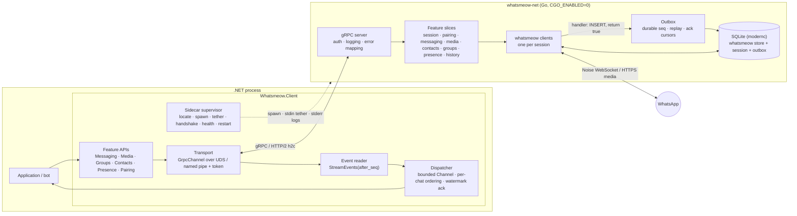

# Architecture

> **Status:** v1 design, frozen for implementation.
> Changes go through an ADR (see [Decision log](#decision-log)).
> **Name:** Whatsmeow.NET.
> Identifiers are in [Naming](#naming).
> **Background:** the full research behind every decision here is in [`RESEARCH.md`](RESEARCH.md).
> This document states *what we do*.
> The research explains *why*, with sources.
> **How to write the code:** [`guidelines/`](guidelines/README.md).
> Coding rules that used to live here (§6 proto style, §7.9, the idiom half of §8.3, §8.9 table, §8.10, test discipline) moved there; each spot keeps a pointer.
> **House rules win:** where this document and the house guidelines (shared with bridge, compras, chrominal) disagreed, the house rule was applied, except where a measured reason made this library opt out (BCL time, `IWhatsAppClient`).
> Both kinds are ADRs in the [Decision log](#decision-log).

Whatsmeow.NET gives .NET applications full access to WhatsApp's multi-device protocol by wrapping the Go library [whatsmeow](https://github.com/tulir/whatsmeow). It has two parts, released together from one repo:

1. **`whatsmeow-net`**: a thin, CGO-free Go sidecar. It hosts one or more whatsmeow clients and serves the `whatsmeow.v1` gRPC API over a private local socket.
2. **The .NET library** (`Whatsmeow.Client` and friends): spawns and supervises `whatsmeow-net`, and exposes an idiomatic, AOT-safe C# API. gRPC and protobuf never leak into the public surface, except through an explicitly unstable `Raw` escape hatch.

The bot built on top is **out of scope** for this repository.

## Naming

The product is **Whatsmeow.NET**, the same name as the repo.
Code identifiers follow the Akka.NET and Quartz.NET pattern: the brand keeps the `.NET` suffix, and packages, namespaces and types drop it.
An earlier draft called the project Wameow.
That name is retired, including in the Go layer.

The sidecar is not a second product.
Its names still land in the contract, in process listings and in generated code, so they use this identity instead of a leftover codename.
Upstream whatsmeow stays lowercase `whatsmeow` in prose, so the two stay easy to tell apart.

| Kind | Name | Notes |
|---|---|---|
| Product, repo, docs | Whatsmeow.NET | not a C# namespace |
| NuGet and C# root | `Whatsmeow` | `Whatsmeow.Client`, `WhatsmeowSidecar`, `WhatsmeowException` |
| Proto package | `whatsmeow.v1` | `proto/whatsmeow/v1/`. Our contract. Upstream packages stay `WAWebProtobufs*` |
| Generated Go package | `whatsmeowv1` | `go_package` is `github.com/tcortega/Whatsmeow.NET/sidecar/gen/whatsmeow/v1;whatsmeowv1`, so it does not collide with `go.mau.fi/whatsmeow` |
| Go module | `github.com/tcortega/Whatsmeow.NET/sidecar` | case matches the GitHub repo. Do not lowercase it in `go.mod` |
| Sidecar binary | `whatsmeow-net` | `whatsmeow-net.exe` on Windows. Not `whatsmeowd`, which reads as an upstream daemon |
| Env var | `WHATSMEOW_NET_SIDECAR_PATH` | overrides binary location |
| ErrorInfo domain | `whatsmeow.net` | reason-code namespace, not a DNS claim |
| Default DB file | `whatsmeow-net.db` | avoids colliding with a whatsmeow or mautrix database in the same directory |
| Windows pipe prefix | `\\.\pipe\whatsmeow-net-` | plus a 128-bit random suffix |
| ActivitySource, Meter | `Whatsmeow.Client` | public constants |
| Sidecar log category | `Whatsmeow.Sidecar` | stderr is forwarded here |

---

## 1. Goals and non-goals

**Goals**

- Feature parity with whatsmeow for personal and group messaging, media, contacts, groups, presence, receipts and history sync.
- **No lost messages.** Delivery is at-least-once from WhatsApp all the way into user handlers, and survives a crash of either process, for every stanza kind whose answer to the server whatsmeow lets a handler withhold: decrypted messages (answered with a delivery receipt), non-retry receipts and `w:gp2` group notifications (answered with an ack). Undecryptable messages are answered early by design, and their content is recovered by the retry protocol: a resend from the sender arrives later as a normal, gated message; the copy the account's phone sends back is not gated (§7.2 `AutomaticMessageRerequestFromPhone`, ADR 0022). The remaining kinds (retry receipts, calls, app state, history-sync receipts, most notifications) are acked by whatsmeow regardless of our handler, so for those the guarantee is best effort. This matches how whatsmeow's maintainer runs it in production (§14 question 8).
- Absorb whatsmeow's weekly churn. A whatsmeow bump changes Go adapter code only. It never changes the `whatsmeow.v1` contract or the public C# API.
- Modern and strict: `net10.0` / C# 14, Native AOT and trimming compatible, no runtime reflection, latest stable toolchains.
- Zero setup for consumers. `dotnet add package` is enough; the sidecar binary ships inside NuGet.

**Non-goals (v1)**

- Bot framework features: commands, middleware, conversation state. Those belong to the bot.
- Long-term message storage. The application owns history; the sidecar keeps only an operational cache.
- Status updates (statuses). History sync never delivers the statuses a blob carries; it counts them as skipped (§7.7).
- Media processing in Go. Thumbnails, transcoding and waveforms are done in .NET.
- Calls (whatsmeow only does call signaling), newsletters/channels, business features. Possible later.
- Being a network service. `whatsmeow-net` is a local child process. "External mode" (separate container) comes in Phase 4.

---

## 2. System overview



**Process model:** one `whatsmeow-net` process per host application, many sessions (WhatsApp accounts) per process, one SQLite database for all sessions.

---

## 3. Code organization: feature slices end-to-end

Vertical-slice thinking applies to this library. A **slice is a WhatsApp capability**, and it is cut the same way through all three layers:

| Slice | Proto file | Go package | .NET folder | Public entry point |
|---|---|---|---|---|
| Sidecar (process) | `sidecar.proto` | `internal/sidecar` | `Sidecar/` | `WhatsmeowSidecar` |
| Sessions | `session.proto` | `internal/session` | `Sessions/` | `WhatsmeowSidecar.Sessions` |
| Pairing | `session.proto` (`Pair`) | `internal/session` (`pair.go`) | `Pairing/` | `client.PairWithQrCodeAsync`, `client.PairWithPhoneNumberAsync` |
| Events | `events.proto` | `internal/events` + `internal/outbox` | `Events/` | `client.On<T>`, handlers |
| Messaging and receipts | `message.proto` | `internal/messaging` (its receipt mapper feeds the Events slice) | `Messaging/` | `client.SendTextAsync`, `client.SendRawAsync`, `client.MarkReadAsync`, `ReceiptReceived` |
| Media | `media.proto` | `internal/media` | `Media/` | `client.UploadMediaFileAsync`, `client.DownloadMediaFileAsync` and their `Stream` forms, `client.RequestMediaRetryAsync` |
| Contacts & LID | `contact.proto` | `internal/contacts` | `Contacts/` | `client.Contacts` |
| Presence | `presence.proto`; `events.proto` (`StreamEphemeralEvents`) | `internal/presence`; `internal/events` (`ring.go`) | `Presence/` | `client.SendPresenceAsync`, `client.SubscribePresenceAsync`, `client.SendChatPresenceAsync`; events |
| Groups | `group.proto` | `internal/groups` | `Groups/` | flat on the client: `client.GetGroupsAsync`, `client.CreateGroupAsync`, ... ([ADR 0030](adr/0030-groups-participants-settings-invites-and-group-events.md)) |
| History sync | `history.proto` (`RequestHistory`); `events.proto` (history events) | `internal/history` | `History/` | `client.RequestHistoryAsync`; events ([ADR 0035](adr/0035-history-sync-that-never-delays-live-traffic.md)) |
| Chat state | `chatstate.proto`; `events.proto` (`ChatStateEvent`) | `internal/chatstate` (`recovery.go`) | `ChatState/` | `client.MuteChatAsync`, `client.PinChatAsync`, `client.ArchiveChatAsync`, `client.MarkChatReadAsync`, `client.StarMessageAsync` and their opposites; events |

**Rules**

- A slice owns its proto messages, Go service implementation, event mapping, .NET public types, proto↔record mapping and tests. Adding a capability means adding or extending **one** slice in all three layers.
  A slice's event mapping is an `events.Mapper` the Events slice records through its one handler; a slice acts on WhatsApp through a session with `session.(*Service).Online` ([ADR 0028](adr/0028-contacts-blocklist-and-lid-resolution.md)).
- Slices do not call each other's internals. Shared needs go into the **core**, which is deliberately small:
  - Go core: `internal/server` (gRPC plumbing, interceptors, error mapping), `internal/transport`, `internal/outbox`, `internal/store`, `internal/log`.
  - .NET core: `Core/Transport`, `Core/Dispatching`, `Core/Errors`, `Core/Telemetry`, `Core/Primitives` (`Jid`, `MessageId`, `SessionId`, `MediaRef`).
- Slices may depend on core. Core never depends on a slice.

---

## 4. Repository layout

```
/AGENTS.md                         # agent entry point, progressive disclosure
/CLAUDE.md                         # symlink to AGENTS.md
/LICENSE                           # MPL-2.0, the repository's licence (ADR 0016)
/NOTICE                            # what the sidecar binary owes: GPL-3.0-only as a whole, Corresponding Source per release (ADR 0016)
/.editorconfig                     # house VsaTemplate file, tabs (see docs/guidelines/csharp.md)
/.gitattributes                    # LF everywhere, so generated and copied files are byte identical on Windows
/global.json                       # exact .NET SDK pin and the Microsoft.Testing.Platform runner; at the root so every cwd sees it
/mise.toml                         # exact pins for Go, buf, golangci-lint, protoc and shellcheck
/nuget.config                      # nuget.org only
/build/ci.sh                       # every CI check, one subcommand per job; ci.yml and AGENTS.md call only this
/.golangci.yml                     # lint rules for both Go modules (docs/guidelines/go.md)
/tools/                            # Go module github.com/tcortega/Whatsmeow.NET/tools: repo tools, not product code
  check-repo/                      # allowlists for analyzer configs, MSBuild files, csproj elements, build tags; suppression rules
  sync-protos/                     # checks (default) or rewrites (-write) third_party/whatsmeow against VERSION
  check-licenses/                  # sidecar/licenses.allow equals the licence files of every module whatsmeow-net links (ADR 0016)
  stub-sidecar/                    # stands in for whatsmeow-net in the integration tests, for startup failures the real one never produces
  check-parity/                    # whatsmeow Client method coverage report
/docs/ARCHITECTURE.md              # this document
/docs/RESEARCH.md                  # research report (reference only)
/docs/guidelines/                  # how to write code: csharp, options, tests, go, proto
/docs/adr/                         # decision records, NNNN-title.md
/buf.yaml                          # buf v2 workspace; upstream protos excluded from lint/breaking
/buf.gen.yaml                      # whatsmeow.v1 to Go (sidecar/gen) and C# (Whatsmeow.Protocol); managed mode
/buf.gen.whatsapp.yaml             # upstream protos to C# (Whatsmeow.Protocol.WhatsApp); a separate template, since one plugin has one out dir
/proto/whatsmeow/v1/*.proto           # OUR contract, one file per slice
/proto/whatsmeow/fake/v1/fake.proto   # the fake WhatsApp's control service: test builds only, not the contract (ADR 0019)
/third_party/whatsmeow/            # *.proto and LICENSE copied byte for byte from the EXACT pinned module + VERSION (a go.sum line)
/sidecar/                          # Go module github.com/tcortega/Whatsmeow.NET/sidecar
  licenses.allow                   # every licence file linked into whatsmeow-net, with its sha256 and reviewed licence
  THIRD-PARTY-NOTICES.txt          # generated by check-licenses -write: every file licenses.allow lists, verbatim (ADR 0029)
  COPYING                          # the GPL-3.0 text, shipped in each native package beside NOTICE (ADR 0029)
  cmd/whatsmeow-net/                     # entry point: flags, stdin token + tether, ready line, signals
  internal/<slice>/                # one package per slice (see §3)
  internal/fakewhatsapp/           # the fake WhatsApp behind the fakewhatsapp build tag, and its control service (ADR 0019)
  internal/{server,transport,outbox,store,log}/   # core
  gen/                             # buf-generated Go for whatsmeow.v1 and whatsmeow.fake.v1 only (never for upstream protos)
/dotnet/
  Whatsmeow.slnx  Directory.Build.props  Directory.Build.targets  Directory.Packages.props
  BannedSymbols.txt  .globalconfig  # banned APIs; generated code exempt from the ban list
  src/Directory.Build.props        # everything under src/ ships: IsAotCompatible, IsTrimmable
  src/Whatsmeow.Protocol.WhatsApp/    # committed generated upstream C# (Whatsmeow.Proto.*) in Generated/, unstable
  src/Whatsmeow.Protocol/             # committed generated whatsmeow.v1 C# (internal where possible)
  src/Whatsmeow.Client/               # public API: Core/ + one folder per slice
  src/Whatsmeow.Extensions.Hosting/   # DI, options, keyed sessions, hosted supervisor
  src/Whatsmeow.Testing/              # FakeWhatsAppClient on the client's own event pipeline, UseFakeClient for hosts; no sidecar (ADR 0036)
  src/Whatsmeow.Sidecar.Native.{Linux,MacOS,Windows}/   # pack-only: runtimes/{rid}/native/whatsmeow-net[.exe] (ADR 0023)
  src/Whatsmeow.Sidecar.Native.targets            # buildTransitive in each native package: never bundled in a single file
  src/Whatsmeow.Sidecar.Native.md                 # each native package's README: GPL-3.0 object code, where its source is (ADR 0029)
  tests/Whatsmeow.Client.Tests/       # vital unit tests only: dispatcher, supervisor (FakeTimeProvider), request body fence
  tests/Whatsmeow.IntegrationTests/   # default: real whatsmeow-net in fake-WhatsApp mode; Generated/ is the fake control's C#
  tests/Whatsmeow.LiveTests/          # real WhatsApp; opt-in, never in default CI
  tests/Whatsmeow.Testing.Tests/      # FakeWhatsAppClient through its public API only; no project gives it internals
  tests/AotSmoke/                  # PublishAot console app, zero warnings required
  tests/SidecarHost/               # parent process for the kill-parent integration test; with "events", the process the events kill test kills
  samples/EchoBot/
/build/package-smoke/Program.cs    # the new consumer build/ci.sh install builds from the local feed (ADR 0023)
/.github/workflows/  ci.yml  whatsmeow-bump.yml  release.yml
```

Generated code is **committed** and regenerated by CI (`buf generate` plus a diff check). Consumers never need protoc.

Scaffolded in Phase 0, with the contract from #3 (`buf.gen.yaml`, `proto/`, `gen/`, `Whatsmeow.Protocol/Generated/`), the walking skeleton from #4 (`cmd/whatsmeow-net`, `internal/{server,transport,sidecar}`), and the fake WhatsApp mode from #5 (`proto/whatsmeow/fake/v1`, `internal/fakewhatsapp`): everything above except the other `internal/` packages (Phase 1 slices), `tools/check-parity/` (Phase 4), `Whatsmeow.LiveTests` (#7), `samples/EchoBot/` (Phase 3), `whatsmeow-bump.yml` and `release.yml` (Phase 4); the native packages came with #43 ([ADR 0023](adr/0023-native-packages-build-pin-and-find.md), which drops `.goreleaser.yaml`), `Whatsmeow.Extensions.Hosting` with #39 ([ADR 0034](adr/0034-hosting-package.md)), and `Whatsmeow.Testing` with #41 ([ADR 0036](adr/0036-testing-package-and-fake-client.md)).

---

## 5. Technology baseline

Re-verify exact versions on nuget.org and proxy.golang.org when scaffolding. "Latest stable" wins over the numbers below.
Each version has one pin: the Go toolchain in the `toolchain` line of `sidecar/go.mod` and `tools/go.mod`, which `mise.toml` must match (`build/ci.sh` checks it); the .NET SDK in `global.json`; packages in `dotnet/Directory.Packages.props` and the Go modules; buf, golangci-lint, protoc and shellcheck in `mise.toml`; CI actions by commit SHA and mise itself in `.github/workflows/ci.yml`.
Last verified as latest stable on 2026-10-31 [observed: go.dev/dl, builds.dotnet.microsoft.com, nuget.org, proxy.golang.org, GitHub releases]: Go 1.27.3, .NET SDK 10.0.403 (runtime 10.0.14), buf 1.75.0, protoc 36.2, golangci-lint 2.15.0, Google.Protobuf 3.36.2, Meziantou.Analyzer 3.0.318, BannedApiAnalyzers 5.6.0, PublicApiAnalyzers 5.6.0, xunit.v3 4.0.2, golang.org/x/mod 0.42.0, shellcheck 0.11.0, mise 2026.10.25.

| Area | Choice |
|---|---|
| Go | 1.27.x toolchain (1.27.3 current, `toolchain go1.27.3`); `go 1.26.0` module floor, matching whatsmeow's `go 1.26.0` (toolchain `go1.27.2`) at the pin |
| whatsmeow | exact pseudo-version, bumped weekly by CI |
| gRPC (Go) | grpc-go latest 1.8x, protobuf-go APIv2 (`google.golang.org/protobuf`) |
| SQLite | `modernc.org/sqlite` (driver `"sqlite"`), no CGO. DSN: the database's plain path, then `?_pragma=foreign_keys(1)&_pragma=journal_mode(WAL)&_pragma=busy_timeout(30000)&_pragma=synchronous(FULL)&_txlock=immediate` (§14 question 3; whatsmeow's `Upgrade` refuses to run without foreign keys). A plain path, not a `file:` URI, needs no escaping on Windows; modernc strips the query and applies the underscore keys (driver.go:90-108). `busy_timeout` was 5000 until #8, where Windows CI writers starved for more than 5 s under the integration suite's load; it is 30000 (ADR 0022). One file per sidecar, `--database`, default `whatsmeow-net.db` in the current directory ([ADR 0020](adr/0020-sessions-and-the-store.md)). The sidecar's own tables are numbered steps tracked in `PRAGMA user_version`, run in one transaction on open; a step is never edited, a schema change is a new one ([ADR 0022](adr/0022-outbox-event-stream-and-dispatcher.md)) |
| Go logging | zerolog, the same logger whatsmeow uses through `waLog.Zerolog` |
| Proto tooling | buf v2 (managed mode), protoc-gen-go 1.36.12 and protoc-gen-go-grpc 1.6.2 (pinned in `mise.toml`), protoc's built-in C# generator (protoc 36.2, paired with Google.Protobuf 3.36.2), and `grpc_csharp_plugin` from the Grpc.Tools 2.85.0 package (paired with Grpc.Core.Api 2.85.0); all pinned in `mise.toml`, none remote |
| .NET | `net10.0` only, C# 14 (`LangVersion latest` on the pinned SDK), `.slnx`, Central Package Management with transitive pinning, artifacts output in `dotnet/artifacts/` |
| gRPC (.NET) | `Grpc.Net.Client`, `Google.Protobuf`, `Grpc.StatusProto`. **Never** `Grpc.Core` |
| Resilience | Polly v8 (`Microsoft.Extensions.Resilience` where appropriate) |
| Time (.NET) | BCL: `DateTimeOffset` (UTC) and `TimeSpan`, from an injected `TimeProvider`; Google.Protobuf's built-in WKT conversions. No NodaTime in shipped packages (opt-out from the house rule, Decision log 0009) |
| IDs (.NET) | Vogen for primitive wrappers (`SessionId`, `MessageId`); `Jid` hand-written |
| Analyzers (.NET) | `AnalysisLevel latest-all`, `Meziantou.Analyzer`, `Microsoft.CodeAnalysis.BannedApiAnalyzers`, house `.editorconfig` with this repo's deltas ([guidelines/csharp.md](guidelines/csharp.md) Build baseline) |
| Lint (Go) | golangci-lint v2 with gofumpt and goimports ([guidelines/go.md](guidelines/go.md)) |
| Tests | xUnit v3 (4.x, Microsoft.Testing.Platform v2, selected in `global.json`), `FakeTimeProvider` (`Microsoft.Extensions.TimeProvider.Testing`); Go `testing` with `-race` |
| Versioning / release | MinVer 8.0.0 from `v<semver>` tags, one version for every package and binary; the binaries from a plain `go build` in `build/ci.sh package`, not GoReleaser ([ADR 0023](adr/0023-native-packages-build-pin-and-find.md)); NuGet Trusted Publishing (OIDC) |

---

## 6. The `whatsmeow.v1` contract

The contract is the most important artifact in the repo. Both sides are generated from it.

**Rules**

- Proto style (proto3, buf STANDARD, AIP-191, `_UNSPECIFIED` zero values, WKTs, field numbering) and the `Timestamp`/`Duration` mapping: [guidelines/proto.md](guidelines/proto.md).
- **Independent of whatsmeow's Go API.** No field mirrors a whatsmeow Go struct by accident. Mapping happens in Go slice code.
- whatsmeow's own protos (`WAWebProtobufsE2E.Message` etc.) are imported **unmodified** from `third_party/whatsmeow` and embedded as **typed fields**. On the wire, a typed field is identical to a `bytes` field holding the serialized message.
- The Go server uses a lenient codec (`AllowPartial` both ways) installed with `grpc.ForceServerCodecV2`, never a global `encoding.RegisterCodec`.
  With grpc-go's default codec, a message missing a proto2 `required` field fails to decode before any interceptor runs, as a bare `Internal` with no `ErrorInfo`; with the lenient codec it reaches the slice, which checks it with `proto.CheckInitialized` before anything is sent (the rule whatsmeow's send-path `proto.Marshal` enforces) and returns `INVALID_ARGUMENT` (§14 question 1, ADR 0025).
- From the first published `v<semver>` tag (pre-releases and build metadata included) on, `whatsmeow.v1` never breaks: a break means a new package `whatsmeow.v2` with its own ADR, every additive change increments `protocol`, and `buf breaking` gates `whatsmeow.v1` against `main`.
  Before that tag, `protocol` keeps its initial value, 1, and `buf breaking` only reports ([ADR 0015](adr/0015-buf-breaking-gates-from-first-published-tag.md)).
  `buf breaking` covers `whatsmeow.v1` only; upstream wire changes are reported but don't block.
- `GetInfo` reports `version`, `protocol` (an integer contract revision), `whatsmeow_version`, `wa_web_version`, `go_version` and `commit`.

**Service shape** (full outline in the research report):

| Service | Kind | Notes |
|---|---|---|
| `SidecarService` | unary | `GetInfo`, `Shutdown`; `grpc.health.v1` is also served |
| `SessionService` | unary + `Pair` (server stream) + `WatchSessionState` (server stream, snapshot first) | app-chosen session IDs |
| `EventService` | `StreamEvents` (server stream) + `AckEvents` (unary) + `StreamEphemeralEvents` (server stream) | durable `seq`, resume with `after_seq`, per-consumer cursor; presence and typing best effort, without a seq ([ADR 0027](adr/0027-ephemeral-events-presence-and-typing.md)) |
| `MessageService` | unary | raw `SendMessage` plus typed helpers (text, media, reaction, edit, revoke, poll, read) |
| `PresenceService` | unary | own presence, typing, presence subscription |
| `MediaService` | `UploadMedia` (client stream), `DownloadMedia` (server stream), `RequestMediaRetry` | path handoff or 64 KiB chunks |
| `ContactService`, `GroupService` | unary | includes LID↔PN resolution |
| `ChatStateService` | unary | Phase 3 |

**Error model:** every error is a gRPC status plus `google.rpc.ErrorInfo{ reason, domain: "whatsmeow.net", metadata }`. `reason` is a stable `SCREAMING_SNAKE` code: `NOT_LOGGED_IN`, `SESSION_NOT_FOUND`, `RECIPIENT_NOT_ON_WHATSAPP`, `RATE_LIMITED`, `TEMPORARILY_BANNED`, `INVALID_ARGUMENT`, `SIDECAR_SHUTTING_DOWN`, and so on (`MEDIA_EXPIRED` came with media, #28). Clients map on `reason` only, never on message text. The list of reasons is part of the contract: `enum ErrorReason` in `proto/whatsmeow/v1/error.proto`, sent without its `ERROR_REASON_` prefix.

---

## 7. Go sidecar (`whatsmeow-net`)

### 7.1 Responsibilities

A protocol adapter, nothing more: session lifecycle, pairing, event capture into the outbox, send queue, media transfer, history download. **No business logic and no media processing.**

### 7.2 whatsmeow configuration (mandatory)

The reference is the maintainer's own production bridge, mautrix-whatsapp `5dd621f` (`pkg/connector/client.go:81-93`), which sets the same core flags. Where we differ, the row says why.

| Setting | Value | Why |
|---|---|---|
| `SynchronousAck` | `true` | ack WhatsApp only after our handler succeeded, for the gated kinds only (§1, §14 whatsmeow source review) |
| `EnableDecryptedEventBuffer` | `true` | redelivery after a crash is decryptable and deduplicated, for DM and group Signal messages only (not bot `msmsg` or newsletter messages; message.go:605, 625, 653). mautrix turns it on only when its portal handling is synchronous (`PortalEventBuffer == 0`; the default is 64, so it is off by default), which is our mode (§14 "Measured for Events (#8)") |
| handler registration | `AddEventHandlerWithSuccessStatus` | returning `false` withholds the ack, for the gated kinds only |
| `ManualHistorySyncDownload` | `true` | history blobs aren't deleted from the server before we have them; we call `DownloadHistorySync` and then `DeleteMedia` ourselves (§7.7) |
| `DisableManualHistorySyncReceipt` | `false` (whatsmeow's default) | whatsmeow sends the `hist_sync` receipt on a goroutine before any handler runs, whatever the handlers return, and again on a redispatch (message.go:899-906, 1172-1178); the notification itself is gated on its delivery receipt (§7.7). What the phone does without the receipt is [unknown] |
| `UseRetryMessageStore` | `true` | retry receipts can be answered after a restart. mautrix defaults this to `false` ("by default, the bridge only stores messages in memory, and therefore can't accept retry receipts if the bridge is restarted"); we choose robustness |
| `AutomaticMessageRerequestFromPhone` | `true` | an undecryptable message gets a retry receipt to the sender and, with `SynchronousAck`, at once a re-request to our own phone (retry.go:493-497; `RequestFromPhoneDelay` applies only without `SynchronousAck`). The sender's resend is a normal, gated message, with the same id when the sender is whatsmeow (retry.go:371) [inferred for other senders]. The phone's copy is dispatched from inside the phone's protocol message, with the id of the response's key (message.go:863-881, client.go:1039), and a failed handler on it does not withhold the receipt (message.go:1172-1175): best effort. Whether the recovered id equals the original is checked live in #10. mautrix sets it |
| `InitialAutoReconnect` | `true` | retry when the first connect at startup fails; mautrix's default (`initial_auto_reconnect: true`) |
| `EmitAppStateEventsOnFullSync` | `true` | ours, not mautrix's (it leaves the default, false): without it a full sync dispatches no chat state event (appstate.go:70-72, 114-116), so the chat state after pairing and after a recovery would never arrive. A full sync of the contacts then stores each name in turn instead of in one batch and dispatches a `Contact` event per contact, which no slice records (appstate.go:181-190, 292-297; [ADR 0031](adr/0031-chat-state-and-app-state-recovery.md)) |
| `EnableAutoReconnect` | `true` (whatsmeow's default, `client.go:307`), with no `AutoReconnectHook`: mautrix sets none, and a hook that returns false leaves the session `Reconnecting` with no event (`client.go:673-675`); whatsmeow's own backoff is 2 s more per failed attempt (`client.go:653`) | with it off, a dead socket only emits `KeepAliveTimeout` and is never closed: the keepalive loop forces a reconnect only when auto reconnect is on (`keepalive.go:46`). This is the mechanism behind the "zombie socket" report; no "zombie" appears in the code |
| `store.DeviceProps`, `SetOSInfo`, `SetWAVersion` | set **once** at startup | process-global in whatsmeow; never mutated per session. The history options (`RequireFullSync`, `HistorySyncConfig`'s full sync days and size limits and storage quota) come from the `--history-*` flags, so they apply to every session paired while the sidecar runs with them: whatsmeow sends them only in the registration payload (store/clientpayload.go:174-183) |
| libsignal's `logger.Setup` | set **once** at startup, to the sidecar's zerolog | libsignal sets its default logger lazily on first use, a data race between goroutines that create devices at once, and that default prints to stdout, where the sidecar writes only its ready line (libsignal v0.2.2 `logger/Logger.go:34-38`, `logger/DefaultLogger.go:16-28`) |

### 7.3 The event handler contract (critical)

whatsmeow runs most handlers **synchronously, in order, on one node queue per client**, but not all (§14 whatsmeow source review):

- Connection events are dispatched off the queue on their own goroutines (`LoggedOut`, `StreamReplaced`, `Disconnected`, `KeepAlive*`, `IdentityChange`, `TemporaryBan`, `Connected`, `PairSuccess`, automatic-mode `HistorySync`). They can run concurrently with message handlers.
- When the queue is full (2048 nodes), whatsmeow logs that ordering is no longer guaranteed and enqueues from a goroutine (`client.go:900`).
- A node that takes over about 5 minutes is left running in the background and the queue moves on (`client.go:954-970`).

Therefore the handler stays fast (milliseconds, never near the 5-minute cutoff), and:

1. Converts the event to a `whatsmeow.v1` event (pure mapping, no I/O except the next step).
2. Runs **one short transaction**: `INSERT INTO outbox … ON CONFLICT DO NOTHING` on the event's natural key (kind, chat, sender, message id), so the redispatch whatsmeow does from its decrypted-event buffer after a crash keeps its seq; the seq comes from SQLite (`AUTOINCREMENT`) inside that transaction, never from memory, and the session's highest seq is kept in `session.last_seq` (ADR 0022).
3. Signals waiting stream goroutines without blocking.
4. Returns `true` only after the commit. It returns `false` on a DB error or a panic; it uses its **own** `recover()`, because whatsmeow's `dispatchEvent` recovers a panic and returns "not failed", so the answer goes out, and the remaining handlers are skipped (`client.go:999-1013`).

The handler is `events.(*Service).Handler`, attached to every session's client by `cmd/whatsmeow-net`. Its only wait is SQLite's `busy_timeout`; a write that fails returns `false`, and WhatsApp redelivers the stanza later [unknown: when; #10 measures it].
An event is deleted only once every consumer of its session acked it; a session with no consumer keeps everything, and an abandoned consumer pins its session's rows.

The handler **never** calls gRPC, never waits on .NET, never downloads media, and never returns `false` just because no consumer is connected.

`UndecryptableMessage` is written to the outbox like any event (mautrix shows it as a placeholder), so .NET can show "waiting for this message". The recovered message arrives later as a `MessageEvent` in the same chat, and the dedupe key (§8.4) ties the two together if it carries the same `MessageId` [inferred for the phone's copy; verify in the Phase 1 live test, #10].

Ephemeral high-volume events (presence, typing) bypass the outbox. whatsmeow dispatches them on the node queue and answers neither, so they are not gated (presence.go:18-58). The handler pushes them into the session's ring in memory, its newest 256, and returns true; `StreamEphemeralEvents` sends them without a seq to every open stream, best effort, and a `QueueOverflowEvent` with how many a stream did not get. A restart loses them ([ADR 0027](adr/0027-ephemeral-events-presence-and-typing.md)).

The History slice attaches a third handler, after the Chat state slice's: a history sync notification from the account's own phone is written to the session's history queue in one short transaction, and the session's history worker woken without waiting; it returns true only after the commit, false on a failed write or a panic, so the notification's delivery receipt waits for the queue. `OfflineSyncCompleted` starts the session's worker, or wakes the one this connection has; `LoggedOut` and `PairSuccess` delete the session's queue, the old account's ([ADR 0035](adr/0035-history-sync-that-never-delays-live-traffic.md)).

The Chat state slice attaches a second handler, after the Events slice's: on `AppStateSyncError` it notes the collection for the session's recovery worker and wakes it through a 1-buffered channel, dropping the wake when one is pending, and returns true.
whatsmeow dispatches that error holding its app state lock (appstate.go:46-47, 77, 167), which a full sync takes, so the handler never syncs itself; the worker, one goroutine per online session, does ([ADR 0031](adr/0031-chat-state-and-app-state-recovery.md)).

**Strings from WhatsApp are made UTF-8.** whatsmeow copies a push name, a group name and the like unchecked (client.go:1039-1040), and protobuf refuses to marshal a proto3 string that is not UTF-8, so one such string would fail its event's recording on every redispatch, or its call's answer.
Every slice's mapper passes each string it takes from WhatsApp data into the contract through `server.Text`, which replaces an invalid sequence with U+FFFD [observed: `TestALiveMessageWithAnInvalidUTF8PushNameIsRecordedWithTheReplacementCharacter`, `TestAHistoryMessageWithAnInvalidUTF8PushNameArrivesWithTheReplacementCharacter`].

### 7.4 Session state machine

Every whatsmeow signal maps to exactly one state. Each transition goes through one function (`session.(*Service).transition`), which writes it to the outbox as a `ConnectionStateEvent`, in the same transaction as the state a restart keeps, and publishes it to `WatchSessionState`. A restart that moves a paired session (to `Disconnected`, or to `LoggedOut{0}` when its device is gone) is recorded as a transition at load.

`Created → Pairing → Connecting → Connected → CaughtUp`, with transient `Reconnecting`, the idle `Disconnected` (paired but offline, after `Disconnect` or a sidecar restart; the sidecar never connects a session on its own), and the terminal or blocking states `LoggedOut{code}`, `Replaced`, `TempBanned{code, expire_time}`, `Outdated`, `Error{code, message}`.
After a sidecar restart, a never-paired session is `Created`; the states that stop a session, `LoggedOut`, `Replaced`, `Outdated`, `TempBanned` and `Error`, come back as they were, with their fields; and a session that was `Connecting`, `Connected`, `CaughtUp`, `Reconnecting` or `Disconnected` comes back `Disconnected`.
The .NET client then connects again only the sessions the application had connected that came back `Disconnected`, so a `Replaced` session never fights the client that replaced it ([ADR 0020](adr/0020-sessions-and-the-store.md)).
Connection events arrive on their own goroutines, so each applies only from the states it belongs to: `Connected` from `Connecting` or `Reconnecting`, `OfflineSyncCompleted` (`CaughtUp`) from `Connected`, `Disconnected` (`Reconnecting`) from a live state; a PermanentDisconnect from any state but `LoggedOut`.
While a `Pair` call is open the session is `Pairing`, and the pairing owns the state: before the phone links the device a `PermanentDisconnect` ends the pairing with `PAIRING_FAILED` and the previous state comes back (there is no account to stop yet); after the link, `Connected` with the pre-keys uploaded makes it `Connected`, a stopping state is the session's, and a failed login leaves it `Disconnected`. Once the login ended, events are the state machine's again ([ADR 0021](adr/0021-pairing.md), §9).
`LoggedOut{code}` is the connect failure reason, 401 for a stream-error logout (`connectionevents.go:40`); `TempBanned.expire_time` is the receive time, kept to the second, plus `TemporaryBan.Expire`, a `time.Duration`.
whatsmeow's `events.PermanentDisconnect` implementations at the pin are `*LoggedOut`, `*StreamReplaced`, `*ClientOutdated`, `*CATRefreshError`, `*TemporaryBan` and `*ConnectFailure` (`types/events/events.go:118-128`); each maps to one of these states (`CATRefreshError` and `ConnectFailure` to `Error`).

Actions the sidecar itself starts (`Connect`, `Disconnect`, `Logout`) produce no whatsmeow events for them (a self-initiated `Logout()` emits no `LoggedOut`), so the sidecar synthesizes those transitions: `Connecting` while `ConnectContext` runs, which returns after the websocket handshake (the login answer comes later as an event), and the previous state again when it fails; `Disconnected`; `LoggedOut{0}`.
On a server-side `LoggedOut`, whatsmeow dispatches the event on a goroutine and deletes the device rows concurrently (`go cli.dispatchEvent(...)` then `cli.Store.Delete(ctx)`, `connectionevents.go:43-44`), so the handler may see the rows before or after deletion.
The `LoggedOut` handler must not read or write the device rows and must not delete them itself; it only records the transition.
Each SQLite file has a single owner, enforced with an OS lock on `<database>.lock` that the OS releases when the process dies ([ADR 0020](adr/0020-sessions-and-the-store.md)).

### 7.5 Sending

The design is [ADR 0025](adr/0025-messaging-and-receipts.md); the whatsmeow facts are in §14 "Measured for Messaging (#9)".

- Per-session FIFO queue, one send in flight, paced by a token bucket (a burst of 5, then one per second; tuning and jitter are Phase 2).
  An IQ 429 before the write is tried again after 1 s, 2 s and 4 s while the wait and one second more for the try fit the call's deadline, then fails with `RATE_LIMITED`.
- Sends never wait for a connection: a session that is not logged in, not connected or `TempBanned` fails at once (`NOT_LOGGED_IN` or `LOGGED_OUT`, `NOT_CONNECTED`, `TEMPORARILY_BANNED`), through `session.(*Service).Online`.
  Queued sends fail when the session stops being `Connected` or `CaughtUp` (`NOT_CONNECTED`, `LOGGED_OUT`, or `TEMPORARILY_BANNED`), having sent nothing.
- Idempotent sends: .NET supplies `client_message_id` (`3EB0` and 18 uppercase hex digits, the format whatsmeow makes; `MessageId.New()`), which is used as the WhatsApp message ID through `SendRequestExtra.ID`.
  The send is recorded in `sent_message` before the hand-off to whatsmeow and its result after, so a repeat returns the recorded result, and a repeat in flight waits for the first; the rules are in `message.proto`.
- **A send whose outcome is unknown is never automatically replayed.** It surfaces as `OUTCOME_UNKNOWN`, also on every repeat.
  Only errors that provably come before the write count as "nothing sent"; everything else is unknown.
- Responses report `SendResponse.Chat`, because whatsmeow redirects a phone-number user JID to its LID, fetching it with `GetUserInfo` if needed; with no LID it returns `ErrRecipientNotOnWhatsApp` (`send.go:340-363`), which maps to `RECIPIENT_NOT_ON_WHATSAPP`.
- Media messages ([ADR 0033](adr/0033-media-messages.md); §14 "Measured for Media messages (#29)"): `SendMedia` takes a `MediaRef` and the caller's metadata for one kind, image, video, audio or voice note, document or sticker; the sidecar builds the message as mautrix does and sends it through the same queue and records as text.
  The metadata goes out unchanged and is never checked against the file; the `MediaRef`'s type must be the kind's (a sticker's is IMAGE).
  A received media message is mapped in .NET to its content case, with a `MediaRef` that downloads lazily and `IsViewOnce` for an image, a video or an audio.
- Receipts are recorded through the outbox by Messaging's `events.Mapper`, so whatsmeow acks them only after they are durable (§13 invariant 2); `MarkRead` sends one read receipt and is not queued.

### 7.6 Media

[ADR 0026](adr/0026-media-transfer-and-media-retry.md); whatsmeow at the pin, §14 "Measured for Media (#28)".

- Upload uses `UploadReader(ctx, io.Reader, io.ReadWriteSeeker tempFile, MediaType)`, which encrypts into the temporary file and then POSTs it, with a new media key on every call (upload.go:115-154). The temporary file is always one of the sidecar's: whatsmeow overwrites it with ciphertext (upload.go:114). whatsmeow does **not** retry uploads: `rawUpload` makes one POST to the first host (`upload.go:243-302`). The media slice owns upload retry: 3 attempts, 1 s and 2 s apart, within the call, each a whole `UploadReader` from a source that can be read again, so each has its own media key. Download uses `DownloadMediaWithPathToFile`, which tries each media host and retries up to 5 times with an `(n+1)`-second or `Retry-After` backoff (`download-to-file.go:80-119, 163-189`); its `File` must implement `ReaderAt`, `WriterAt`, `Truncate` and `Stat`. Never use the in-memory `Upload([]byte)` / `Download` variants for user media.
- Same host: hand files over by **path** under `--media-root`, which the sidecar opens through one `os.Root`, so `..` and a symlink out of it (an absolute symlink too) are refused. Otherwise use **64 KiB chunk streams**, the header first. Never put whole files inline in a message. A chunked upload is spooled to a file, so a retry can read it again. Each attempt opens the path again, non-blocking, and refuses what it opened unless it is a regular file. The client decides path or chunks by case except on Windows, as Go compares paths. A missing file or directory under the root throws `FileNotFoundException` or `DirectoryNotFoundException`, as outside it.
- An error or a log line never carries a media URL's query, which holds the media connection's auth or the CDN's signature (§14).
- The sidecar's own temporary files are in `<database>.tmp/` (0700, emptied at start), not in `/tmp`, which may be a tmpfs. A download is verified as a whole before any plaintext leaves the sidecar: the MAC covers all of the ciphertext, and a failed check leaves ciphertext or unchecked plaintext in whatsmeow's file (`download-to-file.go:121-161`). A download to a path is written to `.<name>.<random>.part` next to it and renamed over it once verified; the destination holds the verified file or what it held before. `ErrInvalidMediaSHA256` after a valid MAC is delivered with a warning, as mautrix does; any other failed check is `INTERNAL`.
- The media HTTP client has no total timeout (a cloned `http.DefaultTransport`, client.go:271-276), so a transfer is bounded only by the call's deadline and cancellation.
- `MediaRef` (`media_type`, `direct_path`, `url`, `media_key`, `file_sha256`, `file_enc_sha256`, `file_length`, `streaming_sidecar`) is enough to download lazily, also after a sidecar restart, or to forward without re-uploading. The mimetype is message metadata, with the media messages (§7.5).
- Expired media (403, 404 or 410) returns `MEDIA_EXPIRED`. The caller then calls `RequestMediaRetry`, which stores the request with its `MediaRef` before it sends the receipt; the phone's answer, encrypted with the media key (mediaretry.go:123-137), is matched on the message id, with the chat as a tiebreak, decrypted by the media slice's `events.Mapper` in the event handler and arrives as a `MediaRetryEvent` with the media at its new path, or the failure. It is best effort: whatsmeow acks the notification whatever the handler returns (notification.go:510-511), and the phone may never answer (tulir/whatsmeow#1261). A final answer deletes the request, with its media key.
- Every media RPC needs the session online (Connected or CaughtUp): whatsmeow asks WhatsApp for its media hosts over the connection (`refreshMediaConn`, mediaconn.go:44-58).

### 7.7 History sync

[ADR 0035](adr/0035-history-sync-that-never-delays-live-traffic.md); whatsmeow at the pin, §14 "Measured for History sync (#37)".

- Notifications (`ProtocolMessage.HistorySyncNotification` inside `events.Message`, from the account's own phone) are written by the History slice's handler to `history_blob` before whatsmeow answers them (§7.3), never recorded as live messages, and wait there across a restart.
- `OfflineSyncCompleted` starts one worker per session, or wakes the one this connection has: whatsmeow dispatches it for each offline `ib`.
  The worker runs while the session is online; started before the session is (whatsmeow dispatches `Connected` on a goroutine of its own after two IQs, connectionevents.go:183-205), it waits on `session.Up` for at most 3 minutes, then gives up with a debug line until the next offline sync.
  It takes the queue in order.
- One download, parse and cut into batches runs at a time across the sessions, and each download is bounded by 5 minutes, counted as a failed attempt when it runs out: `DownloadHistorySync(ctx, notif, true)` holds a whole blob in memory (message.go:783-825), and whatsmeow's media client has no timeout of its own.
  The memory bound is one blob in flight, compressed, decompressed, parsed and mapped, plus, for each online session whose consumers have not taken a blob's batches yet, that blob's batches still to record: at most one blob's mapped messages per session [inferred: from the code; a blob's size is unknown, §14].
- Messages are parsed with `ParseWebMessage`, mapped as live ones are (`events.MessageEvent`), and recorded as **batched** `HistoryMessagesEvent`s, at most 256 messages and 1 MiB as an event each, a larger message alone, one over 15 MiB skipped and counted; then a `HistorySyncProgressEvent`.
  Status updates are never delivered and count as skipped (§1); a `NO_HISTORY` or `MESSAGE_ACCESS_STATUS` notification without a blob is a progress event with no messages and no failure.
  A batch's key is `h`, the notification's id and the blob index of its first message; the progress event's is `h`, the id and `p`.
- Each batch moves the blob's `messages_done` to the index after its last message in its transaction, so a blob half done when the sidecar stops is downloaded again and recorded from its next message, wherever the next sidecar's mapping cuts its batches. Only after the progress event committed does the worker call `DeleteMedia` (in manual mode whatsmeow deletes nothing itself), once.
- A blob that cannot be downloaded any more (403, 404, 410; a failed check; one that does not decompress or parse) is reported in its progress event and the backlog moves on; another failure while online is tried three times, a minute apart, then reported unavailable.
  A failure while the session leaves online, or after whatsmeow's socket is gone, is offline and not counted.
  A queued notification that does not parse, a blob whose delivery panics, and one whose event does not marshal (a protobuf error, which never passes) are reported `INVALID` and leave the queue; a message whose parse panics is skipped and counted, and the rest of its blob arrives; any other failure, a store error, is tried again after a backoff from 1 second doubling to 1 minute, from 1 second again after a delivery that succeeded.
  Every queue update in a history event's transaction must change the blob's one row, or the transaction is rolled back: a worker whose blob left the queue meanwhile, at a logout, a pairing or a delete, records nothing more of it.
- **Live traffic always has priority.** A session keeps at most 4 history events in the outbox that its consumers have not all acked (`outbox.Pending`), so a live message is never recorded behind more; the .NET client runs every history event in one lane of its own. A consumer that stops acking stops the history, not the outbox's growth by more than the window.
- `RequestHistory` sends whatsmeow's `BuildHistorySyncRequest` to the account's phone as a peer message; the answer arrives as history events of type `ON_DEMAND`.
  Its errors are a send's (ADR 0025): 429 is `RATE_LIMITED`, WhatsApp's other answers `WHATSAPP_ERROR` with the code, and only a request that may have gone out with no answer `OUTCOME_UNKNOWN`.

### 7.8 Process conventions

- `stdin`: first line is the 32-byte auth token. The rest is the tether: **EOF means shut down gracefully.**
- `stdout`: exactly **one** JSON line, the ready line: `{"event":"ready","version","protocol","whatsmeow","listen","nonce"}`.
- `--fake-whatsapp`: only a test build (`-tags fakewhatsapp`) accepts it; it replaces WhatsApp with a scripted fake and serves its control service. A release build refuses it with exit code 2 (ADR 0019).
- `stderr`: JSON log lines (zerolog), at info level and above for every component, whatsmeow's and libsignal's included; there is no option. whatsmeow's debug lines carry every node it sends (client.go:990), phone numbers in them, and each QR code with the device's ADV secret (qrchan.go:97, pair.go:125-130). Every log line includes `session_id` where applicable. Info lines carry the account's own JID and LID, which hold its phone number ("Successfully paired", pair.go:155; "Updated LID", connectionevents.go:182): operator data, not a secret, so they stay. Other people's numbers and JIDs appear in whatsmeow's debug lines, which never reach stderr. The sidecar's own code never logs them, and its errors never carry them: the Contacts slice keeps none of the text whatsmeow wraps around an error, which names the JID (user.go:1034, 1039, 1043, 1052), so neither a status message nor the error line `server.toStatus` writes for an INTERNAL one has it ([ADR 0028](adr/0028-contacts-blocklist-and-lid-resolution.md)) [observed: `internal/contacts` tests `TestWhatsAppsErrorsBecomeTheirReasons`, `TestTheInfoLogCarriesNoJID`].
  whatsmeow itself logs other people's JIDs at warn and error, so they reach stderr [observed: whatsmeow at the pin]. Not only on failures of this process: an unavailable message, a message it ignores for an old counter or cannot decrypt, all carry the sender (message.go:327, 412, 415), a sender with no LID known is logged (message.go:351), and so is a device list hash that does not match (notification.go:174, 183). On store and parse failures: a LID lookup (message.go:345), an identity change's cleanup (notification.go:44, 48), a privacy token (notification.go:332), a push name or business name (user.go:672, 686, 695, 715, 724), a user's verified name (user.go:214, 255), and a LID pair (client.go:1098).
  Groups (#34): a group's JID is personal data too, since an older one carries its creator's phone number; the Groups slice logs none and keeps none of whatsmeow's error text, which names participants with `%v` (group.go:71, 84, 221, 229) ([ADR 0030](adr/0030-groups-participants-settings-invites-and-group-events.md)) [observed: `internal/groups` tests `TestWhatsAppsErrorsBecomeTheirReasons`, `TestTheInfoLogCarriesNoJID`]. whatsmeow logs group JIDs at warn and error: a group it fails to parse in the list (group.go:564), LID pairs and redacted phones it fails to store (group.go:691, 695), and a group notification it fails to parse, with the node in some of its errors (notification.go:496, group.go:935).
  These are the lines read for #33 and #34, not an audit of all of whatsmeow; whether others log a JID at info or above is [unknown]. Redacting them is a follow-up.
- `--parent-pid`: the client's process id. The sidecar stops once it is no longer its parent, on the same graceful path as stdin EOF, also when another process keeps stdin open; without the flag it takes its parent at start ([ADR 0024](adr/0024-tether-backups.md)).
  - Linux: `PR_SET_PDEATHSIG` with SIGUSR1, then a parent check right away and on every signal. The signal also comes when only the thread that forked the sidecar exits, a .NET thread-pool thread for example, so it only wakes the check; a signal while the parent lives is logged at info. A wrapper script as `SidecarPath` does not work: the sidecar's parent would be the script, not `--parent-pid`.
  - macOS: the parent check right away and every second.
  - Windows: nothing in the sidecar; the client's Job Object (§8.5).
  - The stop cause is logged at info with `parent_pid`.
- SIGPIPE is ignored: a dead parent takes the read ends of stdout and stderr along, and the graceful stop's first log line would otherwise kill the sidecar.

### 7.9 Go code conventions

Moved to [guidelines/go.md](guidelines/go.md): `context.Context` first, `%w` errors mapped to `ErrorInfo` only in `internal/server`, no `reflect`/`unsafe`/cgo/mutable globals, small per-slice whatsmeow interfaces, `whatsmeowv1` import name, owned goroutines.

---

## 8. .NET library

### 8.1 Packages

| Package | Contents | Stability |
|---|---|---|
| `Whatsmeow.Client` | public API, supervisor, transport, dispatcher, mapping | stable |
| `Whatsmeow.Protocol` | generated `whatsmeow.v1` messages and client stubs | internal use; no stability promise |
| `Whatsmeow.Protocol.WhatsApp` | generated upstream WhatsApp protos (`Whatsmeow.Proto.*`) | **unstable**: changes with every whatsmeow bump |
| `Whatsmeow.Extensions.Hosting` | `AddWhatsmeow()`, options validation, keyed sessions, DI handlers, hosted sidecar | stable |
| `Whatsmeow.Testing` | `FakeWhatsAppClient` (`RaiseAsync(event)`, `Calls`, `FailNext`), `UseFakeClient` for a host ([ADR 0036](adr/0036-testing-package-and-fake-client.md)) | stable; pinned to the exact `Whatsmeow.Client` and `Whatsmeow.Extensions.Hosting` version |
| `Whatsmeow.Sidecar.Native.{Linux,MacOS,Windows}` | `whatsmeow-net` binaries under `runtimes/{rid}/native/` | pinned to the exact `Whatsmeow.Client` version |

`Whatsmeow.Client` depends on the native packages with exact versions (`[x.y.z]`). Do not use a `runtime.json` pointer package.

### 8.2 Public API shape (indicative)

```csharp
await using var sidecar = await WhatsmeowSidecar.StartAsync(options, cancellationToken);
IWhatsAppClient client = await sidecar.Sessions.GetOrCreateAsync(SessionId.From("main"), cancellationToken);

await foreach (PairingUpdate update in client.PairWithQrCodeAsync(cancellationToken)) { … }

using IDisposable subscription = client.On<MessageReceived>(static async (e, ct) => { … });

SendResult result = await client.SendTextAsync(chat, "hello", cancellationToken: cancellationToken);
```

- **One `IWhatsAppClient` per session.** The session's lifecycle, its pairing and its messaging are members of the client itself (#6, #7, #9; [ADR 0021](adr/0021-pairing.md) amends ADR 0012).
  Every later feature slice (media, contacts, groups, presence, later chats) adds members too, never a feature group: a group needs a second public interface, or a class `FakeWhatsAppClient` cannot substitute ([ADR 0025](adr/0025-messaging-and-receipts.md)).
- `WhatsmeowSidecar` owns the process and the single shared `GrpcChannel`. Clients are lightweight views over it.
- `IWhatsAppClient` is the one deliberate exception to the house rule "no interface just to mock it": `Whatsmeow.Testing` ships `FakeWhatsAppClient` to consumers. Library internals get no interfaces for testability.
- Core behavior lives on real members. C# 14 extension blocks are used only for convenience (`jid.IsGroup`), never for logic that must be mockable.
- Works without DI (`WhatsmeowSidecar.StartAsync`) and with DI (`services.AddWhatsmeow()` in namespace `Whatsmeow.Extensions.Hosting`, **not** `Microsoft.Extensions.DependencyInjection`).
  With DI, `AddWhatsmeow()` binds `WhatsmeowSidecarOptions` from the `Whatsmeow` section through the same setup step and rules, registers the `WhatsmeowSidecar` singleton, and returns a builder: `AddSession("key")` declares a session resolved as `[FromKeyedServices("key")] IWhatsAppClient`, and `AddHandler<TEvent, THandler>()` registers a DI handler for every session, or with a key for one ([ADR 0034](adr/0034-hosting-package.md)).

### 8.3 Modeling rules

- Events: `public abstract record WhatsAppEvent` with `sealed record` cases (`MessageReceived`, `ReceiptReceived`, `ConnectionStateChanged`, …). Message content is a separate `abstract record MessageContent` hierarchy with sealed cases (`TextContent`, `ImageContent`, …, `UnknownContent`). These are shaped so they can become C# `closed`/`union` types later without breaking users' `switch` statements.
- Identifiers: `MessageId` and `SessionId` are Vogen value objects; `Jid` is a hand-written `readonly struct Jid : ISpanParsable<Jid>`. `Jid` carries both PN and LID forms where known. Events always include `Sender`/`SenderAlt` and `Chat`/`RecipientAlt`. Rules and rationale: [guidelines/csharp.md](guidelines/csharp.md) IDs.
- **Generated protobuf types never appear in the stable public API.** The only exception is the opt-in `Raw` escape hatch: `MessageReceived.Raw` (an `[Experimental]`-attributed property, later) and `client.SendRawAsync(Jid, WAWebProtobufsE2E.Message, …)` (`[Experimental("WMN1001")]`, #9).
  These live in `Whatsmeow.Protocol.WhatsApp` types and are documented as unstable.
- Time is BCL: `DateTimeOffset` (UTC) and `TimeSpan` in public members, "now" and every timer from one injected `TimeProvider`, never `DateTime`.
- Idioms (immutability with `required`/`init` and `ImmutableArray<T>`/`IReadOnlyList<T>`, `Task` vs `ValueTask`, `CancellationToken` last, `Async` suffix, time): [guidelines/csharp.md](guidelines/csharp.md) Public API modeling and Time.

### 8.4 Event pipeline and delivery guarantee

```
gRPC StreamEvents ─► reader loop ─► bounded Channel<Envelope> ─► dispatcher ─► handlers
                       (decode only,                (per-chat lanes,          (isolated
                        never awaits user code)      concurrent across chats)  try/catch)
                                                         │
                                       ack watermark ◄───┘  AckEvents(up_to_seq)
```

- The **reader** only decodes and writes to the channel. Backpressure flows into gRPC flow control and the sidecar's durable outbox; nothing is dropped.
- The **dispatcher** orders events per chat (a session's state changes have a lane of their own) and runs different chats concurrently. The lane comes from the event's record, the same function for `FakeWhatsAppClient`, whose events run on this pipeline too ([ADR 0036](adr/0036-testing-package-and-fake-client.md)).
- **Ack by watermark:** the cursor sent with `AckEvents` is the highest `seq` such that every event at or below it has finished all its handlers. Events are acked in batches on a timer (every second, when the watermark moved) and at shutdown.
- **Start and stop:** a session's events flow from its first successful `ConnectAsync` in the process, under one fixed consumer name (`client`; External mode, #49, may make it an option), so handlers are registered first. Disposing the sidecar stops the readers, cancels the handlers' token and waits for them, then acks the watermark while the sidecar still runs; a handler that ended because of the cancellation has not handled its event, which comes again (ADR 0022).
- **Bounds:** the reader writes to a channel of 64; the dispatcher keeps at most 64 events received and unfinished, and runs at most 16 chat lanes at once. These are internal constants.
- **Handler failures do not block the stream.** An exception is caught, logged, counted in metrics (later, with #40), and raised on `OnHandlerError`. The event still counts as handled; a failing event that blocked the stream forever would be worse. Users who need retries implement them in the handler.
- **The consumer contract is at-least-once:** handlers must be idempotent, and `MessageId` plus `SessionId` is the dedupe key. This is documented on every handler interface.
- Three consumption styles, all fed by the same dispatcher:
  1. DI handlers: `IWhatsAppEventHandler<TEvent>.HandleAsync(TEvent, IWhatsAppClient, CancellationToken)`, with the client of the event's session to answer on; each event in a DI scope of its own, through `On<T>` on that client, so with its rules (#39, [ADR 0034](adr/0034-hosting-package.md)).
  2. Delegates: `client.On<TEvent>(handler)`, which returns `IDisposable` (#8).
  3. Opt-in `IAsyncEnumerable` reader (single consumer, mainly for scripts and tests; not built).
- **History events** (`HistoryReceived`, `HistorySyncProgressed`) run in one lane of their own, in seq order, never in a chat's lane, so a live message never waits for history; the sidecar keeps at most 4 of a session's history events unacked in the outbox ([ADR 0035](adr/0035-history-sync-that-never-delays-live-traffic.md)).
- **Ephemeral events** (presence, typing, `EphemeralEventsDropped`) come on `StreamEphemeralEvents`, with a reader, channel and dispatcher of their own that never ack: they never move, hold back or delay the watermark, run in lanes per user or chat, and are best effort, never repeated (ADR 0027).
- `WaitForAsync<TEvent>(predicate, timeout, ct)` supports request/response-style flows; it is a handler in the same dispatcher, so it sees events in their chat's order. `OnHandlerError(callback)` reports a handler that threw.

### 8.5 Sidecar supervision

- **Locate the binary** in this order: `options.SidecarPath` or `WHATSMEOW_NET_SIDECAR_PATH`; then `AppContext.BaseDirectory`; then `AppContext.BaseDirectory/runtimes/<rid>/native/`. The RID is the OS and `RuntimeInformation.ProcessArchitecture`, and Linux is always `linux-<arch>`: the CGO-free Linux binary runs unchanged on Alpine (musl) and Debian (glibc) (§14 question 6), so a musl host uses the glibc RID's binary, and a `linux-musl-*` publish gets it through the RID graph [observed: #43, ADR 0023]. Never use `Assembly.Location`.
  A portable build, `dotnet run` or portable publish finds it under `runtimes/<rid>/native/`, and copies all six binaries (about 148 MB [observed: `du -sh`, osx-arm64, ADR 0023]) into its output; a RID-specific, self-contained, Native AOT or single-file publish puts the one binary of its RID beside the app. The native packages set `ExcludeFromSingleFile` on it, so `IncludeNativeLibrariesForSelfExtract` never bundles it; `IncludeAllContentForSelfExtract` (a .NET Core 3.1 compatibility mode) moves `AppContext.BaseDirectory` to the extraction directory, so such an app sets `SidecarPath` ([ADR 0023](adr/0023-native-packages-build-pin-and-find.md)).
  The execute bit NuGet gives is the owner's only (0744 with umask 022), so an app restored or published by one user and run by another (a Docker image built as root that runs as `USER app`) cannot chmod it and takes the copy fallback below on every start [observed: the copy, in an Alpine container; inferred: every start; ADR 0023]; such an image sets the mode at build time.
- **Make it executable:** call `File.SetUnixFileMode(+x)` before every start. If the binary still cannot be executed (the chmod failed, or it sits on a `noexec` mount), copy it to `LocalApplicationData/whatsmeow-net/<version>/` and start the copy (never `/tmp`, which may be mounted `noexec`).
- **Socket directory:** the client creates it (`Directory.CreateTempSubdirectory`, `0700`) once per `WhatsmeowSidecar`, passes it with `--socket-dir`, reuses it for every restart and deletes it on dispose; on every launch the sidecar makes it owner-only again and removes the socket a killed sidecar left behind ([ADR 0017](adr/0017-sidecar-process-conventions.md)).
- **Start:** redirect stdin/stdout/stderr, write the token as the first stdin line, wait for the ready line within `StartupTimeout`, verify the nonce, then call `GetInfo` for the version check, which also proves the socket and the token work. The client does not call `grpc.health.v1`; the sidecar serves it for other callers (ADR 0017). If startup fails, the exception includes the tail of stderr, and the process is gone.
- **Tether:** keep stdin open for the sidecar's whole lifetime, and pass `--parent-pid` (§7.8). On Windows the backup is a Job Object with `KILL_ON_JOB_CLOSE`, one per launch, assigned right after the start (hand-written `[LibraryImport]`, `Sidecar/KillOnCloseJob.cs`); only the client holds its handle, which cannot be inherited, so the client's death kills the sidecar at once: a hard kill by design, graceful only when stdin EOF wins. If Windows refuses the job, the start fails ([ADR 0024](adr/0024-tether-backups.md)).
- **Stop:** `Shutdown` RPC, then close stdin, then a 5 s grace on the `TimeProvider`, then `Kill(entireProcessTree: true)`. No SIGTERM step: the sidecar handles SIGTERM on the same path as stdin EOF, and Windows has none (ADR 0017).
- **Restart:** a supervisor loop with a hand-written deterministic backoff: 1 s, doubling, capped at 30 s, back to 1 s after a run that stayed up 60 s. No jitter and no Polly: one local child has no herd to spread, and a fixed schedule is exact under `FakeTimeProvider` (ADR 0017). The loop never lets an exception escape.
- **Version check:**
  - Embedded mode requires `sidecar.version == client.version`.
  - Every mode requires `sidecar.protocol` to be within `[MinProtocol, MaxProtocol]`.
  - A mismatch is a hard `SidecarVersionMismatchException`.
- **Hosted** (`Whatsmeow.Extensions.Hosting`): one `IHostedLifecycleService` starts the sidecar and creates the declared sessions in `StartingAsync`, before any hosted service's `StartAsync`, and connects the ones that come back `Disconnected` in `StartedAsync`, once every `StartAsync` succeeded; a failure, a connect included, fails the host's start and leaves no sidecar. It stops it in `StoppedAsync`, after every hosted service stopped, with the stop above; once the host's shutdown timeout passes it no longer waits for handlers that ignore their token, whose events come again, and the process stop is never cut short: the host waits for it [observed: ADR 0034], so the kill always runs. Crashes in between are the supervisor's ([ADR 0034](adr/0034-hosting-package.md)). A host whose declared sessions a test replaced with `UseFakeClient` starts no sidecar: the handlers go on the fakes from `StartedAsync` to `StoppedAsync`, which cancels the ones still running and waits for them with the same shutdown timeout ([ADR 0036](adr/0036-testing-package-and-fake-client.md)).
- After a sidecar restart, the client calls `Connect` again for the sessions the application had connected that come back `Disconnected` (it reads `ListSessions`; a stopped session keeps its state, §7.4), a `WatchStateAsync` reopens with the restarted sidecar's current state first, and the event reader reopens `StreamEvents` with `after_seq` = the highest `seq` it received in this process (0 in a new process, so the server-side cursor decides). Users see a `SidecarRestarted` diagnostic event, not a gap.

### 8.6 Transport

- `GrpcChannel.ForAddress("http://localhost", new GrpcChannelOptions { HttpHandler = new SocketsHttpHandler { ConnectCallback = … } })`.
- Unix domain socket by default on every OS, Windows included (§14 question 2: stable on both transports).
  AF_UNIX was about 2-4x faster for server streams of 64 KiB messages and about 1.5-3x for bidi.
  Client-stream upload was comparable, with the named-pipe range equal or higher (328-469 vs 308-390 MiB/s) [inferred: ratios from the range ends across the three hosts, not paired per host].
  Paired on one host, a 300 MiB media upload in 64 KiB chunks, encryption and the fake WhatsApp included, ran at 91 MiB/s over AF_UNIX and 74 MiB/s over the named pipe, and its download at 96 and 108 MiB/s [observed: `Media/MediaTransferTests.cs`, GitHub Actions run 41394734844, win-x64, one run]; the media path is bound by more than the transport, so the raw transport ratio stays [inferred].
  On Windows the named-pipe transport stays selectable as a fallback; it passed the same soak.
- An auth token is added to every call by an interceptor, together with `ThrowOperationCanceledOnCancellation = true`.
- `MaxReceiveMessageSize` and `MaxSendMessageSize` are set explicitly to 16 MiB on both sides.
- The `SocketsHttpHandler` sits behind `RequestBodyFence` (`Core/Transport/`), which ends a request body only once no write is in flight on it (#71).
  When a call ends, grpc-dotnet 2.85.0 ends a client stream's request content without waiting for the write in flight (`GrpcCall.Cleanup` and `CancelCall` cancel `CompleteTcs`), and SocketsHttpHandler then completes the HTTP/2 stream under that write: in .NET 10.0.14 `Http2Stream.Complete` clears `_creditWaiter` under the credit lock, and `SendDataAsync`, out of credit, reads it again after leaving that lock [observed: both sources at those tags].
  An upload the sidecar refused mid-stream threw a `NullReferenceException` from `SendDataAsync` [observed: GitHub Actions job 125158865294, linux-x64] or never returned [observed: 7 test timeouts in 500 local runs without the fence, macOS under load].
  In 100 of those runs, 75 of 2,000 uploads ended with a write in flight, and in both timed-out runs that write never returned [observed: an observe-only fence]; that it waits on a credit waiter created after `Complete` is [inferred: from the source].
  With the fence the write in flight is cancelled and awaited first, and a later write throws `ObjectDisposedException` before it reaches the handler; grpc-dotnet turns either into the call's status `RpcException` once the call completed (`StreamExtensions.TryCreateCallCompleteException`, v2.85.0) [observed: source], so the upload throws the sidecar's reason.
- Never call `GrpcChannel.ConnectAsync` or read `GrpcChannel.State`; both throw `InvalidOperationException` ("doesn't support client-side load balancing or connectivity state tracking") when `ConnectCallback` is set (§14 transport spike). Readiness comes from the handshake.

### 8.7 Errors

- `WhatsmeowException` (base) carries `ErrorCode`, the public enum `WhatsmeowErrorCode` mapped from `ErrorInfo.reason` by an explicit switch (`Unknown` for no reason, a local failure, or a reason the client does not know), and the `RpcException` as `InnerException`.
  A subtype of one reason sets its `ErrorCode` in every constructor, so one a test builds for a fake carries the library's code, and `WhatsmeowValidationException` is always `InvalidArgument`, a local invalid value too ([ADR 0036](adr/0036-testing-package-and-fake-client.md)).
- Each subtype exists from the slice that first returns its reason: Sessions (#6) added the validation, session-not-found, not-logged-in, logged-out, not-connected, temporarily-banned and outcome-unknown ones; Pairing (#7) added `PairingException` and `RateLimitedException`; Contacts (#33) added `RecipientNotFoundException`, for a phone number without a LID WhatsApp knows when blocking (and, from Messaging (#9), when sending), and the `WHATSAPP_TIMED_OUT` reason, a read WhatsApp did not answer in time, on the base type with its `ErrorCode`: nothing was done, so it is not `OUTCOME_UNKNOWN`, which stays for writes; Media (#28) added `MediaExpiredException`.
  Groups (#34) added `WhatsAppErrorException`, with WhatsApp's numeric `Code` from the `code` metadata, for `WHATSAPP_ERROR` from every slice, and the `INVITE_LINK_INVALID` reason, a group invite link WhatsApp does not accept, on the base type with its `ErrorCode` ([ADR 0030](adr/0030-groups-participants-settings-invites-and-group-events.md)).
  Until a later slice adds its subtype, a reason maps to `WhatsmeowException` with its `ErrorCode`.
- Subtypes:
  - `SidecarUnavailableException`, `SidecarVersionMismatchException`
  - `NotLoggedInException`, `SessionLoggedOutException`, `SessionNotFoundException`
  - `NotConnectedException`, `PairingException`, `OutcomeUnknownException`
  - `RateLimitedException`, `TemporarilyBannedException` (`Until`, a `DateTimeOffset?`; null when WhatsApp sent no end)
  - `RecipientNotFoundException`, `MediaExpiredException`, `WhatsmeowValidationException`
  - `WhatsAppErrorException` (`Code`, WhatsApp's numeric error code; 0 when it sent none)
- `RateLimitedException` has no `RetryAfter`: whatsmeow's `IQError` has no delay field, only `Code`, `Text` and the raw nodes (`errors.go:179-184`), so there is no source for one; whether the raw node carries one is [unknown].
- Each `ErrorReason` (`proto/whatsmeow/v1/error.proto`) maps to one exception; a transport failure with no `ErrorInfo` (`UNAVAILABLE`, the socket gone) is `SidecarUnavailableException`; any other status without `ErrorInfo`, or a reason the client does not know, is a plain `WhatsmeowException`:

| Reason | Exception |
|---|---|
| `INTERNAL`, `CONSUMER_REPLACED`, `WHATSAPP_TIMED_OUT`, `NO_PUSH_NAME`, `INVITE_LINK_INVALID` | `WhatsmeowException` |
| `WHATSAPP_ERROR` | `WhatsAppErrorException` |
| `INVALID_ARGUMENT` | `WhatsmeowValidationException` |
| `UNAUTHENTICATED`, `SIDECAR_SHUTTING_DOWN` | `SidecarUnavailableException` |
| `SESSION_NOT_FOUND` | `SessionNotFoundException` |
| `NOT_LOGGED_IN` | `NotLoggedInException` |
| `LOGGED_OUT` | `SessionLoggedOutException` |
| `ALREADY_PAIRED`, `PAIRING_IN_PROGRESS`, `PAIRING_TIMED_OUT`, `PAIRING_FAILED` | `PairingException` |
| `NOT_CONNECTED`, `CONNECTION_FAILED` | `NotConnectedException` |
| `TEMPORARILY_BANNED` | `TemporarilyBannedException` |
| `RECIPIENT_NOT_ON_WHATSAPP` | `RecipientNotFoundException` |
| `RATE_LIMITED` | `RateLimitedException` |
| `MEDIA_EXPIRED` | `MediaExpiredException` |
| `OUTCOME_UNKNOWN` | `OutcomeUnknownException` |

- Cancellation surfaces as `OperationCanceledException`, and deadlines as `TimeoutException`.
- `RpcException` never escapes the public API. No Result types for I/O failures.
- Exceptions are raised through per-type static throw helpers, never `throw new` at a call site ([guidelines/csharp.md](guidelines/csharp.md) Control flow). `WhatsmeowValidationException` is also the Vogen `throws:` type.

### 8.8 Observability

- Logging: `ILogger` with `[LoggerMessage]` source-generated methods only. Sidecar stderr is forwarded into category `Whatsmeow.Sidecar` with level mapping.
- Tracing: one static `ActivitySource("Whatsmeow.Client")`, with spans for sends, media transfers and event processing.
- Metrics: one `Meter("Whatsmeow.Client")` via `IMeterFactory`, covering messages sent and received, handler duration, dispatcher queue depth, errors, and restarts. Source and meter names are public constants.
- **PII:** JIDs and phone numbers appear only at `Debug` level or below, or redacted.

### 8.9 Reflection policy

**No runtime reflection in library code.** Everything that would normally use reflection is either generated at build time or written explicitly, and the shipped projects are AOT- and trim-clean with zero warnings (`tests/AotSmoke`).
The per-need table (protobuf, logging, options validation, JSON, native interop, event dispatch, handler registration, IDs) and the enforcement (`IsAotCompatible`, `IsTrimmable`, BannedApiAnalyzers with `BannedSymbols.txt`, AotSmoke) are in [guidelines/csharp.md](guidelines/csharp.md) Reflection.

### 8.10 Concurrency rules

Moved to [guidelines/csharp.md](guidelines/csharp.md) Async and concurrency: `Channels` and `System.Threading.Lock` (never across `await`), no sync-over-async or `async void`, `ConfigureAwait(false)` everywhere (CA2007 as error), every background loop owned by a `CancellationTokenSource` awaited in `DisposeAsync`.

---

## 9. Key flows

**Inbound message:** WhatsApp → whatsmeow decrypts (decrypted-event buffer) → sidecar handler maps and inserts into the outbox, then returns `true` → whatsmeow sends WhatsApp the delivery receipt → the `StreamEvents` goroutine sends `seq=N` → .NET reader → dispatcher (chat lane) → handlers → watermark reaches N → `AckEvents(N)`. A crash at any step causes a replay from the last durable point, never a loss.

**Send:** `SendTextAsync` → `MessageService.SendText` with `client_message_id` → per-session queue (pacing) → `whatsmeow.SendMessage` → the response carries the server timestamp and the actual `chat` JID (which may be a LID) → `SendResult`.

**Media send:** .NET prepares metadata (thumbnail, dimensions, waveform) → `UploadMedia` (path or chunks) → `UploadReader` → `MediaRef` → `SendMedia(MediaRef, metadata)`. Re-sending an existing `MediaRef` skips the upload.

**Pairing** ([ADR 0021](adr/0021-pairing.md); whatsmeow at the pin):

1. `Pair` checks the state (`Created` or `LoggedOut`, else `ALREADY_PAIRED`, or `PAIRING_IN_PROGRESS` while one is open), and in phone mode the number, as whatsmeow does (pair-code.go:97-102), before anything connects.
2. The session gets a new device and client, as mautrix-whatsapp's logins do (login.go:157-158): a logged-out device is deleted (store/store.go:286-299). It becomes `Pairing`.
3. The sidecar calls `GetQRChannel`, then `ConnectContext`, both with the sidecar's lifetime, never the call's: the QR channel disconnects when its context ends (qrchan.go:125-131), which would race the 515 reconnect after a link. `GetQRChannel` must come first (qrchan.go:221-228).
4. Each QR code the channel sends is streamed. In phone mode the first code is the cue for `PairPhone(digits, true, PairClientChrome, "Chrome (Linux)")` (pair-code.go:78-92; mautrix's values, login.go:223), whose code is sent once; the channel goes on rotating unseen, and its timeout, about 160 s in, ends the pairing (pair-code.go:83-85).
5. The phone links the device: whatsmeow saves it and dispatches `PairSuccess` (pair.go:148-158, 222-226); the session records the JID. WhatsApp sends a 515 and whatsmeow logs in again (connectionevents.go:26-38), uploads the pre-keys, then dispatches `Connected` (connectionevents.go:187-204).
6. At that `Connected`, `Client.PreKeysUploaded` (a field, set by the first successful upload, prekeys.go:95) says whether the device is usable: yes makes the session `Connected` and sends `success`; no disconnects, leaves it `Disconnected` (paired) and fails with `PAIRING_FAILED`. No login within 60 s of the link fails the same way: a failed 515 reconnect is only logged. A login that still comes after the session was left `Disconnected` (whatsmeow's 515 reconnect ignores our `Disconnect`) is disconnected again.
8. The application keeps the session connected after `success` until it is `CaughtUp`: a device that went offline about a second after pairing stayed "connecting" on the phone, and one held online was `CaughtUp` 5 s after `Connected` [observed: the owner's phone, 2026-11-01]; that a new device must stay online through its first sync is [inferred].
7. The QR channel's `timeout` is `CONNECTION_FAILED` when a `Disconnected` came first (the session's handler runs before the channel's, client.go:1008-1012; qrchan.go:196-197), else `PAIRING_TIMED_OUT`; any other item that is not a code, passkey ones included, is `PAIRING_FAILED`, and so is a `PermanentDisconnect` before the link, which the QR channel does not always end on. Before the link, a cancel or a failure puts the previous state back and disconnects; after it, a cancel never disconnects, the login goes on without the call, and `Disconnect` stops it. A client a session no longer uses (deleted, or replaced by a later Pair) that dispatches again, as after a 515 reconnect a Delete could not stop, is disconnected.

**Startup:** locate the binary → chmod → spawn → write the token → ready line → nonce check → `GetInfo` version check → `Connect` for the sessions the application had connected → `WatchSessionState` and `StreamEvents(after_seq = the highest seq received in this process, 0 in a new process)` for each session.

---

## 10. Security

- The socket lives in a `0700` directory with a short random name, created by the client for each `WhatsmeowSidecar` and reused by its restarts; the sidecar removes a stale socket file before `Listen` (ADR 0017). Linux abstract sockets are never used.
- Windows named pipes use a random name, a DACL for the current user only (go-winio, `D:P(A;;GA;;;<current user SID>)`, read back by the `sidecar/internal/transport` Windows test), and `PipeOptions.CurrentUserOnly` on the client. The spike's `OW` (owner rights) connected in the soak [observed: tag `spike/windows-transport`, `spikes/windows-transport/go/server/pipe_windows.go:16`, `spikes/windows-transport/dotnet/Program.cs:50`; §14 question 2]; #4 names the user's SID instead, for the owner reason in the next item.
- On Windows, `os.Chmod(dir, 0700)` does not set an ACL, so on every launch the sidecar replaces the socket directory's DACL with one protected entry, `D:P(A;OICI;FA;;;<current user SID>)`, which the socket file inherits [observed: `sidecar/internal/transport` Windows test]. The token stays the real gate.
- Before that, the directory carries the `%LOCALAPPDATA%\Temp` ACL it inherits from `CreateTempSubdirectory`: full access for `SYSTEM`, `BUILTIN\Administrators` and the user, nobody else, and a file created in it is owned by `BUILTIN\Administrators`, not the user [observed: GitHub Actions run 41288693033, windows-2025, build 26100, user `runneradmin`, an elevated member of Administrators; throwaway PR #23]. That owner is why the DACL names the user's SID instead of `OW` (owner rights). The ACL of a non-administrator desktop user is [unknown]; the explicit DACL does not depend on it.
- A per-launch 32-byte token is delivered on stdin (never argv or environment variables). It is checked in constant time by a gRPC interceptor. A nonce echo guards against connecting to a stale sidecar.
- The SQLite database holds long-term private keys. It is created `0600` before SQLite opens it, and its `-wal` file inherits that mode; the lock file next to it is `0600` too.
  One sidecar at a time owns it (§7.4).
  The docs recommend disk encryption. Backups use `VACUUM INTO` and must be encrypted by the user.
- Media paths are confined to `--media-root`: the sidecar opens them through one `os.Root`, which refuses `..` and symlinks that leave it, absolute ones included, without a check-then-use race on Unix and Windows (`go doc os.Root`, Go 1.27). Downloaded files are created 0600.

---

## 11. Testing strategy

Integration tests are the default (house rule).
Every slice gets a FullCycle through the public `IWhatsAppClient` against a real sidecar in fake-WhatsApp mode.
.NET unit tests exist only for the short vital list below; proto-to-record mapping and error mapping are covered through integration.
How to write each test, what is banned, and the can-it-fail check: [guidelines/tests.md](guidelines/tests.md).

| Layer | What | Where |
|---|---|---|
| Integration (default) | real `whatsmeow-net` built with the test-only tag `fakewhatsapp` and started with `--fake-whatsapp`: `*whatsmeow.Client` is replaced by a scripted fake behind the slices' own interfaces, the store stays real, and the `whatsmeow.fake.v1` control service scripts the fake and observes what the sidecar sent, receipts included, on the same socket and token (ADR 0019); one shared fixture (`FakeSidecar`) for the run; one FullCycle per slice through the public API, covering proto ↔ record mapping and error mapping; kill-either-process tests for delivery guarantees | `tests/Whatsmeow.IntegrationTests` |
| Go unit | every slice, with whatsmeow faked behind the slice's small interface; event-mapping tables covering every event type; outbox replay/ack/crash semantics; `-race` always | `sidecar/internal/**` |
| Contract | `buf lint`; `buf breaking`. From the first published `v<semver>` tag (pre-releases and build metadata included) on, `whatsmeow.v1` never breaks: a break means a new package `whatsmeow.v2` with its own ADR, every additive change increments `protocol`, and `buf breaking` gates `whatsmeow.v1` against `main`. Before that tag, `protocol` keeps its initial value, 1, and `buf breaking` only reports ([ADR 0015](adr/0015-buf-breaking-gates-from-first-published-tag.md)); generated-code diff check | CI |
| .NET unit (vital only) | dispatcher per-chat ordering and watermark acking; the lane of every event type; supervisor restart/backoff state machine with `FakeTimeProvider`; the transport's request body fence (§8.6, the exception in [guidelines/tests.md](guidelines/tests.md)) | `tests/Whatsmeow.Client.Tests` |
| Consumer fake | `FakeWhatsAppClient` and `UseFakeClient` through their public API only, without a sidecar ([ADR 0036](adr/0036-testing-package-and-fake-client.md)) | `tests/Whatsmeow.Testing.Tests` |
| Live | real WhatsApp with a dedicated test number; manual pairing; `[LiveFact]` tests run only when `WHATSMEOW_LIVE_PHONE_NUMBER` is set, and `build/ci.sh` never sets it; the fake-mode tests' own checks ([ADR 0021](adr/0021-pairing.md)) | `tests/Whatsmeow.LiveTests` |
| Packaging | `build/ci.sh package` builds the six binaries and packs every package on win-x64; `build/ci.sh install` restores that feed into a new console app and runs it portable, RID-specific framework-dependent and self-contained, single-file, and single-file with `IncludeNativeLibrariesForSelfExtract`, on win-x64 (plus win-x86, which ships no binary and must fail naming both paths), linux-x64 (glibc; Alpine in Docker, portable and a `linux-musl-x64` publish; a noexec mount) and osx-arm64; it checks the exact pins, the exact files of each native package, that every packaged binary is a CGO-free `-trimpath` build of its target without the fake tag, and that the host's packaged binary refuses `--fake-whatsapp` ([ADR 0023](adr/0023-native-packages-build-pin-and-find.md)); and the GPL obligations: each native package's README, `COPYING`, `NOTICE` and `THIRD-PARTY-NOTICES.txt`, every package's licence expression, and that the Corresponding Source archive holds the commit plus `go mod vendor`, builds every release target without a network (`docker --network none` on Linux), links the packaged module versions, and reports the release version through `GetInfo` ([ADR 0029](adr/0029-gpl-release-obligations.md)) | CI `package` and `install` jobs |
| AOT | `tests/AotSmoke`, zero warnings | CI |

---

## 12. Release and upstream tracking

- One git tag (`vX.Y.Z`) drives MinVer, and `build/ci.sh package` builds the binaries at MinVer's version and packs every package at it. The versions are always equal; untagged, they are one pre-release ([ADR 0023](adr/0023-native-packages-build-pin-and-find.md)).
- No Developer ID signing, notarization, or Authenticode (§14 questions 2 and 6).
  A binary restored by `dotnet restore` from nuget.org carries no `com.apple.quarantine` attribute, and an ad-hoc signed one runs even though `spctl` rejects it (§14 question 6) [inferred: Gatekeeper assesses only quarantined launches, which matches what we saw].
  Apple Silicon needs arm64 code to be signed at all [inferred: Apple platform rule, not measured here], and the Go linker ad-hoc signs `darwin/arm64` itself.
  An app that embeds us and ships as a notarized `.app` signs its embedded binaries as part of its own release [inferred: standard macOS app signing, not our concern].
- **Weekly `whatsmeow-bump` workflow:**
  1. Bump the whatsmeow pin.
  2. Copy the protos from the **exact** module directory (`go mod download -json`).
  3. Regenerate the code.
  4. Run all tests.
  5. Post a non-gating upstream wire-diff comment and a parity report.
  6. Open a PR.
- The whatsmeow pin is an implementation detail; a bump that passes CI is a patch release.
- A release build never passes `-tags fakewhatsapp`: `build/ci.sh` fails when the untagged `whatsmeow-net` links the fake, when `go version -m` on any packaged binary shows the tag, or when a shipped assembly contains its control (ADR 0019, ADR 0023).
- From the first published `v<semver>` tag (pre-releases and build metadata included) on, `whatsmeow.v1` never breaks: a break means a new package `whatsmeow.v2` with its own ADR, every additive change increments `protocol`, and `buf breaking` gates `whatsmeow.v1` against `main`.
  Before that tag, `protocol` keeps its initial value, 1, and `buf breaking` only reports ([ADR 0015](adr/0015-buf-breaking-gates-from-first-published-tag.md)).
- `whatsmeow-net` statically links `go.mau.fi/libsignal` (GPL-3.0-or-later), so we convey each released binary under GPL-3.0-only as a whole ([ADR 0016](adr/0016-sidecar-binary-gpl-3-corresponding-source-per-release.md)).
  The repository and the .NET packages are MPL-2.0.
  `build/ci.sh package` builds the Corresponding Source, `whatsmeow-net_<version>_source.tar.gz` (the whole tagged repository plus `go mod vendor`), into the feed beside the packages; each GitHub release attaches it (#46), and no workflow or script may delete a release (`tools/check-repo`, [ADR 0029](adr/0029-gpl-release-obligations.md)).
  Each native package carries `COPYING`, `NOTICE`, `THIRD-PARTY-NOTICES.txt` and a README; `NOTICE` and the README say where the source is.
  `PackageLicenseExpression` is `GPL-3.0-only` on the native packages and `MPL-2.0` on the .NET packages.
- `sidecar/licenses.allow` lists every licence file of every module linked into `whatsmeow-net`, and of the Go standard library, with its sha256 and a reviewed licence.
  `build/ci.sh go` fails when the linked graph or a licence file differs from it (`tools/check-licenses`), so a bump that adds a module waits for a reviewer to read its licence.
  It also fails when `sidecar/THIRD-PARTY-NOTICES.txt` is not what `go -C tools run ./check-licenses -write` generates from the allowlist.

---

## 13. Invariants

Any change that violates one of these is wrong unless an ADR changes the invariant first.

1. The whatsmeow event handler never blocks on .NET, the network, or media. It only writes to the outbox, or, for an ephemeral event, to the session's ring in memory ([ADR 0027](adr/0027-ephemeral-events-presence-and-typing.md)), deletes the media retry request a final answer settled ([ADR 0026](adr/0026-media-transfer-and-media-retry.md)), wakes the session's app state recovery without waiting ([ADR 0031](adr/0031-chat-state-and-app-state-recovery.md)), writes a history sync notification to the session's history queue and wakes its history worker without waiting, starts the session's history worker, and deletes the session's history queue at a logout or a pairing ([ADR 0035](adr/0035-history-sync-that-never-delays-live-traffic.md)).
2. A WhatsApp stanza of a gated kind (§1) is answered to the server (a delivery receipt for a message, an ack for a receipt or notification) only after it is durably in the outbox, or, for a history sync notification, in the history queue ([ADR 0022](adr/0022-outbox-event-stream-and-dispatcher.md), [ADR 0035](adr/0035-history-sync-that-never-delays-live-traffic.md)). Ungated kinds are answered by whatsmeow regardless, and so is a history sync notification's `hist_sync` receipt, which whatsmeow sends before any handler runs (message.go:899-906); we never claim otherwise.
3. An event is acked by .NET only after all of its handlers have completed. Acks follow the watermark.
4. Every whatsmeow `PermanentDisconnect` (six types at the pin, §7.4) maps to an explicit session state and is delivered to .NET. "Silent" sessions are a bug.
5. From the first published `v<semver>` tag (pre-releases and build metadata included) on, `whatsmeow.v1` never breaks: a break means a new package `whatsmeow.v2` with its own ADR, every additive change increments `protocol`, and `buf breaking` gates `whatsmeow.v1` against `main`.
   Before that tag, `protocol` keeps its initial value, 1, and `buf breaking` only reports ([ADR 0015](adr/0015-buf-breaking-gates-from-first-published-tag.md)).
6. Generated protobuf types never appear in the stable public C# API.
7. No runtime reflection, no `async void`, no sync-over-async, no `Grpc.Core`, no `Newtonsoft.Json`, no `DateTime`, no clock or timer that bypasses the injected `TimeProvider`.
8. No whole-file media in a single gRPC message; use paths or chunks.
9. The sidecar cannot outlive its parent process.
10. A send with an unknown outcome is never automatically retried.
11. Go code never regenerates whatsmeow's protos into its own packages; it imports whatsmeow's.
12. Embedded sidecar version equals client version.

---

## 14. Open questions (Phase 0 spikes)

These could change the architecture.
All nine are answered, and each outcome is recorded in the ADR named in its row.

| # | Question | Decides |
|---|---|---|
| 1 | Does grpc-go's codec fail on whatsmeow messages with missing proto2 `required` fields? | **Answered: yes.** Typed fields stay, with a server-only lenient codec (§6). [ADR 0004](adr/0004-whatsmeow-protos-as-typed-fields-hand-written-records.md) |
| 2 | Windows: AF_UNIX streaming stability (grpc-go #7039) vs named pipes | **Answered.** Both stable on Go 1.27.3; AF_UNIX is the default, named pipe the fallback (§8.6). [ADR 0014](adr/0014-af-unix-default-on-windows.md) |
| 3 | modernc + sqlstore under contention, and whether `_txlock=immediate` is supported | **Answered.** Supported; final DSN in §5. [ADR 0003](adr/0003-at-least-once-delivery-synchronousack-sqlite-outbox.md) |
| 4 | Are any event types still acked before dispatch with `SynchronousAck`? | **Answered: yes, many.** The guarantee is scoped to gated kinds (§1, §13 invariant 2). [ADR 0003](adr/0003-at-least-once-delivery-synchronousack-sqlite-outbox.md) |
| 5 | AOT/trim warnings from the large generated WhatsApp types, and from Vogen-generated code with the chosen `conversions:` | **Answered (go), see Spike results.** The AOT claim holds; Vogen used `Conversions.SystemTextJson`, now `Conversions.None` (ADR 0020: its converter fails RS0041). [ADR 0006](adr/0006-no-runtime-reflection.md), [ADR 0010](adr/0010-vogen-ids-hand-written-jid.md) |
| 6 | Sidecar binary size; Alpine run; macOS signing | **Answered.** No Developer ID signing or notarization needed (§12). [ADR 0007](adr/0007-per-os-native-nuget-packages-exact-pins.md) |
| 7 | Can house-rule NodaTime coexist with BCL timers (Polly v8, `Task.Delay`, `PeriodicTimer`, CTS timeouts) and with testable fake time? | **Answered, see Spike results.** It can only with an interop adapter and two fakes; Antonio chose BCL time instead. [ADR 0009](adr/0009-bcl-time-over-nodatime.md) |
| 8 | Should the delivery guarantee extend to the ungated kinds, via an upstream whatsmeow PR or a fork? | **Answered: no fork.** Follow the maintainer's configuration and fix real gaps upstream. See Spike results. [ADR 0013](adr/0013-whatsmeow-config-follows-mautrix-no-fork.md) |
| 9 | Licences of everything linked into the sidecar (RESEARCH "What still needs proof" item 1) | **Answered: libsignal is GPL-3.0-or-later**, util and whatsmeow are MPL-2.0, everything else is permissive. We convey the binary under GPL-3.0-only as a whole. See Licence audit. [ADR 0016](adr/0016-sidecar-binary-gpl-3-corresponding-source-per-release.md) |


### Spike results (2026-10-31)

Run on macOS arm64, .NET SDK 10.0.400, `dotnet publish -r osx-arm64` with `PublishAot=true`, `TrimmerSingleWarn=false`.
Packages: Google.Protobuf 3.36.2, Grpc.Tools 2.85.0, NodaTime 3.3.7 and NodaTime.Serialization.Protobuf 2.0.2 (measured, then dropped), Vogen 8.0.7, Polly.Core 8.9.0, Microsoft.Extensions.* 10.0.14, Microsoft.Extensions.TimeProvider.Testing 10.11.0, BannedApiAnalyzers 5.6.0.
Protos: all 57 `.proto` files from whatsmeow `56e5ad0581cee858000f856b1a98dbd03cc5b14f`, compiled unmodified with `GrpcServices="None"`.
**The whatsmeow pin** is `56e5ad0581cee858000f856b1a98dbd03cc5b14f`, the merge commit of tulir/whatsmeow#1312 [observed: GitHub API, `repos/tulir/whatsmeow/pulls/1312` `merge_commit_sha`, 2026-10-31].
"At the pin" in this document means that commit.
The spikes were throwaway code outside the repo; each result below was observed in their output unless tagged.

**Question 5: answered, go.**

- Zero IL/AOT warnings for the full set: the 57 generated WhatsApp types (build, serialize, parse, equality, descriptor lookup), Google.Protobuf `Timestamp`↔`DateTimeOffset` and `Duration`↔`TimeSpan`, NodaTime with a Tzdb lookup and `NodaTime.Serialization.Protobuf`, Vogen value objects, Polly retry, the `[OptionsValidator]` generator and the configuration-binding generator.
- Every path ran correctly in the native binary (about 10 MB for the whole spike).
- The only trim warnings came from a probe that called `TypeDescriptor.GetConverter` on a Vogen type with `Conversions.Default`. That is why Vogen uses `Conversions.SystemTextJson` only ([guidelines/csharp.md](guidelines/csharp.md) IDs).
- Not covered: `Grpc.Net.Client` and the generated `whatsmeow.v1` stubs (they do not exist yet). `tests/AotSmoke` stays the gate.

**Vogen and options findings** (they shape rules in the guidelines):

- Vogen needs a public `(string)` constructor on the `throws:` exception (VOG013). `default(T)` is a compile error (VOG009). A defaulted field throws on `.Value` at runtime.
- `Vogen.SharedTypes.dll` is a hard runtime dependency of consumers: the nupkg depends on `Vogen`, and a consumer without the dll crashes with `FileNotFoundException`.
- STJ source-gen inside the same assembly cannot see Vogen converters (it serialized `{}`). A consumer's STJ source-gen sees them through metadata, under AOT, with zero warnings. Omit the public `VogenTypesFactory`.
- `TimeSpan` binds from `00:00:30` through the binding generator under AOT. `NodaTime.Duration` does not bind from a configuration string at all: the generator treats it as an object with properties, the reflection binder ignores it too, and both keep the old value without an error.
- A library with only `IsAotCompatible=true` does not get the configuration-binding generator: `BindConfiguration` raised IL2026/IL3050 until `EnableConfigurationBindingGenerator=true` was set. Only `PublishAot=true` turns it on implicitly.

**Question 1: answered, typed fields stay.** grpc-go 1.85.0, protobuf-go 1.36.12, whatsmeow at the pin.

- whatsmeow protos have 125 proto2 `required` fields. `Message.extendedTextMessage.endCardTiles[]` reaches `VideoEndCard`, which has four.
- grpc-go's default codec refuses to marshal such a message (`code = Internal`, "error while marshaling"), and refuses to unmarshal it on the server ("failed to unmarshal the received message", `Internal`, no `ErrorInfo`) before any interceptor runs.
- whatsmeow's own decrypt path (`proto.Unmarshal`, `message.go:290`, `:446`) rejects the same message, so anything whatsmeow hands us inbound is already complete. The risk is only .NET → sidecar.
- C# Google.Protobuf 3.36.2 is lenient: `ToByteArray()` and `ParseFrom()` accept the partial message; `IsInitialized()` returns false.
- With `grpc.ForceServerCodecV2(lenient codec)` the partial message reaches the handler. whatsmeow's send path marshals with plain `proto.Marshal` (`send.go:1106`, `:1261`), so the slice gets a "required field not set" error and returns `InvalidArgument`. Complete messages are unaffected.

**Question 2: answered.** GitHub Actions run 41228306743, spike code at tag `spike/windows-transport` (commit `0e5774d`) under `spikes/windows-transport/`; the branch was deleted after recording these results, and the tag keeps the commit reachable.
Setup: Go 1.27.3 grpc-go 1.85.0 server, .NET 10.0.14 Native AOT client, on Windows Server 2022 (build 20348, x64), Windows Server 2025 (build 26100, x64) and Windows 11 (build 26200, arm64).

- The grpc-go #7039 reproducer shape (Go client and server, AF_UNIX, bidi, 500 B messages back to back, 90 s): 15.1-21.5M messages echoed in order, no transport error, on all three. That matches a third-party report on the issue that the corruption was a Go runtime bug, present on Go 1.22.12 and gone on Go 1.26.5.
- .NET client ↔ Go sidecar, every test passing on both transports and all three hosts, with 60 s or 30 s budgets:

| Test | AF_UNIX | Named pipe |
|---|---|---|
| server stream, 512 B, in order | 34-40M events, 563k-654k/s | 34-38M events, 564k-631k/s |
| server stream, 64 KiB messages | 1,078-1,482 MiB/s | 393-545 MiB/s |
| client stream upload, 64 KiB chunks, in order | 308-390 MiB/s | 328-469 MiB/s |
| bidi 500 B back to back + a ping every 50 ms | 3.2-4.2M echoed in order | 1.5-2.1M echoed in order |
| stdin EOF stops the sidecar | exit 0 | exit 0 |

- Mark-of-the-Web: the `protoc.exe` that `dotnet restore` pulled from nuget.org has no `Zone.Identifier` stream, and our unsigned `sidecar.exe` (Authenticode `NotSigned`) starts. So no Authenticode signing is needed either [inferred: SmartScreen keys on Mark-of-the-Web, which matches what we saw].

**Question 3: answered.** modernc v1.61.1 parses `_txlock=deferred|immediate|exclusive` (`sqlite.go:426`); `dbutil.ParseDialect` accepts any `sqlite*` name. Workload: 8 sessions, 10,400 ops mixing whatsmeow's own store writes (sessions, identities, pre-keys, app-state versions and MACs), our outbox insert transactions, and a read-then-write cursor transaction, 3 runs each.

| DSN | SQLITE_BUSY |
|---|---|
| WAL, deferred, no `busy_timeout` | 7,886-9,568 (about 90%) |
| WAL, deferred, `busy_timeout(5000)` | 574-678, all in the read-then-write transaction |
| WAL, `_txlock=immediate`, `busy_timeout(5000)` | 0 |

`synchronous(FULL)` costs about 2-5x over `NORMAL` (0.7-1.9 s vs 2.0-3.2 s for the 10,400 ops), still with 0 BUSY. FULL is chosen because invariant 2 needs the outbox row to survive power loss, not only a process crash [inferred: from SQLite's documented WAL durability, not measured here].

**Question 4: answered by source review** of whatsmeow at the pin. A review agent read the source; the starred items were re-checked by hand.

- Acks a handler can withhold: decrypted `*events.Message` and `*events.FBMessage`, newsletter plaintext messages, non-retry receipts*, `w:gp2` group notifications*.
- Acked regardless of the handler: undecryptable messages* (retry receipt and ack go out before `UndecryptableMessage` is dispatched, `message.go:424-437`), unavailable messages, missing-secret `msmsg` (nacked), already-processed messages, retry receipts* (acked inside the retry handler, `receipt.go:34-38`), calls, app state, `hist_sync` receipts, and every notification type except `w:gp2` and `server_sync`*; `encrypt` and `account_sync` notifications run on goroutines*.
- A handler panic counts as success*. A placeholder-resend failure is turned into success (`message.go:1174`).
- Grouped receipts with several participants: only the last participant's handler result decides the ack*, because the loop overwrites `cancelled` (`receipt.go:29-31`).
- How soon the server redelivers an unacked message is [unknown].

**Other whatsmeow claims this document used to state, checked at the pin:**

- Confirmed: all six `Client` fields in §7.2*; `store.DeviceProps`, `store.SetOSInfo`, `store.SetWAVersion` are package-level; `SendRequestExtra.ID` and `SendResponse.Chat`; `SendMediaRetryReceipt` with the result as `*events.MediaRetry`; `ParseWebMessage`; `events.OfflineSyncCompleted`; `waLog.Zerolog`; `events.PermanentDisconnect`*.
- Measured for Sessions (#6): `ConnectContext` returns after the handshake, and `Connected` is dispatched from a goroutine once WhatsApp accepts the login (`client.go:541-599`, `connectionevents.go:204`); `Disconnect` and `Logout` raise no event (`client.go:695-703`, `749-779`); `LoggedOut` comes from a 401 `device_removed` stream error with reason 401 (`connectionevents.go:37-44`) and from the 401, 403 and 406 connect failures (`IsLoggedOut`, `connectionevents.go:130-136`); `TemporaryBan.Expire` is a `time.Duration` from WhatsApp's seconds (`connectionevents.go:139-142`); `handlePair` saves the device before it dispatches `PairSuccess` (`pair.go:222-240`, `157`); `AutoReconnectHook` returning false stops reconnecting with no event (`client.go:673-675`); libsignal v0.2.2 sets its logger lazily and racily, and its default prints to stdout (§7.2).
- Measured for Pairing (#7), whatsmeow at the pin: the QR channel's items and when it disconnects (qrchan.go:77-84, 125-131, 154-213); handlers run in the order they were added (client.go:820-826, 1008-1012); an unpaired client does not reconnect (client.go:648); the pre-key upload comes before `Connected` on the login after a link (connectionevents.go:187-204), and a failed upload or 515 reconnect is only logged (prekeys.go:84-87, connectionevents.go:33-38); `PairPhone` checks the number and wants a "Browser (OS)" name (pair-code.go:87-102); a deleted device cannot connect (store/store.go:286-299, client.go:567-568); whatsmeow logs every node it sends at debug level, PairPhone's with the phone number (client.go:990). Measured live with nothing scanned (2026-11-01, `Whatsmeow.LiveTests` QR test with the phone test filtered out, against real WhatsApp): whatsmeow emitted 6 codes, the first for 60 s and then one every 20 s, ran out at 160 s and disconnected, and the call ended with `PAIRING_TIMED_OUT`; each code matched `PairingChecks`' format, with client type `9` (`PairClientOtherWebClient`, store.BaseClientPayload) [observed: `dotnet/artifacts/live/sidecar.log` of that run]. With the phone (2026-11-01, the persistent live session): a device that went offline about a second after `Paired` stayed "connecting" on the phone and kept loading; connecting it again and holding it got `Connected`, then `CaughtUp` 5 s later [observed: the owner, and the coordinator's hold run]; that a new device must stay online through its first sync is [inferred], so the live QR test stays until `CaughtUp` and logs the time. Still to measure with the phone: the time from the link to `Connected`, whether passkeys appear, which display names WhatsApp accepts, and the phone code's real lifetime.
- Measured for Events (#8), whatsmeow at the pin, mautrix-whatsapp `5dd621f` and the mautrix-go it pins (`0907c3c`, its go.mod:23):
  - Gating, a decrypted message: a handler returning false makes `decryptMessages` return before the buffer clear and before any answer (message.go:459-462); on success whatsmeow clears the buffered plaintext (463-477) and then sends the delivery receipt (`sendMessageReceipt`, 489-497). A receipt and a `w:gp2` notification are answered with an ack only when no handler failed (`maybeDeferredAck`, receipt.go:115-128).
  - A panic: `dispatchEvent` recovers it and reports success (client.go:999-1013); `decryptMessages` recovers a panic of its own and sends an ack (message.go:318-323).
  - Off the node queue: client.go:552, 621; connectionevents.go:43, 51, 64, 68, 78, 128, 135, 141, 148, 154; message.go:509; keepalive.go:42, 55. Each node's handler runs on a goroutine the queue loop waits for, 10 × 30 s at most (client.go:940-965); a full queue enqueues from a goroutine (client.go:896-903).
  - Redispatch: ciphertext whose plaintext was cleared is `ErrEventAlreadyProcessed`, ignored and receipted (message.go:408-410, 545-552); plaintext not cleared yet, after a crash between our commit and the clear, is dispatched again. Buffered hashes are deleted after 14 days (store/sqlstore/store.go:1093-1097), checked at most every 12 hours (message.go:478-486). The buffer is in our SQLite file, written outside our transaction.
  - Retries: at most 5 retry receipts (retry.go:489); with `SynchronousAck` the first one also asks the phone at once (retry.go:493-497). The phone's copy is not gated (message.go:863-881, 1172-1175, §7.2).
  - mautrix: `EnableDecryptedEventBuffer = PortalEventBuffer == 0` (mautrix-whatsapp pkg/connector/client.go:83); `portal_event_buffer: 64` by default (mautrix-go bridgev2/matrix/mxmain/example-config.yaml:57), with which bridgev2 queues an event and returns before handling it (bridgev2/portal.go:364-385).
  - One stanza, several Messages: whatsmeow dispatches a Message for each decrypted `enc` part with the same info (message.go:355-497, 1172-1178), and processProtocolParts filters none (938-961); a group message with a new sender key has a part with only the sender key next to the skmsg content (send.go:795-831). The outbox skips the sender-key-only part (ADR 0022).
  - A server stream blocked in `Send` on flow control is woken only by the stream's own end, not by a context derived from it (grpc-go 1.85.0 http2_server.go:624, flowcontrol.go:54-66).
  - SQLite spends a seq on an `INSERT … ON CONFLICT DO NOTHING` that inserts nothing [observed: `TestARedispatchedMessageKeepsItsSeqAndIsStreamedOnce`].
- Measured for Presence (#32), whatsmeow at the pin and mautrix-whatsapp `5dd621f`: `presence` and `chatstate` are node handlers (client.go:322-323), queued and run on the node queue (client.go:896-903, 944); `handlePresence` and `handleChatState` ignore the handlers' result and send nothing back (presence.go:18-58), so neither is gated. `events.Presence.LastSeen` is the zero time when the stanza has no `last` or `last="deny"` (presence.go:49-52); an unknown chat state tag is logged and dispatched (presence.go:26-35). `SendPresence` refuses with `ErrNoPushName` without the push name (presence.go:67-68), which only the app state's push-name setting sets and saves (appstate.go:364-374); available turns active delivery receipts on and unavailable off (presence.go:70-75), and a receipt then has no type instead of `inactive` (receipt.go:280-296). `SubscribePresence` needs the own JID (tctoken.go:121-122) and sends without a privacy token when none is stored, as `ErrorOnSubscribePresenceWithoutToken` is false by default (presence.go:104-110, client.go:188). `SendChatPresence` sends media only with composing (presence.go:131-136). All three only write the stanza: `ErrNotConnected` when there is no socket (client.go:982), `socket.ErrSocketClosed` when it closed (framesocket.go:128). mautrix handles `ChatPresence` and never `Presence`, never subscribes, and sends unavailable after connecting and after a push-name change (pkg/connector/handlewhatsapp.go:91, 154-156, 186-189).
- Measured for Contacts (#33), whatsmeow at the pin ([ADR 0028](adr/0028-contacts-blocklist-and-lid-resolution.md)):
  - `IsOnWhatsApp` queries `+digits@c.us` with LID addressing; the answer's `JID` is the LID when there is one, `PhoneNumber` the `pn_jid`, `IsIn` the contact type `in`, `Query` the number as sent, and the LID pairs are stored (user.go:176-229); an answer with a LID and no `pn_jid` leaves `PhoneNumber` empty (user.go:194-204). What WhatsApp answers for an unregistered number, and whether it answers every number of a batch, are [unknown].
  - `GetUserInfo` gives `Status`, `PictureID`, `VerifiedName`, `LID` and the devices, stores the pairs, and stores a verified name through `updateBusinessName`, which dispatches `BusinessName` when it changed (user.go:232-280, 709-736). How it keys the answer to a LID query is [unknown].
  - `GetProfilePictureInfo`: 401 is `ErrProfilePictureUnauthorized`, 404 and a 204 status `ErrProfilePictureNotSet`; nil with no error needs an `ExistingID` or a 304 (user.go:548-656).
  - `GetBlocklist` with no dhash returns every item, `{LID ("jid"), PN ("pn_jid"), Active}`, and stores the pairs of the active ones only (user.go:957-1022); `active` is read nowhere else at the pin, so what an inactive item means is [unknown]. `UpdateBlocklist` takes a phone number's LID from the store, else from `GetUserInfo`, and without one returns `ErrRecipientNotOnWhatsApp`; a JID on any other server is sent with an empty `jid`; the JID goes out as given, device included, and the stored LID keeps the device (user.go:1027-1090); its errors name the JID (user.go:1034, 1039, 1043, 1052). An `IQError` without a code prints its node, JIDs in it (errors.go:216-226).
  - The LID map is the container's, one for every session (store/sqlstore/container.go:260); `GetAltJID` asks it for a phone number or LID, and gives the empty JID for any other server (store/store.go:316-326). An unknown pair is the empty JID, never an error (lidmap.go:96-98, 105-107, 115); a known one comes with the input's device (lidmap.go:100, 113); only a database error fails (lidmap.go:108), and a lookup on the wrong server (lidmap.go:119-121, 129-131), which `GetAltJID` never makes. A device that was never paired has no stores (container.go:212-224, 257-263).
  - A message stores its LID pair from `SenderAlt`, else `RecipientAlt`, before decryption, and updates the push name and verified name on goroutines (message.go:51-61); `updatePushName` stores both forms and dispatches `PushName` only when it changed (user.go:679-707).
  - No contact event is gated: `Picture` and `UserAbout` come from notifications acked whatever the handlers return (notification.go:91-115, 449-466, 472), the saved name from app state, whose results `FetchAppState` ignores (appstate.go:31-39, 292-296), `Blocklist` from the account_sync goroutine (notification.go:245-264, 487).
- Measured for Media (#28), whatsmeow at the pin and Go 1.27.3:
  - Upload: `UploadReader` draws a new media key per call (upload.go:115-117), encrypts the plaintext into the temporary file with `cbcutil.EncryptStream`, which writes at offsets when the file is a `WriterAt` (upload.go:131; util/cbcutil/cbc.go:161-215), builds the streaming sidecar for video only (upload.go:141-151), then makes one POST to `Hosts[0]` (upload.go:152, 243-302). The same file as plaintext and temporary file is overwritten with ciphertext (upload.go:114). The errors are strings, with the HTTP status only in the text (upload.go:291-298). whatsmeow enforces no size limit [observed: upload.go]; WhatsApp's own limits are [unknown] (RESEARCH item 14).
  - Download: `DownloadMediaWithPathToFile` takes the fields directly (download-to-file.go:80-119); it stops at once on `ErrInvalidMediaSHA256`, 403, 404, 410 and a cancel, and otherwise tries the next host. The checks run on the file: the ciphertext hash, then the MAC, then in-place decryption, then the plaintext hash (download-to-file.go:121-161, 209-246); a failure leaves ciphertext, or unchecked plaintext, in the file. Network errors and retryable statuses are retried 5 times (download-to-file.go:163-189, download.go:327-336).
  - Keys: HKDF-SHA256 of the media key with the type's info string, 112 bytes (download.go:42-52, 322-325); stickers use the image keys (download.go:95-106).
  - Media retry: `SendMediaRetryReceipt` names `ID`, `Chat`, `IsFromMe`, and `Sender` in a group (mediaretry.go:77-119); the answer is `events.MediaRetry`, AES-GCM under an HKDF of the media key with the message id as additional data, or an unencrypted error code, 2 for not on the phone (mediaretry.go:24-41, 121-176); its result is GENERAL_ERROR, SUCCESS, NOT_FOUND or DECRYPTION_ERROR, and only `DirectPath` changes on success (WAMmsRetry.proto; mediaretry.go:59-74). That the phone re-uploads the same ciphertext, so the hashes still hold, is [inferred] from that. The notification is dispatched on the node queue and acked whatever the handler returns (notification.go:470-472, 510-511; mediaretry.go:178-185).
  - The media HTTP client is a clone of `http.DefaultTransport` with no total timeout (client.go:271-276).
  - Go: `os.Root` refuses `..` and symlinks that leave the root, absolute symlinks included, and has `Open`, `OpenFile`, `Stat`, `Lstat`, `Rename` and `Remove` (`go doc os.Root`, Go 1.27.3).
  - Host switch: after a host fails with anything but the errors that stop the loop, the next host writes into the same file without a seek or a truncate (download-to-file.go:102-117). A failed check leaves the file's offset at its end (`validateMediaFile` reads it all, 233-246, after `downloadEncryptedMediaToFile` cut the MAC, 226), so the next host's bytes follow the first's, its ciphertext hash fails, and the download ends `INTERNAL` with no plaintext delivered. Likewise the retry loop's seek overwrites the error (download-to-file.go:178), so five failed tries return no error and no MAC, which the MAC check then refuses (147) [observed: read at the pin, not run]. Safe for us, since nothing unverified is delivered; a download that could have finished from the next host fails instead.
  - Media connection: no caller forces a refresh; upload, download and their variants call `refreshMediaConn(ctx, false)`, cached until the TTL WhatsApp gave (upload.go:244, 312; download-to-file.go:95; download.go:268; mediaconn.go:44-58). Only `DangerousInternals().RefreshMediaConn` forces one (internals.go:306-308).
  - Credentials in errors: `rawUpload` puts the media connection's auth in the URL's query (upload.go:251-273), and a download URL is the direct path, with the CDN's signature, plus more query (download-to-file.go:104). A failed request is a `*url.Error`, which prints that URL (upload.go:281-288, download.go:375-378), and whatsmeow logs a failed download's error with it (download-to-file.go:116, 177).
  - Go: opening a FIFO with no writer through `os.Root` blocks past the call's context; `O_NONBLOCK` passes through `Root.OpenFile` (os/root_unix.go:82-110, Go 1.27.3) [observed: `TestAPathSwappedForAFIFOIsRefusedAtOnce` without it, macOS].
- Measured for Media messages (#29), whatsmeow at the pin and mautrix-whatsapp `5dd621f` ([ADR 0033](adr/0033-media-messages.md)):
  - `ImageMessage`, `VideoMessage`, `AudioMessage`, `DocumentMessage` and `StickerMessage` have no proto2 required field (WAWebProtobufsE2E.proto); a sticker has `pngThumbnail` and no JPEG thumbnail field.
  - Keys come from the message's type, a sticker's from the image keys (`classToMediaType`, download.go:95-106); whatsmeow sets the stanza's `mediatype` itself, `ptt` from `PTT` and through the view-once and document-with-caption wrappers (send.go:932-1012).
  - A streaming sidecar is made for video only: the first 10 bytes of an HMAC-SHA256 per 64 KiB of the uploaded file, over the 16 bytes before the chunk (the IV first) and the chunk (upload.go:141-151, 156-181).
  - A decrypted message is dispatched through `UnwrapRaw` (message.go:1172-1178), which removes the device-sent, bot, ephemeral, view-once (V1, V2, V2Extension), Lottie, document-with-caption and edit wrappers and sets a flag for each (types/events/events.go:377-425).
  - An `<unavailable>` stanza with no `enc` is acked and asked of the phone, then dispatched as `UndecryptableMessage{IsUnavailable: true, UnavailableType}`, `"view_once"` or `""` (message.go:324-333): not gated. An skmsg without its sender key is unavailable too, without a type, and a retry can still bring it (message.go:419-436).
  - mautrix builds media messages from the upload and the metadata, always sets `PTT`, puts a captioned document in a `DocumentWithCaptionMessage`, and sets neither `StreamingSidecar` nor `MediaKeyTimestamp` (pkg/msgconv/from-matrix.go:220-340); it reads view-once from the wrapper flags or the message's own `viewOnce` (pkg/connector/events.go:131-132, pkg/msgconv/wa-media.go:52-53), and shows an unavailable view-once as a final notice (pkg/connector/events.go:417-423). Whether the phone answers whatsmeow's request for one with its content is [unknown].
- Measured for Messaging (#9), whatsmeow at the pin:
  - Ids: `GenerateMessageID` is `3EB0` plus the uppercase hex of 9 bytes of a SHA-256, 18 digits (send.go:41, 47-61).
    Whether WhatsApp accepts other ids is [unknown]; #10 measures it live.
  - `SendMessage` returns `SendResponse{Timestamp, ID, ServerID, Sender, Chat}`, `Chat` being where it went (send.go:114-133, 384-385); the timestamp is whole seconds (`UnixTime("t")`, send.go:467).
  - Before the node is written: `ErrRecipientADJID` (send.go:203-206), `ErrNotLoggedIn` (207-211), the LID lookup and `ErrRecipientNotOnWhatsApp` (341-365), group members (310-331), `proto.Marshal` (1257-1265), the devices IQs (sendDM 875-918, sendGroup 814-840), and a wrapped `ErrNotConnected` when there is no socket (client.go:981-983; sendDM 921, sendGroup 840 wrap it).
  - After the write: up to 75 s for the answer, `ErrMessageTimedOut`, or `ctx.Err()` on cancel (send.go:438-455; request.go:150).
    A disconnect gives every waiter the stream end (client.go:618, 720, 730), and `retryFrame` waits 5 s for a reconnect, resends the same frame with the same id, or fails with `DisconnectedError` or an unwrapped `ErrNotConnected` (send.go:457-463; request.go:185-216).
  - An answer with an `error` attribute is `ErrServerReturnedError` with the code only in its text (send.go:468-470); whether the message was dropped is [unknown].
  - `IQError` has `Code`, `Text` and the nodes, no delay (errors.go:182-197); `ErrIQRateOverLimit` is 429, and `IQError.Is` compares the text too (errors.go:229-240).
  - `MarkRead` sends one `<receipt type=read>`, a list for more ids, a `participant` only outside a direct chat, `read-self` when read receipts are off, and waits for no answer (receipt.go:197-237).
  - Receipts: `events.Receipt` (types/events/events.go:443-452), types at types/presence.go:38-61; grouped receipts are dispatched per participant (receipt.go:45-63); a non-retry receipt is acked only when no handler failed, a retry receipt in the retry handler regardless (receipt.go:21-43, 115-128; retry.go:184-192); whatsmeow dispatches none without an id (receipt.go:85-88).
  - The answer to a message another of the account's devices sent is a receipt of type `sender` (receipt.go:282-286); the fake answered `inactive` until #9.
- Measured for Groups (#34), whatsmeow at the pin ([ADR 0030](adr/0030-groups-participants-settings-invites-and-group-events.md)):
  - `w:gp2` is gated: `handleNotification` sets `cancelled = cli.dispatchEvent(evt)` (notification.go:493-506) and `maybeDeferredAck` sends no ack when a handler failed (receipt.go:115-128); the LID pairs and redacted phones of the notification are stored before the dispatch (notification.go:498-505). A notification that fails to parse is logged and acked, never dispatched (notification.go:494-497).
  - `GroupInfo` and `JoinedGroup` come only from `w:gp2` (`parseGroupNotification`, group.go:1049-1062; no other dispatch at the pin); neither carries the stanza's id (types/events/events.go:480-528); one `GroupInfo` carries a change per child node (group.go:886-1014), and a removed topic is empty (group.go:928-949).
  - A participant's JID is its LID in a LID-addressed group, with `phone_number` beside it, else its phone number with `lid` beside it (group.go:722-728); `creator_pn` is sent beside a LID creator (group.go:748). A participant WhatsApp refused has an `error` code and, when it offers one, an `add_request` code and expiration (group.go:729-739); `CreateGroup` and `UpdateGroupParticipants` return these per participant (group.go:57-157, 211-256).
  - `GetGroupInfo` maps 404 to `ErrGroupNotFound` and 403 to `ErrNotInGroup` (group.go:671-678); `GetGroupInviteLink` maps 401 to `ErrGroupInviteLinkUnauthorized`, 404 and 403 the same way (group.go:426-449); `JoinGroupWithLink` maps 410 to `ErrInviteLinkRevoked` and 406 to `ErrInviteLinkInvalid`, strips the link's prefix, and answers a group that approves new members with the JID of its `membership_approval_request` (group.go:512-536). Each wraps the IQ error, so `errors.As` still finds its code (errors.go:157-176).
  - `SetGroupTopic` reads the group itself when no previous id is given and wraps that read's error with `%v` (group.go:370-376): the slice passes the topic id of its own read, so a first topic, with no id, costs a second read inside whatsmeow, and that read's failure surfaces as `INTERNAL` [observed: `internal/groups` `TestAFirstTopicCostsWhatsmeowASecondReadWhoseFailureIsInternal`]. `CreateGroup` and `UpdateGroupParticipants` name the participant with `%v` in their store errors (group.go:71, 84, 221, 229). The privacy token they add is read from the store only (tctoken.go:120-138).
  - A write's answer without its data fails after the write went out: an `ElementMissingError` (group.go:151-155, 245-248, 530-533), a `binary.ErrorList` from `parseGroupNode` (group.go:809), or the empty JID from a join answer without a `jid` (group.go:526-533, binary/attrs.go:66-69); the slice makes each `OUTCOME_UNKNOWN`. A group JID with a device, `120363...:3@g.us`, parses (types/jid.go:189-199).
  - What WhatsApp answers a non-admin, whether the create answer lists the refused participants, whether the creator gets a `JoinedGroup`, and the codes for a member added again or a non-member removed are [unknown]; the fake models them as [inferred] (fake.proto `DeliverGroupNotification`), and the live checks are #10's.
- Measured for Chat state (#38), whatsmeow at the pin, mautrix-whatsapp `5dd621f` and wuzapi `main` ([ADR 0031](adr/0031-chat-state-and-app-state-recovery.md)):
  - The lock: `fetchAppState` holds `appStateSyncLock` for the whole fetch (appstate.go:46-47) and dispatches `AppStateSyncError` under it (appstate.go:77, 167); the events it collected are dispatched after it let go (appstate.go:36-38).
    A `server_sync` notification fetches on the node queue under `SynchronousAck` and is acked unless the session disconnected (notification.go:73-89, 481-483).
    The phone's key share fetches on a goroutine (message.go:856, 924).
  - Acks: `FetchAppState` ignores the dispatch results (appstate.go:36-38); a write's echo and its conflict events are dispatched on goroutines (appstate.go:617-621, 631-635).
    Only the phone's answer to a recovery request honours a failed handler (appstate.go:144-148), and nothing here asks for one.
  - A write: `SendAppState` reads the latest app state key and fails without one, with no sentinel (appstate.go:557-562); a 409 has whatsmeow apply the conflicting patches and retry once (appstate.go:607-623), failing with `ErrAppStateUpdate` and, when the patches do not verify, the MAC sentinel, with `AppStateSyncError` dispatched on the caller's goroutine (appstate.go:613, 167); a write taken whose sync after it failed carries only the sentinel (appstate.go:627-629).
    The rejected write's text carries WhatsApp's nodes (appstate.go:603-605).
  - The MACs: a copy out of step fails `ErrMismatchingLTHash`, `ErrMismatchingPatchMAC`, `ErrMismatchingContentMAC` or `ErrMismatchingIndexMAC` (appstate/decode.go:154, 174, 245-256, 348-352); `ErrMissingPreviousSetValueOperation` is only a warning (appstate/hash.go:58); a missing key has whatsmeow ask the phone and dispatches no error (appstate.go:164-166).
    The MACs are computed from the device's own hash, so WhatsApp's server cannot check them, and a copy out of step shows when another device's patch arrives [inferred: end-to-end encrypted patches; how WhatsApp answers such a write is unmeasured].
  - A full sync deletes the version, asks for the snapshot and rebuilds the hash from it (appstate.go:48-59, 466-494; appstate/decode.go:258-311); a snapshot that does not verify fails it (appstate/decode.go:287-294), and a failed one leaves version 0, so the next fetch is a full sync (appstate.go:58-59).
    With `EmitAppStateEventsOnFullSync` false it dispatches no chat state event (appstate.go:70-72, 114-116).
  - The builders: a mute end is milliseconds, -1 forever (appstate/encode.go:43-69), read back the same way (appstate.go:269-276); mautrix reads seconds (handlewhatsapp.go:917), so the unit WhatsApp's other clients write is [inferred: milliseconds].
    Archiving also unpins (appstate/encode.go:111-113); archive and mark read without a message range send now as the last message's time (appstate/encode.go:361-375).
    A star's index sender is "0" for the chat's own user (appstate/encode.go:246-253).
  - The key: one indexed row read, `SELECT key_id ... ORDER BY timestamp DESC LIMIT 1` on the primary key `(jid, key_id)` (store/sqlstore/store.go:437, 466-473; upgrades/00-latest-schema.sql:70-78).
  - mautrix-whatsapp and wuzapi recover a collection whose sync failed from a goroutine: mautrix one full sync until a success, then a peer request (handlewhatsapp.go, `handleWAAppStateSyncError`); wuzapi a full sync an hour, then a peer request every six hours (appstate_recovery.go).
- Measured for History sync (#37), whatsmeow at the pin and mautrix-whatsapp `5dd621f` ([ADR 0035](adr/0035-history-sync-that-never-delays-live-traffic.md)):
  - A notification is a decrypted `*events.Message` from the account's own phone (whatsmeow ignores anyone else's, message.go:888-890), on the node queue (client.go:317, 894-903), gated: a failed handler withholds its delivery receipt and keeps the plaintext buffered for a redispatch (message.go:459-497, 545-552).
    The `hist_sync` receipt goes out on a goroutine from `processProtocolParts`, before the Message is dispatched (message.go:899-906, 1172-1178), so whatever the handlers return, and once more on each redispatch; with `DisableManualHistorySyncReceipt` none goes out, and `SendProtocolMessageReceipt` could send it later (message.go:1181-1199). What the phone does without it, or with two, is [unknown].
  - In automatic mode whatsmeow downloads on its own goroutine, dispatches `HistorySync` and deletes the blob whatever the handler returned (message.go:712-745, 893-897).
  - `DownloadHistorySync` takes the inline payload or downloads the whole blob into memory, then zlib-decompresses and unmarshals it; `synchronousStorage` stores the NCT salt, LID mappings, push names or message secrets, global settings and the companion nonce before it returns, otherwise on a goroutine (message.go:783-825).
    The download tries each media host, 5 times each on a network error, and stops at once on 403, 404, 410 and a bad plaintext hash (download.go:253-292, 338-359).
  - `DeleteMedia(ctx, MediaHistory, directPath, fileEncSHA256, encHandle)` is a DELETE to the first media host whose query carries the media connection's `auth`, with a `Companion_User_Secret` header when there is an `encHandle`; an empty path returns nil; its errors are untyped, and a request error prints the URL (upload.go:305-359).
  - `BuildHistorySyncRequest(info, count)` builds a `PEER_DATA_OPERATION_REQUEST_MESSAGE` of type `HISTORY_SYNC_ON_DEMAND` with the chat, the oldest id, whether it is the account's and its time in seconds (send.go:581-605), sent with `Peer` at `push_priority="high_force"` (send.go:1099-1104); whatsmeow recommends 50 messages; mautrix sends it to the account's own JID with an id of its own (pkg/connector/backfill.go:762-790). That the answer's `peerDataRequestSessionID` is the request's id is [inferred].
  - `ParseWebMessage` builds the info from the message key, the account's own JID or LID for its own messages, the chat for a direct one's other user, the participant in a group, and fails without a sender; an edit becomes the edited message under the original id (client.go:1025-1083). Its error texts carry the JID they could not parse.
  - The blob: `HistorySync` with its sync type (required), conversations of `HistorySyncMsg` (a `WebMessageInfo` and an order id), status messages, chunk order, progress, push names and more; a `Conversation` has its id (required) and messages. Blob sizes are [unknown]; whatsmeow's pairing defaults ask for a 10,240 MB storage quota, the initial payload inline and 60 days of thumbnails (store/clientpayload.go:124-156).
  - `OfflineSyncCompleted` is dispatched from the `ib` node's `offline` child on the node queue, after the offline messages (connectionevents.go:72-90, client.go:329), once for each such child.
    `Connected` is dispatched on a goroutine of its own after the pre-key count IQ, a pre-key upload when needed, and the passive IQ (connectionevents.go:183-205), so an offline sync can come before it [inferred: from the source; not seen live].
    The Sessions slice moves to `CaughtUp` only from `Connected` (session/state.go `next`), so a session whose offline sync came first stays `Connected` [inferred: from the source].
  - whatsmeow reads no `NO_HISTORY` or `MESSAGE_ACCESS_STATUS` notification differently; one without a path or an inline payload fails `Download` with `ErrNoURLPresent` (download.go:222-223). Whether WhatsApp sends such a notification with a blob is [unknown]. That WhatsApp sends it after every login is [inferred: observed after pairing, §14 Pairing; #42's live run checks it].
  - mautrix queues notifications in a table, starts its loop as it connects (pkg/connector/client.go:241, 368-375), not after the offline sync, and deletes a blob after storing it; it ignores `INITIAL_STATUS_V3`, `PUSH_NAME` and `NON_BLOCKING_DATA` blobs and broadcast and PSA chats (pkg/connector/backfill.go:35-260).
  - The outbox with an abandoned consumer, through a blob of 2,560 messages: 4 rows, 95,094 payload bytes, the window [observed: `TestTheWorkerKeepsAtMostAWindowOfHistoryUntilTheConsumersAck`].
- Refuted, now corrected above: "one queue per client" (§7.3)*; "whatsmeow has already deleted the device rows" on `LoggedOut` (§7.4)*; "`UploadReader` retries up to 3 times" (§7.6)*; "a `PreKeysUploaded` event" (§9; it is a `Client` field)*; "the zombie-socket bug" (§7.2, not in code; the mechanism is the keepalive loop)*.
- `RESEARCH.md` still contains the refuted claims as originally researched. This section wins over it.

**Question 6: answered.** Go 1.27.3, `CGO_ENABLED=0 -trimpath -ldflags "-s -w"`, a sidecar-shaped binary (whatsmeow client, sqlstore with the §5 DSN, gRPC health server on a Unix socket, zerolog).

- Sizes: linux-amd64 22.9 MB, linux-arm64 21.9 MB, darwin-arm64 22.4 MB, darwin-amd64 23.3 MB, windows-amd64 23.2 MB, windows-arm64 21.9 MB.
- The Linux binaries ran (store upgrade, client, socket, ready line) on `alpine:3` and `debian:stable-slim`, arm64 natively and amd64 under emulation.
- macOS: the Go linker ad-hoc signs `darwin/arm64`; `darwin/amd64` is unsigned.
  `spctl` rejects both, but that only applies to quarantined launches [inferred: Gatekeeper assesses only quarantined launches].
  The macOS `protoc` that `dotnet restore` pulled from nuget.org (Grpc.Tools 2.85.0) has no `com.apple.quarantine`, is only ad-hoc signed, and runs.
  Developer ID signing and notarization are therefore dropped (§12).

**Transport spike: answered.** Go 1.27.3 grpc-go 1.85.0 server, .NET Grpc.Net.Client 2.85.0 client published with Native AOT (0 IL/AOT warnings), osx-arm64.

- Spawn, token on stdin, JSON ready line on stdout, unary call over a Unix socket through `SocketsHttpHandler.ConnectCallback`: works.
- Server stream of 200,000 events with 512-byte payloads: in order, about 849,000 events/s.
- `GrpcChannel.State` and `ConnectAsync` throw `InvalidOperationException` with `ConnectCallback` set, confirming §8.6.
- Closing stdin stops the sidecar (exit 0).

**Question 8: answered, follow the maintainer.**

- whatsmeow's maintainer runs whatsmeow in production in mautrix-whatsapp.
  At `5dd621f` (2026-10-30; pinned to whatsmeow `20261026125351-1fbae988179a`, which is mautrix's own pin, not ours) it sets `AddEventHandlerWithSuccessStatus`, `SynchronousAck = true`, `EnableDecryptedEventBuffer` (on when `PortalEventBuffer == 0`, which is not the default: mautrix-go's default is 64 [observed: #8, see "Measured for Events (#8)" above]), `ManualHistorySyncDownload = true`, `AutomaticMessageRerequestFromPhone = true`, and `InitialAutoReconnect` (default `true`) (`pkg/connector/client.go:81-93`, `example-config.yaml:66`).
- Its handler returns real success for messages, receipts, undecryptable messages, calls, media retries and group changes, and lets whatsmeow decide which acks that gates (`pkg/connector/handlewhatsapp.go:78-132`). `UndecryptableMessage` becomes a placeholder event (`handlewhatsapp.go:435-458`).
- The maintainer recommends `SynchronousAck` plus `EnableDecryptedEventBuffer` against losing a decrypted-but-undispatched message (tulir/whatsmeow#1093). His note says hitting that is "very rare unless the program is running on a mobile phone".
- Gaps get fixed upstream: tulir/whatsmeow#1312 made `server_sync` fetch app state before acking under `SynchronousAck`.
  It was merged 2026-10-30 19:55:14 UTC as `56e5ad0`, which is our pin.
- So a fork would buy coverage the maintainer considers unnecessary, at the cost of the weekly-bump goal. We take his configuration, and report a gap upstream when a test proves one.

**Question 7: answered; BCL time chosen.**

- Polly v8 has no NodaTime support; it schedules only through `System.TimeProvider` (no NodaTime or `IClock` reference in Polly.Core 8.9.0).
- NodaTime 3.3 bridges one way only: `TimeProvider.ToClock()`. `IClock` has no timer API, so no `IClock`-backed `TimeProvider` can exist, and `FakeClock` cannot drive delays.
- One `FakeTimeProvider` drove a Polly exponential retry (2s, 4s, 8s gaps) and every "now" read in the same test.
- So NodaTime would have needed an interop file, two fakes, a hand-parsed options step, an extra protobuf package, and a forced dependency on every consumer, for a library with no zone or calendar math. Antonio chose BCL time (Decision log 0009).
- BannedApiAnalyzers 5.6.0 flags each ambient-time and timer ID listed in [guidelines/csharp.md](guidelines/csharp.md) BannedSymbols.txt, and none of their `TimeProvider` overloads.

### Licence audit (2026-10-31)

Question 9, run outside the repo with Go 1.27.3 on macOS arm64, because `sidecar/` has no package until #4.

- A throwaway module required the planned graph at the pin (§5 versions) and imported whatsmeow, `sqlstore`, `types`, grpc, grpc health, `status`, `errdetails`, protobuf, the modernc driver and zerolog.
- `CGO_ENABLED=0` builds for darwin, linux and windows on amd64 and arm64 link 28 modules on linux and 29 on darwin and windows (`github.com/ncruces/go-strftime`) [observed: `go version -m`].
- `CGO_ENABLED=0 GOOS GOARCH go list -deps` names exactly those modules on all six targets [observed: empty diff]; `tools/check-licenses` relies on that.
- `go.mau.fi/libsignal v0.2.2` is GPL-3.0-or-later: its `LICENSE` is the GPLv3 text, and its appendix notice says "either version 3 of the License, or (at your option) any later version" [observed].
- We convey the combined binary under GPL-3.0-only, which "or later" allows [inferred: GPLv3 §14].
- `go.mau.fi/util v0.11.0` and whatsmeow are MPL-2.0 without Exhibit B [observed]; every other linked module is BSD, MIT, ISC or Apache-2.0, and SQLite inside modernc is public domain [observed].
- None of the 56 modules in the graph that never link is GPL, AGPL, LGPL or without a licence [observed].
- The full table, the sources quoted and what each party owes are in [ADR 0016](adr/0016-sidecar-binary-gpl-3-corresponding-source-per-release.md); legal review is [unknown] and still open.

---

## 15. Roadmap

| Phase | Scope | Exit criteria |
|---|---|---|
| 0 | Spikes from §14; repository scaffolding and CI | every spike has a written go/no-go ADR |
| 1 | Sessions, state machine, pairing, outbox and event stream, raw and text send, receipts; .NET supervisor, transport, dispatcher, errors, `Jid`, core events | pair a real phone; kill either process mid-stream; no message is lost, and a repeat only follows the last acked cursor and carries the same `MessageId` and `SessionId` (at-least-once, §8.4) |
| 2 | Media, reactions, edits, revokes, polls, presence, contacts and LID, groups, send pacing | parity report covers messaging, groups and contacts |
| 3 | History sync, chat state, hosting package, telemetry, `Whatsmeow.Testing` | hosted sample with two sessions; history doesn't delay live traffic |
| 4 | Native packages, Trusted Publishing, weekly bump, AOT smoke, PublicAPI baseline, External mode, docs | `dotnet add package` works on all target RIDs from nuget.org |

---

## Decision log

Decisions are recorded in `docs/adr/NNNN-title.md` (status, context, decision, consequences).
Phase 0 decisions:

- [0001](adr/0001-go-sidecar-over-csharp-port-or-cgo.md): Go sidecar over a native C# port or cgo FFI
- [0002](adr/0002-grpc-over-local-sockets.md): gRPC over local sockets as the IPC transport
- [0003](adr/0003-at-least-once-delivery-synchronousack-sqlite-outbox.md): At-least-once delivery through `SynchronousAck` and a SQLite outbox
- [0004](adr/0004-whatsmeow-protos-as-typed-fields-hand-written-records.md): Reusing whatsmeow protos as typed fields; hand-written public records
- [0005](adr/0005-feature-slices-across-proto-go-dotnet.md): Feature-slice organization across proto, Go and .NET
- [0006](adr/0006-no-runtime-reflection.md): No runtime reflection; source generation and explicit registration
- [0007](adr/0007-per-os-native-nuget-packages-exact-pins.md): Packaging as per-OS native NuGet packages with exact-version pins
- [0008](adr/0008-product-name-whatsmeow-net.md): Product name Whatsmeow.NET; identifiers rooted at `Whatsmeow`; sidecar binary `whatsmeow-net`
- [0016](adr/0016-sidecar-binary-gpl-3-corresponding-source-per-release.md): The sidecar binary is conveyed under GPL-3.0-only because it links libsignal; Corresponding Source ships with every release; the repository is MPL-2.0 (§14 question 9)
- [0017](adr/0017-sidecar-process-conventions.md): The client owns the socket directory and restarts reuse it; a deterministic restart backoff without Polly; a stop without SIGTERM; no client health call (#4)
- [0018](adr/0018-public-namespaces.md): The entry point and the public types shared across slices are in namespace `Whatsmeow` at the project root; slice-only records in `Whatsmeow.<Slice>`
- [0019](adr/0019-fake-whatsapp-mode.md): The fake WhatsApp replaces only `*whatsmeow.Client`, behind the `fakewhatsapp` tag; its test-only `whatsmeow.fake.v1` control is served on the same socket and token and never ships; one shared fake-mode fixture (#5)
- [0020](adr/0020-sessions-and-the-store.md): One sidecar per database by an OS file lock; one transition function; a restart keeps the stopping states and the client reconnects only sessions that come back `Disconnected`; reason errors in `internal/server`; Vogen without converters; `WhatsmeowErrorCode` (#6)
- [0021](adr/0021-pairing.md): Pairing on `IWhatsAppClient` itself, a new device and client per Pair call, the sidecar's lifetime for the QR channel, usable means `Connected` with the pre-keys uploaded within 60 s of the link, a cancel after the link never disconnects; `Whatsmeow.LiveTests` with `[LiveFact]` and the fake-mode checks (#7)
- [0022](adr/0022-outbox-event-stream-and-dispatcher.md): The outbox (seq in the transaction, natural keys, retention, cascade delete), `StreamEvents` replacement, the dispatcher and watermark ack, events from the first connect, invariant 2 says "answered", and the phone's copy of an undecryptable message is not gated (#8)
- [0023](adr/0023-native-packages-build-pin-and-find.md): One MinVer version for every package and binary; the binaries from a plain `go build` over `tools/check-licenses -targets`, not GoReleaser; exact pins by rewriting NuGet's `_ProjectReferencesWithVersions`; `ExcludeFromSingleFile` in the native packages; `build/ci.sh package` and `install` prove a new consumer finds the binary (#43)
- [0024](adr/0024-tether-backups.md): The tether backups: `--parent-pid`; Linux `PR_SET_PDEATHSIG` with SIGUSR1 that only wakes a parent check; a macOS parent poll; a Windows kill-on-close Job Object from the client, hand-written `[LibraryImport]`, a failed job fails the start; SIGPIPE ignored (#22)
- [0025](adr/0025-messaging-and-receipts.md): Feature members on `IWhatsAppClient` for every slice, never groups; strict `3EB0` ids; a send recorded before its hand-off and the classification of whatsmeow's errors; a paced per-session queue with a 429 backoff; receipts through the outbox (#9)
- [0026](adr/0026-media-transfer-and-media-retry.md): Media by path through `os.Root` or in 64 KiB chunks, the sidecar's temporary files next to the database, verification before delivery, upload retry by whole attempts, `MEDIA_EXPIRED`, media retry stored and decrypted by the media slice's `events.Mapper`, `MediaRef` with content equality (#28)
- [0027](adr/0027-ephemeral-events-presence-and-typing.md): Presence and typing on `StreamEphemeralEvents`, without a seq or an ack, from a 256-event ring per session in memory; a second .NET dispatcher with no ack; `NO_PUSH_NAME`; invariant 1 names the ring (#32)
- [0028](adr/0028-contacts-blocklist-and-lid-resolution.md): Contacts & LID: `Online` for calls to WhatsApp and `Device` for store reads, LID resolution from the store only, contact events through the outbox unkeyed and best effort, a slice records its own events through an `events.Mapper`, no whatsmeow error text in a status, `WHATSAPP_TIMED_OUT` for a read without an answer (#33)
- [0029](adr/0029-gpl-release-obligations.md): The GPL release obligations: `THIRD-PARTY-NOTICES.txt` generated from the allowlist by `check-licenses -write` and checked in CI; `COPYING`, `NOTICE`, the notices and a README in each native package; GPL-3.0-only and MPL-2.0 licence expressions; the source archive in the feed, proven to build offline and to match the packaged binaries; no workflow or script deletes a release; owner items and open legal questions for #52 (#47)
- [0030](adr/0030-groups-participants-settings-invites-and-group-events.md): Groups: group events gated, at least once and unkeyed, a result per participant and no throw for some, `INVITE_LINK_INVALID` on the base exception, `WhatsAppErrorException` with WhatsApp's code for every slice, group JIDs as personal data, the fake's members notified of every change (#34)
- [0031](adr/0031-chat-state-and-app-state-recovery.md): Chat state: one `SetChatState` RPC over whatsmeow's builders, `NOT_CONNECTED` before the app state key, a rejected write recovered by a full sync and sent once more, a failed sync recovered by one worker per online session that the handler only wakes, every full sync on the slice's own context with a 2-minute bound, one at a time per collection with an hour's cooldown after a failed one, `EmitAppStateEventsOnFullSync`, chat state events unkeyed and best effort, `WHATSAPP_ERROR` 409 (`WhatsAppErrorException.Code`), invariant 1 names the wake (#38)
- [0033](adr/0033-media-messages.md): Media messages: one `SendMedia` of a `MediaRef` and the caller's metadata through the send queue, mautrix's message shapes with the streaming sidecar, the type checked against the kind, received media mapped in .NET with `IsViewOnce`, unavailable view-once marked on the undecryptable event (#29)
- [0034](adr/0034-hosting-package.md): Hosting: the sidecar created unstarted so keyed clients exist before the host starts, started in `StartingAsync`, its paired sessions connected in `StartedAsync`, stopped in `StoppedAsync` without waiting past the shutdown timeout for handlers that ignore their token, the event's client passed to a contravariant `HandleAsync`, DI handlers on runtime sessions too, relative paths in the content root, a failed connect fails the start, declared sessions in code and not deletable, the package pinned exactly to `Whatsmeow.Client` (#39)
- [0035](adr/0035-history-sync-that-never-delays-live-traffic.md): History sync: a queue table the handler writes before the notification's receipt and clears at a logout or a pairing, a worker per session started by the offline sync once the session is online, pacing by acks with a window of 4 history events and one .NET lane for history so live traffic never waits, batches under 16 MiB keyed by the notification and their first message, delete only after the progress event commits, failures reported and three tries, a bounded download and a backoff, `RequestHistory`, process-wide history options, invariants 1 and 2 name the history queue (#37)
- [0036](adr/0036-testing-package-and-fake-client.md): Testing: `FakeWhatsAppClient` on the client's own event pipeline, one lane function from the records for both, `RaiseAsync` that waits for the handlers and refuses a raise into its own handler's lane, recorded calls compared by value and `FailNext` of a recorded member only, codes set by the one-reason exceptions' constructors with public `init`, `UseFakeClient` for a host that then starts no sidecar, the package pinned exactly to `Whatsmeow.Client` and `Whatsmeow.Extensions.Hosting` (#41)

House-rule alignment (applied, or opted out of with a measured reason):

- [0009](adr/0009-bcl-time-over-nodatime.md): BCL time (`DateTimeOffset`/`TimeSpan`, injected `TimeProvider`) instead of the house NodaTime rule, because NodaTime would be forced on consumers and its costs were measured (§14 question 7)
- [0010](adr/0010-vogen-ids-hand-written-jid.md): Vogen for primitive ID wrappers; `Jid` stays hand-written; replaces hand-written `readonly record struct` IDs
- [0011](adr/0011-integration-tests-by-default.md): Integration tests by default, with .NET unit tests only for the dispatcher and supervisor; replaces a broad .NET unit layer
- [0012](adr/0012-iwhatsappclient-interface-exception.md): `IWhatsAppClient` kept as the single exception to "no interface just to mock it"
- [0013](adr/0013-whatsmeow-config-follows-mautrix-no-fork.md): whatsmeow configuration follows the maintainer's production bridge (mautrix-whatsapp); gaps are fixed upstream, never in a fork (§14 question 8)
- [0014](adr/0014-af-unix-default-on-windows.md): AF_UNIX as the default transport on Windows too; named pipe as the selectable fallback (§14 question 2)

Contract gating:

- [0015](adr/0015-buf-breaking-gates-from-first-published-tag.md): from the first published `v<semver>` tag (pre-releases and build metadata included) on, `whatsmeow.v1` never breaks (a break is a new `whatsmeow.v2`), every additive change increments `protocol`, and `buf breaking` gates; before it, `protocol` keeps its initial value, 1, and `buf breaking` only reports
