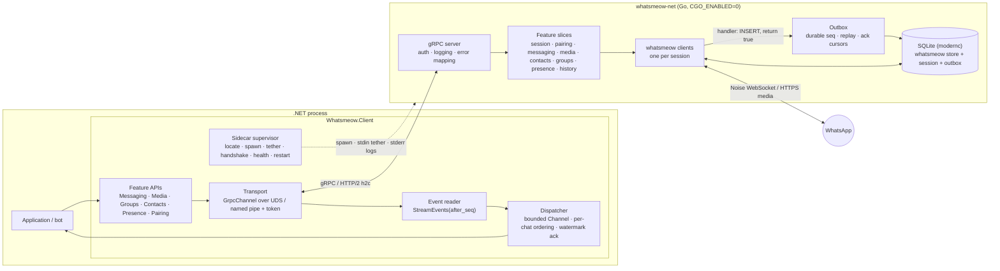

# Architecture

> **Status:** v1 design, frozen for implementation. Changes go through an ADR (see [Decision log](#decision-log)).
> **Name:** Whatsmeow.NET. Identifiers are in [Naming](#naming).
> **Background:** the full research behind every decision here is in [`RESEARCH.md`](RESEARCH.md). This document states *what we do*. The research explains *why*, with sources.
> **How to write the code:** [`guidelines/`](guidelines/README.md). Coding rules that used to live here (§6 proto style, §7.9, the idiom half of §8.3, §8.9 table, §8.10, test discipline) moved there; each spot keeps a pointer.
> **House rules win:** where this document and the house guidelines (shared with bridge, compras, chrominal) disagreed, the house rule was applied and recorded as an ADR seed in the [Decision log](#decision-log).

Whatsmeow.NET gives .NET applications full access to WhatsApp's multi-device protocol by wrapping the Go library [whatsmeow](https://github.com/tulir/whatsmeow). It has two parts, released together from one repo:

1. **`whatsmeow-net`**: a thin, CGO-free Go sidecar. It hosts one or more whatsmeow clients and serves the `whatsmeow.v1` gRPC API over a private local socket.
2. **The .NET library** (`Whatsmeow.Client` and friends): spawns and supervises `whatsmeow-net`, and exposes an idiomatic, AOT-safe C# API. gRPC and protobuf never leak into the public surface, except through an explicitly unstable `Raw` escape hatch.

The bot built on top is **out of scope** for this repository.

## Naming

The product is **Whatsmeow.NET**, the same name as the repo.
Code identifiers follow the Akka.NET and Quartz.NET pattern: the brand keeps the `.NET` suffix, and packages, namespaces and types drop it.
An earlier draft called the project Wameow.
That name is retired, including in the Go layer.

The sidecar is not a second product.
Its names still land in the contract, in process listings and in generated code, so they use this identity instead of a leftover codename.
Upstream whatsmeow stays lowercase `whatsmeow` in prose, so the two stay easy to tell apart.

| Kind | Name | Notes |
|---|---|---|
| Product, repo, docs | Whatsmeow.NET | not a C# namespace |
| NuGet and C# root | `Whatsmeow` | `Whatsmeow.Client`, `WhatsmeowSidecar`, `WhatsmeowException` |
| Proto package | `whatsmeow.v1` | `proto/whatsmeow/v1/`. Our contract. Upstream packages stay `WAWebProtobufs*` |
| Generated Go package | `whatsmeowv1` | `go_package` is `github.com/tcortega/Whatsmeow.NET/sidecar/gen/whatsmeow/v1;whatsmeowv1`, so it does not collide with `go.mau.fi/whatsmeow` |
| Go module | `github.com/tcortega/Whatsmeow.NET/sidecar` | case matches the GitHub repo. Do not lowercase it in `go.mod` |
| Sidecar binary | `whatsmeow-net` | `whatsmeow-net.exe` on Windows. Not `whatsmeowd`, which reads as an upstream daemon |
| Env var | `WHATSMEOW_NET_SIDECAR_PATH` | overrides binary location |
| ErrorInfo domain | `whatsmeow.net` | reason-code namespace, not a DNS claim |
| Default DB file | `whatsmeow-net.db` | avoids colliding with a whatsmeow or mautrix database in the same directory |
| Windows pipe prefix | `\\.\pipe\whatsmeow-net-` | plus a 128-bit random suffix |
| ActivitySource, Meter | `Whatsmeow.Client` | public constants |
| Sidecar log category | `Whatsmeow.Sidecar` | stderr is forwarded here |

---

## 1. Goals and non-goals

**Goals**

- Feature parity with whatsmeow for personal and group messaging, media, contacts, groups, presence, receipts and history sync.
- **No lost messages.** Delivery is at-least-once from WhatsApp all the way into user handlers, and survives a crash of either process.
- Absorb whatsmeow's weekly churn. A whatsmeow bump changes Go adapter code only. It never changes the `whatsmeow.v1` contract or the public C# API.
- Modern and strict: `net10.0` / C# 14, Native AOT and trimming compatible, no runtime reflection, latest stable toolchains.
- Zero setup for consumers. `dotnet add package` is enough; the sidecar binary ships inside NuGet.

**Non-goals (v1)**

- Bot framework features: commands, middleware, conversation state. Those belong to the bot.
- Long-term message storage. The application owns history; the sidecar keeps only an operational cache.
- Media processing in Go. Thumbnails, transcoding and waveforms are done in .NET.
- Calls (whatsmeow only does call signaling), newsletters/channels, business features. Possible later.
- Being a network service. `whatsmeow-net` is a local child process. "External mode" (separate container) comes in Phase 4.

---

## 2. System overview



**Process model:** one `whatsmeow-net` process per host application, many sessions (WhatsApp accounts) per process, one SQLite database for all sessions.

---

## 3. Code organization: feature slices end-to-end

Vertical-slice thinking applies to this library. A **slice is a WhatsApp capability**, and it is cut the same way through all three layers:

| Slice | Proto file | Go package | .NET folder | Public entry point |
|---|---|---|---|---|
| Sidecar (process) | `sidecar.proto` | `internal/sidecar` | `Sidecar/` | `WhatsmeowSidecar` |
| Sessions | `session.proto` | `internal/session` | `Sessions/` | `WhatsmeowSidecar.Sessions` |
| Pairing | `session.proto` (`Pair`) | `internal/pairing` | `Pairing/` | `client.Pairing` |
| Events | `events.proto` | `internal/events` + `internal/outbox` | `Events/` | `client.On<T>`, handlers |
| Messaging | `message.proto` | `internal/messaging` | `Messaging/` | `client.Messages` |
| Media | `media.proto` | `internal/media` | `Media/` | `client.Media` |
| Contacts & LID | `contact.proto` | `internal/contacts` | `Contacts/` | `client.Contacts` |
| Groups | `group.proto` | `internal/groups` | `Groups/` | `client.Groups` |
| Presence & receipts | `message.proto` (presence RPCs) | `internal/presence` | `Presence/` | `client.Presence` |
| History sync | `events.proto` (history events) | `internal/history` | `History/` | events + `client.Messages.RequestHistoryAsync` |
| Chat state (Phase 3) | `chatstate.proto` | `internal/chatstate` | `ChatState/` | `client.Chats` |

**Rules**

- A slice owns its proto messages, Go service implementation, event mapping, .NET public types, proto↔record mapping and tests. Adding a capability means adding or extending **one** slice in all three layers.
- Slices do not call each other's internals. Shared needs go into the **core**, which is deliberately small:
  - Go core: `internal/server` (gRPC plumbing, interceptors, error mapping), `internal/transport`, `internal/outbox`, `internal/store`, `internal/log`.
  - .NET core: `Core/Transport`, `Core/Dispatching`, `Core/Errors`, `Core/Telemetry`, `Core/Primitives` (`Jid`, `MessageId`, `SessionId`, `MediaRef`).
- Slices may depend on core. Core never depends on a slice.

---

## 4. Repository layout

```
/AGENTS.md                         # agent entry point, progressive disclosure
/CLAUDE.md                         # symlink to AGENTS.md
/NOTICE                            # MPL-2.0 source offer for whatsmeow
/.editorconfig                     # house VsaTemplate file, tabs (see docs/guidelines/csharp.md)
/docs/ARCHITECTURE.md              # this document
/docs/RESEARCH.md                  # research report (reference only)
/docs/guidelines/                  # how to write code: csharp, options, tests, go, proto
/docs/adr/                         # decision records, NNNN-title.md
/buf.yaml  buf.gen.yaml            # buf v2; managed mode; upstream protos excluded from lint/breaking
/proto/whatsmeow/v1/*.proto           # OUR contract, one file per slice
/third_party/whatsmeow/            # *.proto copied from the EXACT pinned module version + VERSION
/sidecar/                          # Go module github.com/tcortega/Whatsmeow.NET/sidecar
  cmd/whatsmeow-net/                     # entry point: flags, stdin token + tether, ready line, signals
  internal/<slice>/                # one package per slice (see §3)
  internal/{server,transport,outbox,store,log}/   # core
  gen/                             # buf-generated Go for whatsmeow.v1 only (never for upstream protos)
  scripts/check-parity/            # whatsmeow Client method coverage report
/dotnet/
  Whatsmeow.slnx  Directory.Build.props  Directory.Build.targets  Directory.Packages.props  global.json
  BannedSymbols.txt
  src/Whatsmeow.Protocol.WhatsApp/    # committed generated upstream C# (Whatsmeow.Proto.*), unstable
  src/Whatsmeow.Protocol/             # committed generated whatsmeow.v1 C# (internal where possible)
  src/Whatsmeow.Client/               # public API: Core/ + one folder per slice
  src/Whatsmeow.Extensions.Hosting/   # DI, options, keyed sessions, hosted supervisor
  src/Whatsmeow.Testing/              # FakeWhatsAppClient, in-memory transport
  src/Whatsmeow.Sidecar.Native.{win,linux,osx}/   # pack-only: runtimes/{rid}/native/whatsmeow-net[.exe]
  tests/Whatsmeow.Client.Tests/       # vital unit tests only: dispatcher, supervisor (FakeClock)
  tests/Whatsmeow.IntegrationTests/   # default: real whatsmeow-net in fake-WhatsApp mode
  tests/Whatsmeow.LiveTests/          # real WhatsApp; opt-in, never in default CI
  tests/AotSmoke/                  # PublishAot console app, zero warnings required
  samples/EchoBot/
/.github/workflows/  ci.yml  whatsmeow-bump.yml  release.yml
/.goreleaser.yaml
```

Generated code is **committed** and regenerated by CI (`buf generate` plus a diff check). Consumers never need protoc.

---

## 5. Technology baseline

Re-verify exact versions on nuget.org and proxy.golang.org when scaffolding. "Latest stable" wins over the numbers below.

| Area | Choice |
|---|---|
| Go | 1.27.x toolchain; `go 1.26` module floor, matching whatsmeow's |
| whatsmeow | exact pseudo-version, bumped weekly by CI |
| gRPC (Go) | grpc-go latest 1.8x, protobuf-go APIv2 (`google.golang.org/protobuf`) |
| SQLite | `modernc.org/sqlite` (driver `"sqlite"`), no CGO |
| Go logging | zerolog, the same logger whatsmeow uses through `waLog.Zerolog` |
| Proto tooling | buf v2 (managed mode), protoc-gen-go, protoc-gen-go-grpc, protoc-gen-csharp + grpc C# plugin |
| .NET | `net10.0` only, C# 14, `.slnx`, Central Package Management, artifacts output |
| gRPC (.NET) | `Grpc.Net.Client`, `Google.Protobuf`, `Grpc.StatusProto`. **Never** `Grpc.Core` |
| Resilience | Polly v8 (`Microsoft.Extensions.Resilience` where appropriate) |
| Time (.NET) | NodaTime everywhere, public API included (`Instant`, `Duration`, `IClock`); `NodaTime.Serialization.Protobuf` for WKT mapping. BCL date/time types and `TimeProvider` banned. See §14 question 7 |
| IDs (.NET) | Vogen for primitive wrappers (`SessionId`, `MessageId`); `Jid` hand-written |
| Analyzers (.NET) | `AnalysisLevel latest-all`, `Meziantou.Analyzer`, `Microsoft.CodeAnalysis.BannedApiAnalyzers`, house `.editorconfig` |
| Tests | xUnit v3 on Microsoft.Testing.Platform, `FakeClock` (`NodaTime.Testing`); Go `testing` with `-race` |
| Versioning / release | MinVer from git tags; GoReleaser v2; NuGet Trusted Publishing (OIDC) |

---

## 6. The `whatsmeow.v1` contract

The contract is the most important artifact in the repo. Both sides are generated from it.

**Rules**

- Proto style (proto3, buf STANDARD, AIP-191, `_UNSPECIFIED` zero values, WKTs, field numbering) and the NodaTime mapping: [guidelines/proto.md](guidelines/proto.md).
- **Independent of whatsmeow's Go API.** No field mirrors a whatsmeow Go struct by accident. Mapping happens in Go slice code.
- whatsmeow's own protos (`WAWebProtobufsE2E.Message` etc.) are imported **unmodified** from `third_party/whatsmeow` and embedded as **typed fields**. On the wire, a typed field is identical to a `bytes` field holding the serialized message.
- `buf breaking` gates `whatsmeow.v1` only. Upstream wire changes are reported but don't block.
- `GetInfo` reports `version`, `protocol` (an integer contract revision), `whatsmeow_version`, `wa_web_version`, `go_version` and `commit`.

**Service shape** (full outline in the research report):

| Service | Kind | Notes |
|---|---|---|
| `SidecarService` | unary | `GetInfo`, `Shutdown`; `grpc.health.v1` is also served |
| `SessionService` | unary + `Pair` (server stream) + `WatchSessionState` (server stream, snapshot first) | app-chosen session IDs |
| `EventService` | `StreamEvents` (server stream) + `AckEvents` (unary) | durable `seq`, resume with `after_seq`, per-consumer cursor |
| `MessageService` | unary | raw `SendMessage` plus typed helpers (text, media, reaction, edit, revoke, poll, read, presence) |
| `MediaService` | `UploadMedia` (client stream), `DownloadMedia` (server stream), `RequestMediaRetry` | path handoff or 64 KiB chunks |
| `ContactService`, `GroupService` | unary | includes LID↔PN resolution |
| `ChatStateService` | unary | Phase 3 |

**Error model:** every error is a gRPC status plus `google.rpc.ErrorInfo{ reason, domain: "whatsmeow.net", metadata }`. `reason` is a stable `SCREAMING_SNAKE` code: `NOT_LOGGED_IN`, `SESSION_NOT_FOUND`, `RECIPIENT_NOT_ON_WHATSAPP`, `MEDIA_EXPIRED`, `RATE_LIMITED`, `TEMPORARILY_BANNED`, `INVALID_ARGUMENT`, `SIDECAR_SHUTTING_DOWN`, and so on. Clients map on `reason` only, never on message text. The list of reasons is part of the contract.

---

## 7. Go sidecar (`whatsmeow-net`)

### 7.1 Responsibilities

A protocol adapter, nothing more: session lifecycle, pairing, event capture into the outbox, send queue, media transfer, history download. **No business logic and no media processing.**

### 7.2 whatsmeow configuration (mandatory)

| Setting | Value | Why |
|---|---|---|
| `SynchronousAck` | `true` | ack WhatsApp only after our handler succeeded |
| `EnableDecryptedEventBuffer` | `true` | redelivery after a crash is decryptable and deduplicated |
| handler registration | `AddEventHandlerWithSuccessStatus` | returning `false` withholds the ack |
| `ManualHistorySyncDownload` | `true` | history blobs aren't deleted from the server before we have them |
| `UseRetryMessageStore` | `true` | retry receipts can be answered after a restart |
| `EnableAutoReconnect` | `true`, with `AutoReconnectHook` capping and jittering the backoff | avoids the zombie-socket bug seen when it's disabled |
| `store.DeviceProps`, `SetOSInfo`, `SetWAVersion` | set **once** at startup | process-global in whatsmeow; never mutated per session |

### 7.3 The event handler contract (critical)

whatsmeow runs handlers **synchronously, in order, on one queue per client**. Therefore the handler:

1. Converts the event to a `whatsmeow.v1` event (pure mapping, no I/O except the next step).
2. Runs **one short transaction**: `INSERT INTO outbox … ON CONFLICT DO NOTHING`.
3. Signals waiting stream goroutines without blocking.
4. Returns `true` only after the commit. It returns `false` on a DB error or a panic; it uses its **own** `recover()`, because whatsmeow treats a recovered panic as success.

The handler **never** calls gRPC, never waits on .NET, never downloads media, and never returns `false` just because no consumer is connected.

Ephemeral high-volume events (presence, typing) bypass the outbox. They go into a bounded in-memory ring buffer with `seq = 0` and emit a `QueueOverflowEvent` when items are dropped.

### 7.4 Session state machine

Every whatsmeow signal maps to exactly one state. Each transition is written to the outbox as a `ConnectionStateEvent` and published to `WatchSessionState`.

`Created → Pairing → Connecting → Connected → CaughtUp`, with transient `Reconnecting` and the terminal or blocking states `LoggedOut`, `Replaced`, `TempBanned{until}`, `Outdated`, `Error{reason}`.

Actions the sidecar itself starts (`Disconnect`, `Logout`) produce no whatsmeow events, so the sidecar synthesizes those transitions. On `LoggedOut`, whatsmeow has already deleted the device rows; the sidecar must not delete them again. Each SQLite file has a single owner, enforced with a lock file or lease row.

### 7.5 Sending

- Per-session FIFO queue with a token bucket and jitter. It pauses on `TempBanned`, backs off on 429, and fails all pending sends on `LoggedOut`.
- Idempotent sends: .NET supplies `client_message_id`, which is used as the WhatsApp message ID through `SendRequestExtra.ID` and persisted with the result.
- **A send whose outcome is unknown is never automatically replayed.** It surfaces as an error.
- Responses report `SendResponse.Chat`, because whatsmeow may redirect a phone-number JID to a LID.

### 7.6 Media

- Upload uses `UploadReader` (constant memory, retried up to 3 times with backoff). Download uses `DownloadToFile`. Never use the in-memory `Upload([]byte)` / `Download` variants for user media.
- Same host: hand files over by **path** under a configured root, validated against path traversal. Otherwise use **64 KiB chunk streams**. Never put whole files inline in a message.
- `MediaRef` (`direct_path`, `media_key`, `file_sha256`, `file_enc_sha256`, `file_length`, `mimetype`, `streaming_sidecar`) is enough to download lazily or to forward without re-uploading.
- Expired media returns `MEDIA_EXPIRED`. The caller then calls `RequestMediaRetry`, and the new path arrives as a `MediaRetryEvent`.

### 7.7 History sync

Notifications are persisted to a queue table. After `OfflineSyncCompleted`, a low-priority worker downloads each blob, parses messages with `ParseWebMessage`, and writes **batched** `HistoryMessagesEvent` rows plus progress events. Live traffic always has priority.

### 7.8 Process conventions

- `stdin`: first line is the 32-byte auth token. The rest is the tether: **EOF means shut down gracefully.**
- `stdout`: exactly **one** JSON line, the ready line: `{"event":"ready","version","protocol","whatsmeow","listen","nonce"}`.
- `stderr`: JSON log lines (zerolog). Every log line includes `session_id` where applicable. Phone numbers and JIDs are logged at debug level only.
- Linux: the sidecar sets `PR_SET_PDEATHSIG` on itself and re-checks its parent PID. macOS: polls its parent PID. These are backups to the stdin tether.

### 7.9 Go code conventions

Moved to [guidelines/go.md](guidelines/go.md): `context.Context` first, `%w` errors mapped to `ErrorInfo` only in `internal/server`, no `reflect`/`unsafe`/cgo/mutable globals, small per-slice whatsmeow interfaces, `whatsmeowv1` import name, owned goroutines.

---

## 8. .NET library

### 8.1 Packages

| Package | Contents | Stability |
|---|---|---|
| `Whatsmeow.Client` | public API, supervisor, transport, dispatcher, mapping | stable |
| `Whatsmeow.Protocol` | generated `whatsmeow.v1` messages and client stubs | internal use; no stability promise |
| `Whatsmeow.Protocol.WhatsApp` | generated upstream WhatsApp protos (`Whatsmeow.Proto.*`) | **unstable**: changes with every whatsmeow bump |
| `Whatsmeow.Extensions.Hosting` | `AddWhatsmeow(...)`, options validation, keyed sessions, hosted supervisor | stable |
| `Whatsmeow.Testing` | `FakeWhatsAppClient`, `Raise(event)` | stable |
| `Whatsmeow.Sidecar.Native.{win,linux,osx}` | `whatsmeow-net` binaries under `runtimes/{rid}/native/` | pinned to the exact `Whatsmeow.Client` version |

`Whatsmeow.Client` depends on the native packages with exact versions (`[x.y.z]`). Do not use a `runtime.json` pointer package.

### 8.2 Public API shape (indicative)

```csharp
await using var sidecar = await WhatsmeowSidecar.StartAsync(options, cancellationToken);
IWhatsAppClient client = await sidecar.Sessions.GetOrCreateAsync(SessionId.From("main"), cancellationToken);

await foreach (PairingUpdate update in client.Pairing.PairWithQrCodeAsync(cancellationToken)) { … }

using IDisposable subscription = client.On<MessageReceived>(static async (e, ct) => { … });

SendResult result = await client.Messages.SendTextAsync(chat, "hello", cancellationToken: cancellationToken);
```

- **One `IWhatsAppClient` per session.** It exposes feature groups that mirror the slices: `Pairing`, `Messages`, `Media`, `Contacts`, `Groups`, `Presence` (and later `Chats`).
- `WhatsmeowSidecar` owns the process and the single shared `GrpcChannel`. Clients are lightweight views over it.
- `IWhatsAppClient` is the one deliberate exception to the house rule "no interface just to mock it": `Whatsmeow.Testing` ships `FakeWhatsAppClient` to consumers. Library internals get no interfaces for testability.
- Core behavior lives on real members. C# 14 extension blocks are used only for convenience (`jid.IsGroup`), never for logic that must be mockable.
- Works without DI (`WhatsmeowSidecar.StartAsync`) and with DI (`services.AddWhatsmeow(...)` in namespace `Whatsmeow.Extensions.Hosting`, **not** `Microsoft.Extensions.DependencyInjection`).

### 8.3 Modeling rules

- Events: `public abstract record WhatsAppEvent` with `sealed record` cases (`MessageReceived`, `ReceiptReceived`, `ConnectionStateChanged`, …). Message content is a separate `abstract record MessageContent` hierarchy with sealed cases (`TextContent`, `ImageContent`, …, `UnknownContent`). These are shaped so they can become C# `closed`/`union` types later without breaking users' `switch` statements.
- Identifiers: `MessageId` and `SessionId` are Vogen value objects; `Jid` is a hand-written `readonly struct Jid : ISpanParsable<Jid>`. `Jid` carries both PN and LID forms where known. Events always include `Sender`/`SenderAlt` and `Chat`/`RecipientAlt`. Rules and rationale: [guidelines/csharp.md](guidelines/csharp.md) IDs.
- **Generated protobuf types never appear in the stable public API.** The only exception is the opt-in `Raw` escape hatch: `MessageReceived.Raw` (an `[Experimental]`-attributed property) and `client.Messages.SendRawAsync(WAWebProtobufsE2E.Message …)`. These live in `Whatsmeow.Protocol.WhatsApp` types and are documented as unstable.
- Time is NodaTime, public API included: `Instant` and `Duration` in public members, `IClock` injected, never BCL date/time types.
- Idioms (immutability with `required`/`init` and `ImmutableArray<T>`/`IReadOnlyList<T>`, `Task` vs `ValueTask`, `CancellationToken` last, `Async` suffix, time): [guidelines/csharp.md](guidelines/csharp.md) Public API modeling and Time.

### 8.4 Event pipeline and delivery guarantee

```
gRPC StreamEvents ─► reader loop ─► bounded Channel<Envelope> ─► dispatcher ─► handlers
                       (decode only,                (per-chat lanes,          (isolated
                        never awaits user code)      concurrent across chats)  try/catch)
                                                         │
                                       ack watermark ◄───┘  AckEvents(up_to_seq)
```

- The **reader** only decodes and writes to the channel. Backpressure flows into gRPC flow control and the sidecar's durable outbox; nothing is dropped.
- The **dispatcher** orders events per chat and runs different chats concurrently, with a configurable degree of parallelism.
- **Ack by watermark:** the cursor sent with `AckEvents` is the highest `seq` such that every event at or below it has finished all its handlers. Events are acked in batches on a timer and at shutdown.
- **Handler failures do not block the stream.** An exception is caught, logged, counted in metrics, and raised on `OnHandlerError`. The event still counts as handled; a failing event that blocked the stream forever would be worse. Users who need retries implement them in the handler.
- **The consumer contract is at-least-once:** handlers must be idempotent, and `MessageId` plus `SessionId` is the dedupe key. This is documented on every handler interface.
- Three consumption styles, all fed by the same dispatcher:
  1. DI handlers: `IWhatsAppEventHandler<TEvent>.HandleAsync(TEvent, CancellationToken)`.
  2. Delegates: `client.On<TEvent>(handler)`, which returns `IDisposable`.
  3. Opt-in `IAsyncEnumerable` reader (single consumer, mainly for scripts and tests).
- `WaitForAsync<TEvent>(predicate, timeout, ct)` supports request/response-style flows.

### 8.5 Sidecar supervision

- **Locate the binary** in this order: `options.SidecarPath` or `WHATSMEOW_NET_SIDECAR_PATH`; then `AppContext.BaseDirectory`; then `AppContext.BaseDirectory/runtimes/<rid>/native/`. The RID is derived from `RuntimeInformation` plus musl detection. Never use `Assembly.Location`.
- **Make it executable:** call `File.SetUnixFileMode(+x)` before every start. If that fails, copy the binary to a writable cache directory (never `/tmp` mounted `noexec`).
- **Start:** redirect stdin/stdout/stderr, write the token as the first stdin line, wait for the ready line within `StartupTimeout`, verify the nonce, then call `grpc.health.v1`. If startup fails, the exception includes the tail of stderr.
- **Tether:** keep stdin open for the sidecar's whole lifetime. On Windows, also assign the process to a Job Object with `KILL_ON_JOB_CLOSE` (P/Invoke generated by CsWin32).
- **Stop:** `Shutdown` RPC, then close stdin, wait for the grace period, send SIGTERM (`[LibraryImport("libc")] kill`), and finally `Kill(entireProcessTree: true)`.
- **Restart:** a supervisor loop with Polly exponential backoff and jitter, reset after a sustained healthy period. The loop never lets an exception escape a `BackgroundService`.
- **Version check:**
  - Embedded mode requires `sidecar.version == client.version`.
  - Every mode requires `sidecar.protocol` to be within `[MinProtocol, MaxProtocol]`.
  - A mismatch is a hard `SidecarVersionMismatchException`.
- After a restart, the event reader resumes from the server-side cursor. Users see a `SidecarRestarted` diagnostic event, not a gap.

### 8.6 Transport

- `GrpcChannel.ForAddress("http://localhost", new GrpcChannelOptions { HttpHandler = new SocketsHttpHandler { ConnectCallback = … } })`.
- Unix domain socket by default. On Windows, the named-pipe fallback is selectable, and the default is chosen by the Phase 0 soak test.
- An auth token is added to every call by an interceptor, together with `ThrowOperationCanceledOnCancellation = true`.
- `MaxReceiveMessageSize` and `MaxSendMessageSize` are set explicitly to 16 MiB on both sides.
- Never call `GrpcChannel.ConnectAsync` or read `GrpcChannel.State`; neither works with `ConnectCallback`. Readiness comes from the handshake.

### 8.7 Errors

- `WhatsmeowException` (base) carries `ErrorCode` (from `ErrorInfo.reason`) and the `RpcException` as `InnerException`.
- Subtypes:
  - `SidecarUnavailableException`, `SidecarVersionMismatchException`
  - `NotLoggedInException`, `SessionLoggedOutException`, `SessionNotFoundException`
  - `RateLimitedException` (`RetryAfter`, a NodaTime `Duration`), `TemporarilyBannedException` (`Until`, a NodaTime `Instant`)
  - `RecipientNotFoundException`, `MediaExpiredException`, `WhatsmeowValidationException`
- Cancellation surfaces as `OperationCanceledException`, and deadlines as `TimeoutException`.
- `RpcException` never escapes the public API. No Result types for I/O failures.
- Exceptions are raised through per-type static throw helpers, never `throw new` at a call site ([guidelines/csharp.md](guidelines/csharp.md) Control flow). `WhatsmeowValidationException` is also the Vogen `throws:` type.

### 8.8 Observability

- Logging: `ILogger` with `[LoggerMessage]` source-generated methods only. Sidecar stderr is forwarded into category `Whatsmeow.Sidecar` with level mapping.
- Tracing: one static `ActivitySource("Whatsmeow.Client")`, with spans for sends, media transfers and event processing.
- Metrics: one `Meter("Whatsmeow.Client")` via `IMeterFactory`, covering messages sent and received, handler duration, dispatcher queue depth, errors, and restarts. Source and meter names are public constants.
- **PII:** JIDs and phone numbers appear only at `Debug` level or below, or redacted.

### 8.9 Reflection policy

**No runtime reflection in library code.** Everything that would normally use reflection is either generated at build time or written explicitly, and the shipped projects are AOT- and trim-clean with zero warnings (`tests/AotSmoke`).
The per-need table (protobuf, logging, options validation, JSON, native interop, event dispatch, handler registration, IDs) and the enforcement (`IsAotCompatible`, `IsTrimmable`, BannedApiAnalyzers with `BannedSymbols.txt`, AotSmoke) are in [guidelines/csharp.md](guidelines/csharp.md) Reflection.

### 8.10 Concurrency rules

Moved to [guidelines/csharp.md](guidelines/csharp.md) Async and concurrency: `Channels` and `System.Threading.Lock` (never across `await`), no sync-over-async or `async void`, `ConfigureAwait(false)` everywhere (CA2007 as error), every background loop owned by a `CancellationTokenSource` awaited in `DisposeAsync`.

---

## 9. Key flows

**Inbound message:** WhatsApp → whatsmeow decrypts (decrypted-event buffer) → sidecar handler maps and inserts into the outbox, then returns `true` → whatsmeow acks WhatsApp → the `StreamEvents` goroutine sends `seq=N` → .NET reader → dispatcher (chat lane) → handlers → watermark reaches N → `AckEvents(N)`. A crash at any step causes a replay from the last durable point, never a loss.

**Send:** `SendTextAsync` → `MessageService.SendText` with `client_message_id` → per-session queue (pacing) → `whatsmeow.SendMessage` → the response carries the server timestamp and the actual `chat` JID (which may be a LID) → `SendResult`.

**Media send:** .NET prepares metadata (thumbnail, dimensions, waveform) → `UploadMedia` (path or chunks) → `UploadReader` → `MediaRef` → `SendMedia(MediaRef, metadata)`. Re-sending an existing `MediaRef` skips the upload.

**Pairing:** `Pair` stream opens → sidecar calls `GetQRChannel` and then `Connect` → QR codes are streamed (or a phone pairing code after the first QR event) → `PairSuccess` → the sidecar waits for `PreKeysUploaded` → `success` → session state becomes `Connected`.

**Startup:** locate the binary → chmod → spawn → write the token → ready line → nonce check → health check → `GetInfo` version check → `WatchSessionState` and `StreamEvents(after_seq = cursor)` for each session.

---

## 10. Security

- The socket lives in a freshly created `0700` directory with a short random name; a stale socket file is removed before `Listen`. Linux abstract sockets are never used.
- Windows named pipes use a random name, a current-user-only DACL, and `PipeOptions.CurrentUserOnly` on the client.
- A per-launch 32-byte token is delivered on stdin (never argv or environment variables). It is checked in constant time by a gRPC interceptor. A nonce echo guards against connecting to a stale sidecar.
- The SQLite database holds long-term private keys. It is created `0600`, and the docs recommend disk encryption. Backups use `VACUUM INTO` and must be encrypted by the user.
- Media paths are confined to a configured root, and path traversal is rejected.

---

## 11. Testing strategy

Integration tests are the default (house rule).
Every slice gets a FullCycle through the public `IWhatsAppClient` against a real sidecar in fake-WhatsApp mode.
.NET unit tests exist only for the short vital list below; proto-to-record mapping and error mapping are covered through integration.
How to write each test, what is banned, and the can-it-fail check: [guidelines/tests.md](guidelines/tests.md).

| Layer | What | Where |
|---|---|---|
| Integration (default) | real `whatsmeow-net` started with `--fake-whatsapp`, a test-only build tag that replaces whatsmeow with a scripted fake and exposes a control service to inject events and failures; one FullCycle per slice through the public API, covering proto ↔ record mapping and error mapping; kill-either-process tests for delivery guarantees | `tests/Whatsmeow.IntegrationTests` |
| Go unit | every slice, with whatsmeow faked behind the slice's small interface; event-mapping tables covering every event type; outbox replay/ack/crash semantics; `-race` always | `sidecar/internal/**` |
| Contract | `buf lint`, `buf breaking` against `main`; generated-code diff check | CI |
| .NET unit (vital only) | dispatcher per-chat ordering and watermark acking; supervisor restart/backoff state machine with `FakeClock` | `tests/Whatsmeow.Client.Tests` |
| Live | real WhatsApp with a dedicated test number; manual pairing; opt-in through environment variables; never in default CI | `tests/Whatsmeow.LiveTests` |
| Packaging | `dotnet pack` → restore from a local feed → run on win-x64, linux-x64 (glibc and Alpine), osx-arm64 | CI matrix |
| AOT | `tests/AotSmoke`, zero warnings | CI |

---

## 12. Release and upstream tracking

- One git tag (`vX.Y.Z`) drives both GoReleaser (binaries, signed and notarized) and `dotnet pack` (MinVer). The versions are always equal.
- **Weekly `whatsmeow-bump` workflow:**
  1. Bump the whatsmeow pin.
  2. Copy the protos from the **exact** module directory (`go mod download -json`).
  3. Regenerate the code.
  4. Run all tests.
  5. Post a non-gating upstream wire-diff comment and a parity report.
  6. Open a PR.
- The whatsmeow pin is an implementation detail; a bump that passes CI is a patch release. A change to `whatsmeow.v1` increments `protocol`.
- `NOTICE` carries the MPL-2.0 source offer for whatsmeow at the pinned commit.

---

## 13. Invariants

Any change that violates one of these is wrong unless an ADR changes the invariant first.

1. The whatsmeow event handler never blocks on .NET, the network, or media. It only writes to the outbox.
2. A WhatsApp message is acked to the server only after it is durably in the outbox.
3. An event is acked by .NET only after all of its handlers have completed. Acks follow the watermark.
4. Every whatsmeow `PermanentDisconnect` maps to an explicit session state and is delivered to .NET. "Silent" sessions are a bug.
5. `whatsmeow.v1` never breaks without a `protocol` increment, and `buf breaking` enforces this.
6. Generated protobuf types never appear in the stable public C# API.
7. No runtime reflection, no `async void`, no sync-over-async, no `Grpc.Core`, no `Newtonsoft.Json`, no BCL date/time types.
8. No whole-file media in a single gRPC message; use paths or chunks.
9. The sidecar cannot outlive its parent process.
10. A send with an unknown outcome is never automatically retried.
11. Go code never regenerates whatsmeow's protos into its own packages; it imports whatsmeow's.
12. Embedded sidecar version equals client version.

---

## 14. Open questions (Phase 0 spikes)

These can change the architecture. Resolve them before Phase 1 and record each outcome as an ADR.

| # | Question | Decides |
|---|---|---|
| 1 | Does grpc-go's codec fail on whatsmeow messages with missing proto2 `required` fields? | typed fields vs `AllowPartial` codec vs `bytes` |
| 2 | Windows: AF_UNIX streaming stability (grpc-go #7039) vs named pipes | default Windows transport |
| 3 | modernc + sqlstore under contention, and whether `_txlock=immediate` is supported | final DSN |
| 4 | Are any event types still acked before dispatch with `SynchronousAck`? | the exact scope of the delivery guarantee |
| 5 | AOT/trim warnings from the large generated WhatsApp types, from NodaTime (+ `NodaTime.Serialization.Protobuf`), and from Vogen-generated code with the chosen `conversions:` | the AOT claim; Vogen `conversions:`, or a fallback to hand-written ID wrappers |
| 6 | Sidecar binary size; Alpine run; macOS signing | packaging details |
| 7 | NodaTime at BCL interop: Polly v8 takes a `TimeProvider` and `TimeSpan` delays [observed: Polly docs, `ResiliencePipelineBuilder.TimeProvider`], as do `Task.Delay`, `PeriodicTimer` and CTS timeouts. With `TimeProvider` banned, `FakeClock` cannot drive them. Candidate: one internal `IClock`-backed adapter, the only file allowed to suppress RS0030 [inferred, untested] | how supervisor backoff, ack timers and timeouts are tested with `FakeClock` |

---

## 15. Roadmap

| Phase | Scope | Exit criteria |
|---|---|---|
| 0 | Spikes from §14; repository scaffolding and CI | every spike has a written go/no-go ADR |
| 1 | Sessions, state machine, pairing, outbox and event stream, raw and text send, receipts; .NET supervisor, transport, dispatcher, errors, `Jid`, core events | pair a real phone; kill either process mid-stream; no lost or duplicated messages |
| 2 | Media, reactions, edits, revokes, polls, presence, contacts and LID, groups, send pacing | parity report covers messaging, groups and contacts |
| 3 | History sync, chat state, hosting package, telemetry, `Whatsmeow.Testing` | hosted sample with two sessions; history doesn't delay live traffic |
| 4 | Native packages, signing, Trusted Publishing, weekly bump, AOT smoke, PublicAPI baseline, External mode, docs | `dotnet add package` works on all target RIDs from nuget.org |

---

## Decision log

Decisions are recorded in `docs/adr/NNNN-title.md` (context, decision, consequences). Seed ADRs to write during Phase 0:

- 0001: Go sidecar over a native C# port or cgo FFI
- 0002: gRPC over local sockets as the IPC transport
- 0003: At-least-once delivery through `SynchronousAck` and a SQLite outbox
- 0004: Reusing whatsmeow protos as typed fields; hand-written public records
- 0005: Feature-slice organization across proto, Go and .NET
- 0006: No runtime reflection; source generation and explicit registration
- 0007: Packaging as per-OS native NuGet packages with exact-version pins
- 0008: Product name Whatsmeow.NET; identifiers rooted at `Whatsmeow`; sidecar binary `whatsmeow-net`

House-rule alignment (the house rule replaced what this document said before):

- 0009: NodaTime everywhere, public API included; replaces an injected `TimeProvider`
- 0010: Vogen for primitive ID wrappers; `Jid` stays hand-written; replaces hand-written `readonly record struct` IDs
- 0011: Integration tests by default, with .NET unit tests only for the dispatcher and supervisor; replaces a broad .NET unit layer
- 0012: `IWhatsAppClient` kept as the single exception to "no interface just to mock it"
