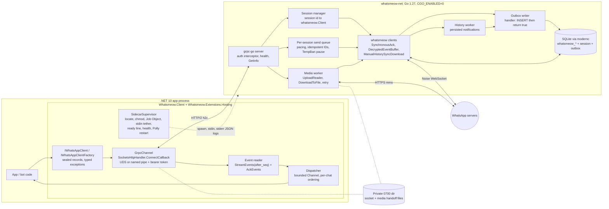

# Ship whatsmeow to .NET over gRPC

> Product name: **Whatsmeow.NET**.
> Identifiers in this report follow [ARCHITECTURE.md](ARCHITECTURE.md#naming).
> Upstream whatsmeow stays lowercase `whatsmeow`.

Build it as **two lock-stepped artifacts from one repo**. The first is a CGO-free Go 1.27 sidecar (`whatsmeow-net`) that pins an exact whatsmeow pseudo-version and serves a versioned `whatsmeow.v1` gRPC API over a private Unix domain socket. The second is a `net10.0` C# 14 library that spawns, tethers, health-checks and restarts that sidecar, then hides gRPC behind idiomatic records, async handlers and typed exceptions. Several things drive the design. whatsmeow has **no tags, about 15–35 commits a month, weekly proto regenerations and a breaking signature change every month or two** ([repo](https://github.com/tulir/whatsmeow)). Its event handlers run **synchronously and in order on one queue per client**, so a slow consumer stalls everything ([client.go](https://github.com/tulir/whatsmeow/blob/2fc844f/client.go#L912)). With default settings it acks messages before your code has persisted them. So the sidecar must stay thin: it is a protocol adapter with a durable SQLite outbox. It is not a feature layer. It must reuse whatsmeow's own 57 `.proto` files instead of hand-mapping message types, and it must forward every lifecycle event, because "the client went silent" is the most common bug in prior art. The closest existing architecture is WAHA's GOWS (a gRPC-over-UDS Go engine), but its public source has been frozen since February 2025 ([gows README](https://github.com/devlikeapro/gows/blob/main/README.md)). The best code to borrow from is whatsmeow-node, and the best reference for configuration is mautrix-whatsapp. On Windows, AF_UNIX gRPC streaming has an unresolved grpc-go bug, so ship a named-pipe fallback. Everything below is current as of 29 October 2026. It includes explicit versions, deprecations, do/don't tables, a component diagram, a service outline, a repo layout, a phased roadmap, and the items you must test before trusting them.

## The October 2026 baseline: Go 1.27, .NET 10 LTS, and a whatsmeow with no releases

Version currency matters more than usual here. **whatsmeow rejects outdated clients with a 405 `ClientOutdated`, and the WhatsApp Web version is hard-coded in the library** (`WAVersionContainer{2, 3000, 1050728964}` at HEAD), so falling behind upstream eventually stops the sidecar from logging in ([clientpayload.go](https://github.com/tulir/whatsmeow/blob/2fc844f/store/clientpayload.go)). whatsmeow has **zero git tags and no CHANGELOG**. Consumers pin pseudo-versions; mautrix-whatsapp, maintained by the same author, pinned `v0.0.0-20261026125351-1fbae988179a`, three days behind HEAD `2fc844f` ([mautrix go.mod](https://github.com/mautrix/whatsapp/blob/main/go.mod)). The module requires **Go 1.26.0 (toolchain go1.27.2)**. The minimum moved to 1.25 in February 2026 and to 1.26 in August 2026, so expect a 1.27 floor around early 2027 ([commit 4650ea9](https://github.com/tulir/whatsmeow/commit/4650ea9)).

| Component | Use (Oct 2026) | Notes |
|---|---|---|
| Go toolchain | **1.27.3** (2026-10-19); keep `go 1.26` as the module floor | 1.27 requires **macOS 13+**. 1.26.10 is still patched ([Go release history](https://go.dev/doc/devel/release), [Go 1.27 notes](https://go.dev/doc/go1.27)) |
| whatsmeow | exact pseudo-version; track mautrix's pin or HEAD | no semver; treat every bump as breaking |
| grpc-go | **v1.84.x** (2026-09-17); v1.85 likely branched | v1.81 raised its minimum to Go 1.25 ([releasealert](https://releasealert.dev/github/grpc/grpc-go), [v1.81.0](https://newreleases.io/project/github/grpc/grpc-go/release/v1.81.0)) |
| google.golang.org/protobuf | **v1.36.12** | max edition 2024 in protoc-gen-go ([FreshPorts](https://freshports.org/devel/protobuf-go)) |
| protoc / buf | **v36.2** / **v1.75.0** | v37.0-rc1 exists; use buf v2 config ([buf releases](https://github.com/bufbuild/buf/releases)) |
| modernc.org/sqlite | **v1.58.0** (SQLite 3.53.4) | pure Go, driver name `"sqlite"` ([pkg.go.dev](https://pkg.go.dev/modernc.org/sqlite@v1.58.0)) |
| GoReleaser | **v2.19** (2026-10-22); no v3 | macOS notarization works from Linux ([GoReleaser 2026 archive](https://goreleaser.com/blog/archive/2026)) |
| .NET | **net10.0** (LTS to Nov 2028), runtime 10.0.13, C# 14 | .NET 11 GA expected Nov 10–12 ([.NET servicing](https://devblogs.microsoft.com/dotnet/dotnet-and-dotnet-framework-october-2026-servicing-updates/), [What's new in .NET 10](https://learn.microsoft.com/en-in/dotnet/core/whats-new/dotnet-10/overview)) |
| Grpc.Net.Client | **2.84.0** stable; **2.85.0** tagged 2026-10-29 | grpc-dotnet itself pins Google.Protobuf 3.36.2 ([NuGet](https://www.nuget.org/packages/Grpc.Net.Client/2.83.0-pre1), [Directory.Packages.props](https://github.com/grpc/grpc-dotnet/blob/master/Directory.Packages.props)) |
| Google.Protobuf / Grpc.Tools | **3.36.2** / **2.84–2.85** | match the protoc major (3.36 ↔ protoc 36) ([version.json](https://github.com/protocolbuffers/protobuf/blob/main/version.json)) |
| Grpc.StatusProto | 2.83.0+ | rich `google.rpc.Status` details ([NuGet](https://www.nuget.org/packages/Grpc.StatusProto/)) |
| go-winio (Windows pipe fallback) | v0.6.2 | about a year old, but stable ([ecosyste.ms](https://packages.ecosyste.ms/registries/proxy.golang.org/packages/github.com%2Fmicrosoft%2FGo-winio/versions)) |
| Test / versioning | xUnit v3 3.2.x on MTP; MinVer 7.0.0 | ([Start Debugging](https://startdebugging.net/2026/08/xunit-v3-vs-nunit-vs-mstest-in-2026/), [MinVer](https://www.nuget.org/packages/MinVer)) |

The notes disagree on some figures, and the disagreements come from timing. The transport notes call grpc-go v1.84 current and say v1.85 "may have shipped". The proto notes list "grpc v1.85.0", but that is the C-core repo, not grpc-go. Grpc.Net.Client 2.85.0 was tagged on the research date, and NuGet's listing dates for it look internally inconsistent. Pin 2.84.0 until 2.85.0 has been on nuget.org for a couple of weeks. Re-verify every row on nuget.org and proxy.golang.org on the day you scaffold, because several numbers came from git tags or aggregators rather than the registries.

The deprecations to steer around are concrete. **`Grpc.Core` (the C-core C# stack) has been maintenance-only since 2021 and is frozen at 2.46.6 (January 2023)**; use `Grpc.Net.Client` ([grpc.io](https://grpc.io/blog/grpc-csharp-future/), [NuGet](https://www.nuget.org/packages/Grpc.Core)). **ConnectRPC has no .NET implementation**, so it adds nothing on the client side ([connectrpc.com](https://connectrpc.com/)). The .NET Cap'n Proto runtime was last released in April 2020 ([NuGet](https://packages.nuget.org/packages/Capnp.Net.Runtime)). Inside whatsmeow, these are deprecated: package-level `GenerateMessageID()`, `RevokeMessage` (use `BuildRevoke` + `SendMessage`), `DownloadAny`, the `events.ReceiptType*` aliases, and `DangerousInternals()`. The old `binary/proto` (`waProto`) package and its `Url`/`FileSha256` field spellings were replaced by `go.mau.fi/whatsmeow/proto/waE2E` with `URL`/`FileSHA256` ([send.go](https://github.com/tulir/whatsmeow/blob/2fc844f/send.go#L504), [upload.go](https://github.com/tulir/whatsmeow/blob/main/upload.go)).

| Don't | Do instead |
|---|---|
| `Grpc.Core`, ConnectRPC for .NET, Cap'n Proto, `GrpcDotNetNamedPipes` (custom wire protocol, incompatible with grpc-go) | `Grpc.Net.Client` + grpc-go over HTTP/2 h2c |
| `binary/proto`/`waProto`, `DownloadAny`, `RevokeMessage`, package `GenerateMessageID` | `proto/waE2E`, typed `Download`/`DownloadToFile`, `BuildRevoke`, `cli.GenerateMessageID()` |
| mattn `sqlite3` + `_foreign_keys=on` (CGO) | modernc `"sqlite"` + `_pragma=foreign_keys(1)` in the DSN |
| buf v1/v1beta1 configs, `github.com/golang/protobuf` APIv1, Go `M`-flag hacks | buf v2 managed mode, protobuf-go APIv2 |
| `runtime.json` pointer packages, `contentFiles/` for executables | main package → direct dependencies on per-OS `runtimes/{rid}/native/` packages |
| `.sln`, long-lived NuGet API keys, `netstandard2.0` targets, Newtonsoft.Json | `.slnx`, Trusted Publishing (OIDC), `net10.0`, System.Text.Json source gen |
| `event EventHandler<T>` + `async void`, Rx as the primary model, reflection assembly scanning | `ValueTask` handlers, DI handler interfaces, explicit or source-generated registration |
| Linux abstract sockets, `chmod` after `Listen`, `GrpcChannel.ConnectAsync` on UDS | 0700 private directory, ready line + health check |

## whatsmeow's single ordered handler queue dictates the sidecar's shape

The lifecycle the sidecar must wrap is short, and it surprises people in a few places. The sequence is `sqlstore.New(ctx, dialect, dsn, log)`, then `GetDevice(ctx, jid)` or `NewDevice()`, then `NewClient(device, log)`, then `AddEventHandler…`, then `Connect()`. **`Connect` returns once the Noise handshake finishes, not when login completes.** `events.Connected` only fires after `<success>` handling, which sets the own LID, prunes privacy tokens, tops up prekeys and sends passive=false ([connectionevents.go](https://github.com/tulir/whatsmeow/blob/2fc844f/connectionevents.go)). **`Disconnect()` and `Logout()` emit no events**, so the sidecar has to synthesize state changes for actions the client starts ([client.go L695–L793](https://github.com/tulir/whatsmeow/blob/2fc844f/client.go#L695)). Auto-reconnect is on by default. Its backoff is **linear and uncapped (`AutoReconnectErrors × 2 s`)**. Keepalives run every 20–30 s, and after **3 minutes** of failed pings whatsmeow forces a reconnect ([keepalive.go](https://github.com/tulir/whatsmeow/blob/2fc844f/keepalive.go)). Terminal conditions implement `events.PermanentDisconnect`: `LoggedOut`, `StreamReplaced`, `ClientOutdated`, `TemporaryBan`, `ConnectFailure` and `CATRefreshError`. On `LoggedOut` (401/403/406 or `device_removed`) **whatsmeow has already deleted the device rows**. wuzapi found that deleting them again races with whatsmeow's own mutation ([session_devices.go](https://github.com/asternic/wuzapi/blob/69658f3f0ef81233287174d46fb478561df9d474/session_devices.go#L12-L40)).

The sidecar therefore needs an explicit per-session state machine that maps every whatsmeow signal to a typed state, the way mautrix maps them to bridge states ([handlewhatsapp.go](https://github.com/mautrix/whatsapp/blob/main/pkg/connector/handlewhatsapp.go)):

| whatsmeow signal | Sidecar state | Sidecar action |
|---|---|---|
| `Connected` → `OfflineSyncPreview` → `OfflineSyncCompleted` | `Connected`, then `CaughtUp` | report backlog counts |
| `Disconnected`, `KeepAliveTimeout` | `Reconnecting` (transient) | let whatsmeow retry; cap delay via `AutoReconnectHook` |
| `LoggedOut{Reason}` (401/403 "LOCKED"/406 "BANNED") | `LoggedOut` (terminal) | drop the client, null `device_jid`, do not delete the store again |
| `StreamReplaced` | `Replaced` (terminal) | never tight-loop; enforce a single-instance lock |
| `TemporaryBan{Code, Expire}` | `TempBanned{until}` | pause the send queue; reconnect after `Expire` + jitter |
| `ClientOutdated` (405) | `Outdated` (process-wide) | needs a whatsmeow bump or `SetWAVersion(GetLatestVersion())` |
| `ConnectFailure`, unknown `StreamError` | `Error{code}` | capped exponential retry by the sidecar |
| `QR`, `PairSuccess`, `PairError`, `PairPasskey*`, `ManualLoginReconnect` | pairing sub-states | stream them to the `Pair` RPC |

Reconnect policy is one place where prior art disagrees. WhatsBox sets `EnableAutoReconnect = false` and runs its own exponential loop capped near 30 s ([real.go](https://github.com/devlooped/WhatsBox/blob/main/src/WhatsBox.Native/wa/real.go)). mautrix keeps whatsmeow's reconnect. evolution-go hit **"zombie instances"**: with auto-reconnect disabled, a silently dead TCP connection never emitted `Disconnected` while keepalives kept failing ([PR #126](https://github.com/evolution-foundation/evolution-go/pull/126)). So **keep `EnableAutoReconnect` and `InitialAutoReconnect` on**. Use `AutoReconnectHook` only to cap and jitter the delay: return false and reschedule `Connect` yourself. Forward `KeepAliveTimeout` and `KeepAliveRestored` as state. Follow mautrix and turn auto-reconnect off only during the login flow ([login.go](https://github.com/mautrix/whatsapp/blob/123ac4f340b248e1b440ae6715a680b519bcc3de/pkg/connector/login.go#L159)).

Pairing has strict ordering rules. **`GetQRChannel(ctx)` must be called before `Connect()`.** It yields codes (60 s for the first, 20 s for each later one) and ends with `success`, `timeout` or an error sentinel ([qrchan.go](https://github.com/tulir/whatsmeow/blob/2fc844f/qrchan.go#L221)). `PairPhone` must be called after the first QR event, within a 160-second window, and its display name must look like `Browser (OS)`, for example `Chrome (Linux)`. A bare `Chrome` returns HTTP 400, a bug whatsmeow-node shipped and then fixed ([pair-code.go](https://github.com/tulir/whatsmeow/blob/2fc844f/pair-code.go#L75), [whatsmeow-node CHANGELOG](https://github.com/nicastelo/whatsmeow-node/blob/main/CHANGELOG.md)). Passkey pairing (`SendPasskeyResponse`/`SendPasskeyConfirmation`) is new and flows through the same QR channel, so model all of it as one server-streaming `Pair` RPC. mautrix v26.10 now waits for one-time-key upload before declaring login done, "as the login will fail if the bridge is stopped before that point". The `PreKeysUploaded` event (added September 2026) is the hook for this, so the sidecar should not report pairing success until it fires ([mautrix CHANGELOG](https://github.com/mautrix/whatsapp/blob/main/CHANGELOG.md)).

The handler model is the most important constraint. **Handlers run synchronously, in registration order, on a single per-client queue (2,048 nodes).** The loop warns every 30 s. After about 5 minutes it moves the handler to the background, and at that point ordering is gone. A full queue also logs "message ordering is no longer guaranteed" ([client.go L867–L972](https://github.com/tulir/whatsmeow/blob/2fc844f/client.go#L867)). `AddEventHandlerWithSuccessStatus(func(any) bool)` combined with `SynchronousAck = true` lets a handler return false to suppress the server ack, which makes WhatsApp redeliver ([receipt.go](https://github.com/tulir/whatsmeow/blob/2fc844f/receipt.go#L102)). **A handler panic is recovered and counted as success**, so the message gets acked anyway. The sidecar must therefore wrap its handler in its own `recover()` that returns false ([client.go L999–L1008](https://github.com/tulir/whatsmeow/blob/2fc844fe169316190810ddc7983ce1ce53b99ab5/client.go#L999-L1008)). Terminal events (`LoggedOut`, `StreamReplaced`, `TemporaryBan` and others) are dispatched with `go`, outside the ordered queue, so their position relative to message events is not deterministic.

The send side has three traps:

1. **Sends are serialized per client by a mutex.** The source warns that "everything will explode if you send a message to the same user twice in parallel". Throughput per account is bounded by one server round-trip at a time ([send.go L388](https://github.com/tulir/whatsmeow/blob/2fc844f/send.go#L388)).
2. **Since July 2026, DMs to phone-number JIDs are unconditionally rewritten to LIDs.** Since 26 October 2026, numbers without a LID return `ErrRecipientNotOnWhatsApp`, and `SendResponse.Chat` (added in September) can differ from the JID you passed in ([commit 4f8f64e](https://github.com/tulir/whatsmeow/commit/4f8f64e), [commit 4b4986f](https://github.com/tulir/whatsmeow/commit/4b4986f)).
3. **Several knobs are process-wide package globals:** `store.DeviceProps` (including `HistorySyncConfig` and `RequireFullSync`), `SetOSInfo` (the "Linked devices" name) and `SetWAVersion`. A multi-session sidecar cannot vary them per tenant without racy mutation around each pairing ([clientpayload.go](https://github.com/tulir/whatsmeow/blob/2fc844f/store/clientpayload.go)).

Every event the sidecar emits should carry both `sender` and `sender_alt`, plus `chat` and `recipient_alt`. The .NET side has to merge PN- and LID-keyed chats, and some LIDs will never resolve to a phone number.

API churn is the other structural force. The last 18 months brought two "contexts everywhere" breaks (May and October 2025, the latter also switching to `coder/websocket`), a `GetBlocklist(ctx, dhash)` signature change, a removed context parameter on receipts, removed legacy proto getters, and steady growth of the store interfaces ([commit 3d82d31](https://github.com/tulir/whatsmeow/commit/3d82d31), [commit b20fb47](https://github.com/tulir/whatsmeow/commit/b20fb47)). This settles a decision: **the `whatsmeow.v1` contract must be independent of whatsmeow's Go API**. A whatsmeow bump should change Go adapter code only. It follows that **a custom store implemented in .NET is impractical**: that would mean about 60 hot-path methods with transactional semantics such as `DoDecryptionTxn`, on interfaces that keep growing. Keep `sqlstore` inside the sidecar.

Licensing is mostly benign, with one serious unknown. whatsmeow is **MPL-2.0**, a file-level copyleft. You may ship the sidecar binary inside a NuGet package under any license for your own files, but distribution obliges you to make whatsmeow's source, including any modified whatsmeow files, available and to tell recipients where it is. The .NET client is unaffected ([LICENSE](https://github.com/tulir/whatsmeow/blob/2fc844f/LICENSE)). The licenses of `go.mau.fi/libsignal` (a port of Signal's GPL library) and `go.mau.fi/util` were **not verified**. Because shipping the binary in a NuGet package is distribution, check them before the first public release.

## Six earlier wrappers already made the mistakes worth avoiding

Three IPC families exist. **Subprocess + stdio NDJSON/JSON-RPC** is used by whatsmeow-node, WhatsBox and wuzapi's stdio mode. **Subprocess + gRPC over a Unix socket with a server-streaming event RPC** is GOWS. **In-process cgo c-shared FFI passing protobuf bytes** is neonize. None is a drop-in fork for this goal.

| Project | Shape | Copy | Avoid |
|---|---|---|---|
| whatsmeow-node (MIT, v0.8.0) | Go child, stdin/stdout JSON lines | command inventory and **parity checker (106/136 methods)**, weekly upstream-watch Action, modernc + pgx, store DSN passed via stdin not argv, temp-file media ([INTERNALS.md](https://github.com/nicastelo/whatsmeow-node/blob/main/INTERNALS.md)) | handwritten TS types: the `stanzaId`/`stanzaID` mismatch meant quoted replies "never worked at runtime"; 1 MiB stdin line cap ([CHANGELOG](https://github.com/nicastelo/whatsmeow-node/blob/main/CHANGELOG.md)) |
| WAHA + GOWS | Go child, gRPC over UDS, ~77 RPCs, multi-session | per-session `SessionConfig{store, proxy}`; a client stream that **always ends in error so retry reconnects**; gRPC keepalive to catch hung servers ([GowsEventStreamObservable.ts](https://github.com/devlikeapro/waha/blob/core/src/core/engines/gows/GowsEventStreamObservable.ts)) | **JSON strings inside a proto envelope** named by Go reflect type; a goroutine per event per listener (no ordering, unbounded); stdout ready-sniff + 1 s sleep; 128 MiB unary media ([gows.proto](https://github.com/devlikeapro/gows/blob/main/proto/gows.proto), [events.go](https://github.com/devlikeapro/gows/blob/main/src/server/events.go)) |
| wuzapi | REST + webhooks product | **"Never replay a failed send"**; app-state LTHash recovery; file-backed media with a concurrency cap of 2 ([session_recovery.go](https://github.com/asternic/wuzapi/blob/main/session_recovery.go), [appstate_recovery.go](https://github.com/asternic/wuzapi/blob/main/appstate_recovery.go)) | base64 media: **~804 MB of heap allocated per 100 MiB file** ([media-memory.md](https://github.com/asternic/wuzapi/blob/main/media-memory.md)) |
| mautrix-whatsapp (AGPL) | in-process Go bridge, the reference | `SynchronousAck`, success-status handler, `EnableDecryptedEventBuffer`, `ManualHistorySyncDownload` with persisted notifications, retry-store hooks, per-event state codes ([client.go](https://github.com/mautrix/whatsapp/blob/main/pkg/connector/client.go)) | copying code: AGPL, so take ideas only |
| WhatsBox (.NET, v0.2.0) | Go child (`CGO_ENABLED=0`), JSON-RPC over stdio, CliWrap | `IAsyncEnumerable` surface, version handshake with `unsupported_version`, bounded per-topic queue with overflow events, "never bytes on the RPC" for media ([INBOX.md](https://github.com/devlooped/WhatsBox/blob/main/docs/INBOX.md)) | **at-most-once** delivery with no replay; no history, edit, revoke, presence or multi-account; no musl RID; `runtime.json` pointer packaging; OSMF EULA fee for revenue users ([readme](https://github.com/devlooped/WhatsBox/blob/main/readme.md)) |
| neonize (Python) | cgo c-shared + ctypes + protobuf bytes | **generated bindings for every whatsmeow proto**, whatsmeow messages embedded as typed fields, CI proto-drift check ([Neonize.proto](https://github.com/krypton-byte/neonize/blob/master/goneonize/Neonize.proto)) | FFI leaks, `c_char_p` truncating media, manual `FreeBytesStruct`; syncs protos from whatsmeow **main** independently of the go.mod pin, so the two drift ([CHANGELOG](https://github.com/krypton-byte/neonize/blob/master/CHANGELOG.md), [update_proto.py](https://github.com/krypton-byte/neonize/blob/master/tools/update_proto.py)) |

The recurring bug classes fall into seven groups. First, **terminal events not forwarded**: whatsmeow-node v0.8.0 added `stream_replaced`, `client_outdated` and `connect_failure` because "previously the client went silent", and WAHA's newest commit on 2026-10-28 is "fix(GOWS): listen all connection failure events" ([waha](https://github.com/devlikeapro/waha)). Second, zombie sockets. Third, LTHash app-state corruption, which turns every mute/pin/archive write into a 409; wuzapi notes that recovery must run off the handler goroutine "since whatsmeow dispatches sync errors while holding its app state lock". Fourth, base64 media memory blow-ups. Fifth, event-stream loss in the wrapper, where streams complete cleanly or buffers overflow. Sixth, FFI memory bugs. Seventh, proto field-name drift. Each one maps to a design rule below. Note also what nobody has done: **no surveyed project publishes whatsmeow's own `.proto` files inside a gRPC contract**. Combining neonize's "generated protos for everything" with GOWS's gRPC transport is the right synthesis, but it has no prior validation, which is why Phase 0 below includes spikes for it.

## gRPC over a private Unix socket wins, with a Windows asterisk

**gRPC (grpc-go server, Grpc.Net.Client client) over a Unix domain socket** is the only option with maintained first-party libraries on both sides that also gives you streaming, deadlines, cancellation, HTTP/2 flow control, status codes and codegen. Its overhead does not matter against WhatsApp's network latency. Raw UDS one-way latency is about 2.3–2.7 µs against 3.6–5.7 µs for TCP loopback ([Eli Bendersky](https://eli.thegreenplace.net/2019/unix-domain-sockets-in-go/)). The HTTP/2 + protobuf cost per unary call is plausibly tens of microseconds; that figure is an unbenchmarked estimate. Microsoft recommends UDS as "the best choice for cross-platform apps" and named pipes when Windows ACLs are needed ([MS Learn: IPC](https://learn.microsoft.com/aspnet/core/grpc/interprocess)). The strongest lightweight alternative is raw length-prefixed protobuf over stdio, but you would have to rebuild multiplexing, cancellation and backpressure yourself. One untested hybrid is worth noting: run gRPC *over* the stdio pipes, using a custom single-connection `net.Listener` in Go and a `ConnectCallback` that returns the process pipes in .NET.

On the .NET side, use the documented `SocketsHttpHandler.ConnectCallback` pattern. It opens a `Socket(AddressFamily.Unix, SocketType.Stream, ProtocolType.Unspecified)` to a `UnixDomainSocketEndPoint` and calls `GrpcChannel.ForAddress("http://localhost", …)`, which gives cleartext HTTP/2 with prior knowledge ([MS Learn: UDS](https://learn.microsoft.com/aspnet/core/grpc/interprocess-uds)). Three limitations shape the client. **`GrpcChannel.ConnectAsync()`, `State` and client-side load balancing all throw with a `ConnectCallback`** ([grpc-dotnet #2428](https://github.com/grpc/grpc-dotnet/issues/2428)), so readiness has to come from a stdout ready line followed by a `grpc.health.v1` check. `MaxReceiveMessageSize` defaults to 4 MB, which a whole history-sync blob can exceed. And `CallCredentials` are ignored on an insecure channel unless `UnsafeUseInsecureChannelCallCredentials = true`, so add the bearer token through an interceptor ([MS Learn: configuration](https://learn.microsoft.com/ro-ro/aspnet/core/grpc/configuration?view=aspnetcore-6.0)).

On the Go side, the socket lives in a freshly created 0700 directory with a short random name. **`sun_path` is 108 bytes on Linux and Windows but 104 on macOS**, where `$TMPDIR` already uses about 50 characters ([golang/go#43635](https://golang.org/issue/43635)). The server removes stale files before `Listen`. Running `chmod` after `Listen` is racy and must be avoided ([tetragon unixlisten](https://pkg.go.dev/github.com/cilium/tetragon/pkg/unixlisten)). Abstract sockets must be avoided too, because "socket permissions have no meaning for abstract sockets" ([unix(7)](https://mail.man.he.net/man7/unix)). Security is layered:

1. The directory permissions.
2. A per-launch 32-byte token written as the first **stdin** line, not argv and not an env var, since `/proc/<pid>/environ` is readable by the same user. A Go interceptor checks it with `subtle.ConstantTimeCompare`.
3. A nonce echoed in the ready line, so the client never connects to a stale sidecar.
4. Optionally, `SO_PEERCRED` (Linux) or `LOCAL_PEERCRED` (macOS) peer checks in the listener, following the containerd/ttrpc pattern ([unixcreds_linux.go](https://www.github.com/containerd/ttrpc/blob/main/unixcreds_linux.go)).

Windows is where the transport choice gets risky. AF_UNIX works on Windows 10 1803+ / Server 2019+ in Go's standard library, but **grpc-go issue #7039 remains open**. Sustained, unpaced streaming over Windows UDS fails after seconds to minutes with "http2: frame too large" / PROTOCOL_ERROR. One reporter says it no longer reproduces on go1.26.5, and maintainers have not confirmed that ([grpc-go #7039](https://github.com/grpc/grpc-go/issues/7039)). Separately, third-party network stacks on managed corporate machines have broken AF_UNIX `connect` for the JDK ([OpenJDK nio-dev](https://mail.openjdk.org/pipermail/nio-dev/2022-November/012526.html)). The notes give two defensible defaults. The transport researcher prefers AF_UNIX everywhere with a go-winio named-pipe fallback. Microsoft's own sample splits by OS, using pipes on Windows. My recommendation is to **build both from day one and pick the Windows default after a Phase 0 soak test** of the event stream plus 2 GB media transfers. The pipe path uses `\\.\pipe\whatsmeow-net-<128-bit random>` with an SDDL DACL restricted to the current user SID. Clients connect with `NamedPipeClientStream` and `PipeOptions.CurrentUserOnly`, which "verifies both the user account and elevation level" ([PipeOptions](https://learn.microsoft.com/bg-bg/dotnet/api/system.io.pipes.pipeoptions?view=net-8.0)). The token is still required, because owner checks cannot detect impostor pipe instances ([MS Learn: named pipes](https://learn.microsoft.com/en-us/aspnet/core/grpc/interprocess-namedpipes)).

Streaming design follows from whatsmeow's semantics:

- **Commands are unary RPCs**, each with its own deadline, cancellation and status. Bidirectional streaming buys nothing here.
- **Events use one long-lived server-streaming RPC** that carries a monotonically increasing `seq` and a resume cursor. Server-streaming calls are never auto-retried after the first message, so the client owns reconnection ([MS Learn: retries](https://learn.microsoft.com/en-us/aspnet/core/grpc/retries)).
- **Media uses chunked streams of 32–64 KiB**, with metadata first.

HTTP/2 flow control gives natural backpressure, but the whatsmeow handler must never block on `stream.Send`; the outbox in the delivery section handles that. Over local IPC, keepalive is optional, because a dead child shows up as EOF. If you do enable pings, the server must allow them: `EnforcementPolicy{MinTime: 10s, PermitWithoutStream: true}`. Otherwise the default 5-minute `MinTime` produces `too_many_pings` GOAWAYs ([grpc-go keepalive](https://pkg.go.dev/github.com/grpc/grpc-go/keepalive)). Set `MaxRecvMsgSize` and `MaxReceiveMessageSize` explicitly and identically on both sides; 16 MiB is a reasonable value. In grpc-go, set **both or neither** of the initial window sizes, because setting one disables BDP estimation and leaves the other at 64 KB ([grpc-go commit 89fe783](https://chromium.googlesource.com/external/github.com/grpc/grpc-go/+/89fe783a79a49ae6b097cd3e215970eede1fb1f3)).

Errors should travel as gRPC status codes plus `google.rpc.ErrorInfo{Reason, Domain:"whatsmeow.net"}` in `grpc-status-details-bin`. Keep details well under the roughly 8 KB header budget. .NET reads them with `ex.GetRpcStatus()?.GetDetail<ErrorInfo>()` ([MS Learn: error handling](https://learn.microsoft.com/en-us/aspnet/core/grpc/error-handling)). Map on stable reason strings, never on message text. The core mapping is `ErrNotLoggedIn` → `FAILED_PRECONDITION/NOT_LOGGED_IN`, `ErrRecipientNotOnWhatsApp` → `NOT_FOUND/RECIPIENT_NOT_ON_WHATSAPP`, media 403/404/410 → `NOT_FOUND/MEDIA_EXPIRED`, `ErrIQRateOverLimit` (429) → `RESOURCE_EXHAUSTED/RATE_LIMITED`, and context errors → `status.FromContextError` ([errors.go](https://github.com/tulir/whatsmeow/blob/2fc844fe169316190810ddc7983ce1ce53b99ab5/errors.go#L197)).

## Reuse whatsmeow's 57 proto files on the wire, never in the public API

whatsmeow commits its `.proto` sources next to the generated Go, at `proto/<goPkg>/<ProtoPkg>.proto`. There are **57 files: 56 proto2 and 1 proto3, with no editions**. Each has a PascalCase package such as `WAWebProtobufsE2E` and only a `go_package` option. They are regenerated about weekly by an extractor that is not public ([proto/](https://github.com/tulir/whatsmeow/tree/main/proto), [commit 74c49f5](https://github.com/tulir/whatsmeow/commit/74c49f5a7d3110dfb23aafea92b68d6b7bcffe03)). **All 57 compile cleanly to C# with protoc 36.2 and buf 1.75.0.** The output is large: `WAWebProtobufsE2E.cs` alone is **4.4 MB and 106,861 lines**. Without a namespace option, the types land in bare namespaces, and `WAMediaTransport.WAMediaTransport` collides with its own namespace. proto2 works in C# with `HasX`/`ClearX` members. `buf lint` reports 5,804 STANDARD violations, so upstream files must be excluded from lint and breaking checks. These results come from the proto researcher's local runs against [WAWebProtobufsE2E.proto](https://github.com/tulir/whatsmeow/blob/main/proto/waE2E/WAWebProtobufsE2E.proto).

The codegen strategy, verified locally, is buf v2 managed mode with `csharp_namespace_prefix: Whatsmeow.Proto` for upstream files and `Whatsmeow.V1` for your own. It needs no edits to upstream files, and `include_imports: true` emits only the transitive closure your service uses: **11 files (6.4 MB) instead of all 57** ([buf managed mode](https://buf.build/docs/generate/managed-mode/)). Commit the generated C# and regenerate it in CI. This beats running Grpc.Tools at build time: consumers need no protoc, builds are deterministic, diffs are reviewable, and Grpc.Tools alone cannot set per-file namespaces without patching upstream. Keep the generated WhatsApp types in their own assembly so edits to `whatsmeow.v1` don't recompile 4 MB files. For Go, generate only your own protos with `protoc-gen-go` + `protoc-gen-go-grpc`. Disable `go_package` management for the whatsmeow path. **Never regenerate whatsmeow's protos into a second Go package**, as neonize does. protobuf-go has treated duplicate registration as a hard error since v1.26.0, and the recommended fix is to "depend on a centralized Go package" ([protobuf.dev Go FAQ](https://protobuf.dev/reference/go/faq/)).

The notes conflict on how to embed whatsmeow messages in your API. The internals researcher suggested opaque `bytes` (`proto.Marshal(evt.RawMessage)`) to decouple versions. The proto researcher recommends **typed fields** (`WAWebProtobufsE2E.Message message = 2;`). Typed fields let the Go side assign `*waE2E.Message` directly with zero mapping code, and they give C# typed access. The decisive fact is that **a message field and a `bytes` field holding its serialization are byte-identical on the wire**, so the choice is purely about codegen and can be changed later without a wire break. Use typed fields. There is one real caveat, and it is unverified. gRPC-Go's default codec calls `proto.Marshal`, which runs `checkInitialized` and fails on missing `required` fields. whatsmeow's protos contain **125 required fields across 7 files**, 4 of them in waE2E and 3 in waHistorySync ([protobuf-go encode.go](https://github.com/protocolbuffers/protobuf-go/blob/master/proto/encode.go)). An inbound WhatsApp message missing one could fail to serialize inside the sidecar. Test this in Phase 0. If it fails, register a gRPC codec that marshals with `AllowPartial: true`; this mitigation is my inference, and grpc-go does support codec registration. Alternatively, fall back to `bytes` for the affected types. On the C# side, **never call `IsInitialized()`**. C# parsing is lenient by default, and that is a feature here: unknown fields from newer upstream versions are preserved.

Upstream wire breaks are routine. Between 2026-09-28 and HEAD, `ChatSolidColorWallpaper` fields changed from `string` to `fixed32`, and `buf breaking` reported 10 WIRE-level issues in three weeks. The CI pipeline therefore has to do these things:

1. Bump whatsmeow (Renovate, or a weekly `go get go.mau.fi/whatsmeow@main`).
2. Copy `*.proto` from **the exact module directory** that `go mod download -json` reports into `third_party/whatsmeow/`, and write the pseudo-version to `VERSION`. This avoids neonize's drift bug.
3. Run `buf breaking` **gating only `whatsmeow.v1`**. Post a separate non-gating WIRE report on upstream changes as a PR comment.
4. Regenerate and build both sides, then open a PR ([neonize autobump.yml](https://github.com/krypton-byte/neonize/blob/master/.github/workflows/autobump.yml)).

Your own protos should follow the buf STANDARD style and AIP-191: package `whatsmeow.v1` in `proto/whatsmeow/v1/`, snake_case names, per-RPC request/response messages, `_UNSPECIFIED` enum zero values, a `Service` suffix, and well-known `Timestamp`/`Duration` types ([buf style guide](https://buf.build/docs/best-practices/style-guide/), [AIP-191](https://google.aip.dev/191)). Write them in proto3. Editions work, but protoc-gen-go v1.36.12 tops out at edition 2024, so don't author edition-2026 files.

The public-API question is a second conflict between notes. The .NET design researcher says **never expose generated protobuf types publicly**: they are mutable, churn weekly, and would make every upstream change a breaking change for your users. The proto researcher values typed C# access. Satisfy both. The stable public surface is handwritten `sealed record` types for common content: text, image, video, audio, document, sticker, location, contact, reaction, poll, and an `Unknown` case carrying raw bytes. Separately, an explicitly unstable `Raw` escape hatch exposes `Whatsmeow.Proto.WAWebProtobufsE2E.Message` from the `Whatsmeow.Protocol.WhatsApp` assembly, plus a raw `SendMessage(WAWebProtobufsE2E.Message)` path. That escape hatch is what makes this "whatsmeow for C#" rather than a narrow chat bus. It lets users reach new message types before your records catch up, mirroring whatsmeow-node's `call()`/`sendRawMessage` hatch.

## At-least-once delivery requires SynchronousAck plus a SQLite outbox

With defaults, whatsmeow's crash guarantee is weak. Notifications, receipts and calls are acked before handlers run. If the process dies after decrypting a message but before your code persists it, the redelivered ciphertext usually cannot be decrypted again, because the Signal ratchet has already advanced (`ErrOldCounter` is logged and ignored) ([message.go L405–L500](https://github.com/tulir/whatsmeow/blob/2fc844fe169316190810ddc7983ce1ce53b99ab5/message.go#L405-L500)). WhatsBox explicitly accepts at-most-once delivery. mautrix does not, and this sidecar should follow mautrix:

1. **Configure the client:** `SynchronousAck = true`, `EnableDecryptedEventBuffer = true` and `AddEventHandlerWithSuccessStatus`. The buffer commits the Signal session update and the plaintext in one transaction, replays the plaintext after a crash, and returns `ErrEventAlreadyProcessed` for duplicates. It purges hashes after 14 days, matching WhatsApp's server buffer ([message.go L518–L575](https://github.com/tulir/whatsmeow/blob/2fc844fe169316190810ddc7983ce1ce53b99ab5/message.go#L518-L575)).
2. **In the handler**, do only a short transaction: `INSERT INTO outbox(…) ON CONFLICT DO NOTHING`, keyed on `(session, chat, sender, wa_msg_id, type)`. Return true only after commit, and false on a DB error or a panic.
3. **Wake** the gRPC stream goroutines with a non-blocking signal. The handler never waits on .NET, so whatsmeow's ordered queue keeps draining and stays far below the 5-minute fallback threshold.

**Do not return false just because .NET is disconnected.** That makes WhatsApp redeliver endlessly while the offline queue grows. Persist the event and let the consumer catch up.

The gRPC contract borrows consumer-offset semantics. `StreamEvents(session_ids, after_seq, consumer)` first replays `seq > after_seq` from the outbox and then tails live. `AckEvents(up_to_seq)` commits a per-consumer cursor on the server, so a .NET restart without a local cursor still resumes correctly. A janitor deletes acked rows after 7–14 days. .NET dedupes on `(session, wa_msg_id)`, ideally in the same transaction as its own side effects. Ephemeral, high-volume events (`ChatPresence`, `Presence`, typing) can skip the outbox and use a bounded in-memory ring with explicit overflow markers, the way WhatsBox signals overflow. Terminal session states should go in the outbox, or into a `WatchSessionState` stream that always opens with a snapshot, so .NET can never miss a `LoggedOut`. These offset patterns are standard designs, not sourced practice. Kafka and JetStream are the canonical references, and the notes did not cite them.

Storage stays inside the sidecar. sqlstore supports exactly two dialects through mautrix `dbutil`: any driver name prefixed `sqlite` or `postgres`, or equal to `pgx` ([dbutil/database.go](https://github.com/mautrix/go-util/blob/9e6b9c87cfbc2d801aa300399bccdc8e1ad30b23/dbutil/database.go#L39-L49)). **Foreign keys are mandatory**: `Upgrade()` fails with "foreign keys are not enabled" ([container.go](https://github.com/tulir/whatsmeow/blob/2fc844fe169316190810ddc7983ce1ce53b99ab5/store/sqlstore/container.go#L101-L112)). **modernc.org/sqlite runs in production with sqlstore today in wuzapi** ([wuzapi main.go](https://github.com/asternic/wuzapi/blob/69658f3f0ef81233287174d46fb478561df9d474/main.go#L523-L526)) and in matterbridge, which switched from `_foreign_keys=on` to `_pragma=foreign_keys(1)` to make foreign keys actually apply ([matterbridge commit](https://git.linux.ucla.edu/lug/matterbridge/commit/d1dc08ecdb7b88909adfc25f308a59ae658bc705)). A 2024 discussion claiming modernc "didn't work well", which got no replies, is stale ([discussion #551](https://www.github.com/tulir/whatsmeow/discussions/551)). Here is the recommended DSN:

`file:<data>/whatsmeow-net.db?_pragma=foreign_keys(1)&_pragma=journal_mode(WAL)&_pragma=busy_timeout(10000)&_pragma=synchronous(NORMAL)&_txlock=immediate`

Pragmas go in the DSN because `database/sql` pools connections and these settings are per connection. Use a small pool (mautrix uses 5 open / 1 idle) rather than a single connection. `_txlock=immediate` is mautrix's recommendation against SQLITE_BUSY under WAL, but **modernc's support for it is unverified**. Run a contention harness before relying on it.

For multi-session use, one `Container` holding many devices is how whatsmeow is designed: every table is keyed by `our_jid` with `ON DELETE CASCADE`. mautrix and wuzapi both work this way, while WAHA uses one database per session for isolation and easier moves ([WAHA storages](https://waha.devlike.pro/docs/how-to/storages/)). Add a sidecar-owned `session` table with an app-chosen `id`, `device_jid` (written at `PairSuccess`), `lid`, `state` and `last_error`. Never use the WhatsApp JID as the public session ID, because it is unknown before pairing and changes on re-pair. Follow wuzapi's rule that a missing device "must never fall back to another device". The device row holds **raw long-term private keys in plaintext columns**. Treat the file like an SSH key: 0600 permissions, full-disk encryption, and encrypted `VACUUM INTO` backups. Enforce a single owner with a file lock or a lease row. Two live copies cause `StreamReplaced` and ratchet divergence, and restoring a stale backup causes a burst of `UndecryptableMessage` events.

History sync should go through the manual path. By default, whatsmeow downloads each blob, dispatches `HistorySync`, and **deletes the blob from WhatsApp's server right after your handler returns**, so a crash mid-processing loses that chunk ([message.go L884–L906](https://github.com/tulir/whatsmeow/blob/2fc844fe169316190810ddc7983ce1ce53b99ab5/message.go#L884-L906)). Set `ManualHistorySyncDownload = true`. Persist each small `HistorySyncNotification` in a queue table, as mautrix does ([backfill.go](https://github.com/mautrix/whatsapp/blob/123ac4f340b248e1b440ae6715a680b519bcc3de/pkg/connector/backfill.go#L35-L110)). Download it from a low-priority worker after `OfflineSyncCompleted`, convert it with `ParseWebMessage`, and write batched `history_message` outbox rows plus progress events. Never emit one multi-MB gRPC message per chunk. History limits (`HistorySyncConfig`, `RequireFullSync`) are process-global and must be set before pairing. Their semantics are undocumented; even mautrix says they "presumably" affect what the phone sends. Turn on `UseRetryMessageStore = true` so retry receipts from recipients can still be answered after a restart. Keep in mind that the sidecar's outbox is an operational cache. The canonical message history belongs to the .NET application.

Pacing belongs to the library, not the bot, because whatsmeow has none. Give each session a FIFO with a token bucket and jitter. Back off exponentially on 429. Pause automatically on `TemporaryBan` until `Expire`, and drain the queue with errors on `LoggedOut`. Make sends idempotent: .NET supplies a client message ID, which the sidecar uses as the WhatsApp ID through `SendRequestExtra.ID` and persists with the result. Never auto-replay a send whose outcome is unknown, which is wuzapi's hard-won rule. No public send-rate thresholds exist, so ship conservative defaults and make them configurable.

## Media should travel by file path or 64 KiB chunks, never as inline bytes

whatsmeow already has constant-memory primitives. **`UploadReader(ctx, r, tempFile, mediaType)` streams plaintext through AES-256-CBC into a temp file in 32 KiB blocks**, hashing and MACing in a single pass, then streams that file in an HTTP POST. **`DownloadToFile`** downloads into a seekable file and verifies the MAC, decrypts in place, and re-hashes, using three disk passes at constant memory. The convenience functions are costly: `Upload([]byte)` holds about 2–3× the file in RAM, and `Download` about 2× ([upload.go](https://github.com/tulir/whatsmeow/blob/main/upload.go), [download-to-file.go](https://github.com/tulir/whatsmeow/blob/main/download-to-file.go)). Because the MAC covers the whole ciphertext, **plaintext cannot safely stream to .NET as it arrives**. Decrypting as the bytes come in would release unauthenticated data. Download to a file first, then hand it over.

Use a hybrid transfer:

- **Same host or shared volume:** pass paths. `UploadFromPath`/`DownloadToPath` put zero bytes on the socket, under a configured root that the sidecar validates against path traversal. Never pass the user's file as `tempFile`, because whatsmeow overwrites it with ciphertext.
- **No shared filesystem:** client-streaming `UploadMedia` and server-streaming `DownloadMedia` in 64 KiB chunks, with a metadata-first `oneof`, as the portable fallback. On .NET, use `UnsafeByteOperations.UnsafeWrap` over pooled buffers to stay off the LOH. In Kreya's 4 GB test, this cut allocations from 4,465 MB to 165 MB ([Kreya](https://kreya.app/blog/transfering-files-with-grpc/), [MS Learn: performance](https://learn.microsoft.com/en-us/aspnet/core/grpc/performance?view=aspnetcore-10.0)).

Shared memory and SCM_RIGHTS fd-passing are poor fits. .NET has no public ancillary-data API, fd-passing doesn't work on Windows, and whatsmeow wants files anyway. A tmpfs file is effectively shared memory already. Two upload gaps need sidecar code: **upload has no retry and no host fallback** (it uses only `Hosts[0]`), and the media-conn refresh is unexported, so wrap uploads in a 3-attempt backoff. Configure `SetMediaHTTPClient` with dial and TLS timeouts but no total timeout, so 2 GB transfers can finish.

whatsmeow generates **no media metadata**: no thumbnails, dimensions, durations, waveforms or sticker conversion. Put that work in **.NET, not Go**, using ImageSharp or SkiaSharp and FFMpegCore. It keeps the sidecar CGO-free (mautrix's WebP encoder is cgo), and transcoding policy is application logic. The conventions the library's media builders should enforce are these:

- **Voice notes:** OGG/Opus, mono, 16 kHz, `audio/ogg; codecs=opus`, `PTT=true`, `Seconds`, and a 64-sample waveform. Non-conforming audio plays on Web but is silent on phones, and iOS reportedly needs the waveform ([issue #517](https://www.github.com/tulir/whatsmeow/issues/517)).
- **Stickers:** upload with `MediaImage` and set `PngThumbnail`, not a JPEG thumbnail.
- **Captioned documents:** wrap in `DocumentWithCaptionMessage`.
- **Video:** set `streamingSidecar` from `UploadResponse`.

These follow mautrix's production code ([from-matrix.go](https://github.com/mautrix/whatsapp/blob/main/pkg/msgconv/from-matrix.go)). The sources disagree on the waveform range: Baileys uses 0–100, whapi says 0–127, and mautrix clamps to 0–255. 64 values peaking near 100 is the safe choice. Size limits also conflict: consumer-app figures are 16 MB for media and 2 GB for documents ([Fastio](https://fast.io/resources/whatsapp-file-size-limit/)), while the Business API documents 5 MB images and 20 MB overall ([Twilio](https://www.twilio.com/docs/whatsapp/guidance-whatsapp-media-messages.md)). The Business figures do not apply to the multi-device protocol. A practical policy is to send anything above roughly 16 MB as a document.

Model media as a `MediaRef { media_type, direct_path, url, media_key, file_sha256, file_enc_sha256, file_length, mimetype, streaming_sidecar }`. Return it from uploads and include it in every incoming media event. Download needs only those four hash/key fields plus the type, so it works lazily and the sidecar does not have to keep the original message ([download.go L54–L93](https://github.com/tulir/whatsmeow/blob/main/download.go)). `SendMedia` should accept either new bytes or an existing `MediaRef`, which lets you forward without re-uploading. Keep a persistent dedup cache keyed by `(FileSHA256, MediaType)` in .NET. The cache has to be client-side, because each upload uses a fresh random media key. Expired media (403/404/410) returns `MEDIA_EXPIRED`. .NET then calls `RequestMediaRetry` with the original `MessageInfo` and media key, the sidecar emits a `MediaRetry` event with the new direct path, and .NET retries the download ([mediaretry.go](https://github.com/tulir/whatsmeow/blob/main/mediaretry.go)). Phone responses to retries are not guaranteed: issue #1261 is still open. Following mautrix, tolerate `ErrInvalidMediaSHA256` ([wa-media.go](https://github.com/mautrix/whatsapp/blob/main/pkg/msgconv/wa-media.go)).

## Per-OS native packages and a stdin tether keep the sidecar honest

**Build** with GoReleaser v2.19 or a plain script. Use `CGO_ENABLED=0`, `-trimpath`, `-ldflags "-s -w -X main.version -X main.commit -X main.date={{.CommitDate}} -X main.protocol=N"` and `mod_timestamp: {{.CommitTimestamp}}` for reproducibility ([GoReleaser reproducible builds](https://goreleaser.com/blog/reproducible-builds/)). Target linux, windows and darwin on amd64 and arm64. A static CGO-free Linux binary has no libc dependency, so **the same linux-x64/arm64 binaries can be copied into `linux-musl-*`**. Verify that on Alpine in CI.

**Sign** on both desktop platforms. macOS signing and notarization works from Linux through GoReleaser's embedded quill and needs a $99/year Developer ID ([GoReleaser notarize](https://goreleaser.com/customization/notarize)). Windows Authenticode works with `azure/artifact-signing-action@v2`, on Windows x64 runners only, and the signature must be timestamped ([artifact-signing-action](https://github.com/Azure/artifact-signing-action)). Gatekeeper risk from a NuGet restore is probably low, because quarantine attributes don't appear on HTTP-client downloads ([Eclectic Light](https://eclecticlight.co/2025/12/08/who-decides-to-quarantine-files/)). Notarization is still cheap insurance.

**Package** with the notes' strongest recommendation: put executables under **`runtimes/{portable-rid}/native/`**, and have the main package take **direct, exact-version dependencies** (`Version="[$(Version)]"`) on per-OS native packages (`Whatsmeow.Sidecar.Native.win`, `.linux` and `.osx`), in the SkiaSharp NativeAssets style ([MS Learn: native files](https://learn.microsoft.com/nuget/create-packages/native-files-in-net-packages)). WhatsBox's `runtime.json` pointer pattern **only resolves when a RID is set at restore**, so a portable `dotnet build`/`run`/test gets no binary. It also depends on the RID graph that .NET 8 froze as "backwards compatibility" ([RID graph change](https://learn.microsoft.com/dotnet/core/compatibility/sdk/8.0/rid-graph)). nuget.org caps packages at about 250 MB, which is another reason to split by OS. No official statement deprecates `runtime.json`, so "legacy" is an inference.

**Make the binary executable at runtime.** NuGet extracts files as 0766 on Unix ([NuGetExtractionFileIO.cs](https://source.dot.net/NuGet.Packaging/NuGetExtractionFileIO.cs.html)), but the execute bit is lost when you build on Windows and deploy to Linux, or use a Docker context. So always call `File.SetUnixFileMode(… | UserExecute | GroupExecute | OtherExecute)` before starting. If that fails on a read-only root, copy the binary to a writable cache directory, and never to a `noexec` `/tmp`.

**Locate the binary** in this order: an explicit option or `WHATSMOW_NET_SIDECAR_PATH`; then `AppContext.BaseDirectory/<exe>` for flattened RID publishes; then `AppContext.BaseDirectory/runtimes/<rid>/native/<exe>` for portable builds, deriving the RID from `RuntimeInformation.OSArchitecture` plus musl detection. Never use `Assembly.Location`, which is empty in single-file apps. Add `ExcludeFromSingleFile` metadata so the binary is never self-extracted ([MS Learn: single-file](https://learn.microsoft.com/dotnet/core/deploying/single-file)). Offer an **External mode** (a TCP or shared-volume UDS endpoint plus a token or mTLS) for containerized sidecars. Playwright's lack of a custom driver path is the cautionary example ([darkthread](https://blog.darkthread.net/blog/playwright-app-dep-issue)).

**Tie the sidecar's lifetime to its parent.** .NET 10 has no built-in way to do this. **The most portable "die with parent" signal is stdin EOF.** The parent keeps the redirected stdin open, the OS closes the pipe even on SIGKILL, and the sidecar shuts down when `io.Copy(io.Discard, os.Stdin)` returns. Back it up with a Windows Job Object using `JOB_OBJECT_LIMIT_KILL_ON_JOB_CLOSE` (generated with CsWin32) ([Meziantou](https://www.meziantou.net/killing-all-child-processes-when-the-parent-exits-job-object.htm)). On Linux, the sidecar can call `PR_SET_PDEATHSIG` on itself and then re-check `os.Getppid()`. On macOS, poll `Getppid`. Pass the parent PID together with its start time to guard against PID reuse, as Aspire does ([Aspire OrphanDetectionEnvironment.cs](https://source.dot.net/aspire/Processes/OrphanDetectionEnvironment.cs.html)). .NET 11 adds `ProcessStartInfo.KillOnParentExit`, `Process.Signal(PosixSignal)` and `InheritedHandles`, but its sources conflict. The .NET blog says `KillOnParentExit` covers Windows and Linux, while the RC2 docs say "Windows only", and macOS is unsupported either way ([.NET Blog](https://devblogs.microsoft.com/dotnet/process-api-improvements-in-dotnet-11/), [MS Learn .NET 11](https://learn.microsoft.com/th-th/DOTNET/core/whats-new/dotnet-11/libraries)). Keep the stdin tether regardless.

**Shut down gracefully:**

1. Call the `Shutdown` RPC, or close stdin.
2. Wait for the grace period.
3. On Unix, send SIGTERM with a `[LibraryImport("libc")] kill`.
4. Call `Kill(entireProcessTree: true)`.

**Start up with a handshake.** The sidecar prints a single stdout line, `{"event":"ready","version",…,"protocol":N,"whatsmeow":"v0.0.0-…","listen":…,"nonce":…}`. The parent awaits it within `StartupTimeout`, then calls `grpc.health.v1`. If the child dies during startup, surface the stderr tail in the exception. Reserve stdout for the handshake and send logs as JSON lines on stderr, mapped into `ILogger`, draining both pipes. The notes split here: the packaging researcher suggests Go `slog`, while the internals researcher suggests zerolog, which whatsmeow already uses through `waLog.Zerolog` and `zerolog.Ctx(ctx)`. **Use zerolog**, so whatsmeow's internal logs and yours carry the same per-session fields ([zerolog.go](https://github.com/tulir/whatsmeow/blob/2fc844f/util/log/zerolog.go)).

**Supervise** with a `BackgroundService` that never throws out, because the .NET 6+ default `StopHost` would take down the whole app ([MS Learn](https://learn.microsoft.com/en-us/dotnet/core/compatibility/core-libraries/6.0/hosting-exception-handling)). Restart with Polly v8 exponential backoff plus jitter, and reset it after a long healthy run. **Version in lock-step:** the embedded binary's version must equal the client's `AssemblyInformationalVersion`, and a mismatch in embedded mode is a hard error. External mode only requires `protocol` to fall within the client's `[Min, Max]` range.

## An idiomatic .NET 10 surface hides gRPC behind records, handlers and typed exceptions

Target **`net10.0` only** with C# 14, `IsAotCompatible=true`, nullable warnings as errors, PublicApiAnalyzers and `EnablePackageValidation`. The notes conflict here: the packaging researcher proposes multi-targeting `net10.0;net11.0` to use the new Process APIs. Defer that until .NET 11 is GA, its `KillOnParentExit` platform matrix is settled, and you actually need it; it is probably an STS release. Design the event hierarchy as `abstract record WhatsAppEvent` with `sealed record` cases. A hierarchy like that maps directly onto C# 15 `closed` hierarchies or `union` types later without breaking users' `switch` statements ([C# 15 unions](https://devblogs.microsoft.com/dotnet/csharp-15-union-types/)). Use C# 14 extension blocks for ergonomic helpers such as `jid.IsGroup` and `client.Groups`, and keep core behavior on real members, because extensions can't be mocked ([What's new in C# 14](https://learn.microsoft.com/dotnet/csharp/whats-new/csharp-14)).

The event model learns from Discord and Telegram SDKs. Discord.Net's gateway waits for handlers and can deadlock ([Discord.Net guide](https://ide-kyxt.pcl.ac.cn/youys/Discord.Net/src/branch/voice-allocs/docs/guides/concepts/events.md)). DSharpPlus 4.4 switched to fully parallel handlers, which broke code that depended on ordering ([DSharpPlus events](https://dsharpplus.github.io/DSharpPlus/articles/beyond_basics/events.html)). Telegram.Bot v22 **removed its IAsyncEnumerable receivers** ([migration guide](https://telegrambots.github.io/book/migrate/Version-22.x.html)). So the design is:

- A dedicated reader loop that only decodes the gRPC stream and writes into a **bounded `Channel<T>`**. It never awaits user code ([MS Learn: Channels](https://learn.microsoft.com/dotnet/core/extensions/channels)).
- A dispatcher whose default is **ordered per chat JID and concurrent across chats**. It isolates each handler with try/catch, error hooks and metrics, and acks the sidecar cursor only after handlers complete. That carries at-least-once delivery all the way into user code.
- Three consumption styles: DI handlers `IWhatsAppEventHandler<T>.HandleAsync(T, CancellationToken)` returning `ValueTask`, as in NetCord ([NetCord](https://netcord.dev/guides/events/first-events.html)); delegates via `client.On<MessageReceived>(…)` returning `IDisposable`; and an opt-in single-consumer `IAsyncEnumerable`.
- A `WaitForAsync<T>(predicate, timeout)` waiter for flows such as pairing.

Use `Task` for client operations and reserve `ValueTask` for handlers. Switching between them later is binary-breaking ([Start Debugging on ValueTask](https://startdebugging.net/2026/06/migrate-from-valuetask-back-to-task-when-and-why/)). Keep the `Async` suffix in line with the BCL and the Framework Design Guidelines, even though Telegram.Bot v22 dropped it; that is a style conflict, and the BCL convention should win.

Hosting follows Microsoft's library-author guidance. **Put `AddWhatsmeow(...)` in your own namespace, not `Microsoft.Extensions.DependencyInjection`.** Return a builder, bind with `BindConfiguration`, and validate with the **source-generated `[OptionsValidator]` plus `ValidateOnStart`**, which is AOT-safe ([options for library authors](https://learn.microsoft.com/en-us/dotnet/core/extensions/options-library-authors), [options validation generator](https://learn.microsoft.com/en-us/dotnet/core/extensions/options-validation-generator)). The namespace guidance contradicts long-standing community practice; follow Microsoft. Multiple accounts use named options plus **keyed services** (`[FromKeyedServices("sales")] IWhatsAppClient`) for a fixed set known at startup, and an `IWhatsAppClientFactory` that owns the single shared `GrpcChannel` for accounts created at runtime, modeled on `IHttpClientFactory`. The core package must work with plain `await WhatsAppClient.StartAsync(options)` and optional `ILoggerFactory`/`TimeProvider`/`IMeterFactory` parameters. Hosting lives in a separate package, as with `Telegram.Bot.AspNetCore` and `NetCord.Hosting`.

Errors and observability round out the API. Use a small exception hierarchy that wraps `RpcException` as `InnerException`, so gRPC types never leak: `WhatsmeowException` with a stable `ErrorCode` taken from `ErrorInfo.Reason`, plus `SidecarUnavailableException`, `NotLoggedInException`, `SessionLoggedOutException`, `RateLimitedException` (with `RetryAfter`), `RecipientNotFoundException`, `MediaExpiredException` and `ValidationException`. Map user cancellation to `OperationCanceledException` by setting `ThrowOperationCanceledOnCancellation = true`, and map deadlines to `TimeoutException`. Don't use Result types for I/O failures. For telemetry, depend only on `Microsoft.Extensions.Logging.Abstractions` and the in-box `System.Diagnostics.DiagnosticSource`. Use `[LoggerMessage]` source-generated logging. Create one static `ActivitySource("Whatsmeow.Client")` with `whatsmeow.send`/`whatsmeow.process` spans, and `IMeterFactory` meters for sent/received counts, handler duration, queue depth and errors. Publish the source and meter names as constants ([distributed tracing guidance](https://learn.microsoft.com/dotnet/core/diagnostics/distributed-tracing-instrumentation-walkthroughs)). **Treat phone-number JIDs as PII**: log them at Debug level or redact them. For AOT, avoid Google.Protobuf's `JsonFormatter` and descriptor reflection, which are annotated `RequiresUnreferencedCode` ([Google.Protobuf.csproj](https://github.com/protocolbuffers/protobuf/blob/main/csharp/src/Google.Protobuf/Google.Protobuf.csproj)). Note that gRPC clients have been Native-AOT publishable since .NET 8 ([gRPC and Native AOT](https://learn.microsoft.com/en-us/aspnet/core/grpc/native-aot)). For testing, use xUnit v3 on Microsoft.Testing.Platform (`global.json` `test.runner`), `FakeTimeProvider`, an internal `ISidecarTransport` seam, and a public `Whatsmeow.Testing` package with a fake client that can `Raise(...)` events ([What's new in .NET 10 SDK](https://learn.microsoft.com/en-in/dotnet/core/whats-new/dotnet-10/sdk)). For repo hygiene: `.slnx` (the .NET 10 default), Central Package Management, `UseArtifactsOutput`, MinVer, and **NuGet Trusted Publishing via OIDC (`NuGet/login@v1`)**, whose single-use keys expire in an hour ([Trusted Publishing](https://learn.microsoft.com/nuget/nuget-org/trusted-publishing), [Andrew Lock](https://andrewlock.net/easily-publishing-nuget-packages-from-github-actions-with-trusted-publishing)).

## The recommended architecture

### Component diagram



### Key design decisions

| Decision | Choice | Rationale | Rejected |
|---|---|---|---|
| Process model | Separate Go child process | crash isolation, simple cross-compilation, no FFI memory contracts (neonize's leaks) | cgo c-shared + P/Invoke |
| Sessions per process | Many per sidecar, one shared SQLite `Container` | matches whatsmeow's design and mautrix/GOWS; one backup unit | process per account (whatsmeow-node), which you can still offer later for per-tenant `DeviceProps` |
| Transport | gRPC over UDS in a 0700 dir; named-pipe fallback on Windows | only maintained first-party stack on both sides; file-permission security | TCP port, stdio JSON-RPC, ConnectRPC, abstract sockets |
| Auth | stdin-delivered token in metadata + nonce echo; optional peer creds | the directory alone can't detect impostor pipes or stale sockets | argv/env secrets |
| Contract | own `whatsmeow.v1` (proto3) importing upstream `waE2E` etc. as typed fields | zero mapping code; upstream churn isolated; wire-equal to bytes | JSON-in-proto (GOWS), handwritten types (whatsmeow-node) |
| Public C# API | handwritten records + unstable `Raw` proto escape hatch | stable surface; full power for advanced users | exposing generated protos as the main API |
| Delivery | at-least-once: SynchronousAck + decrypted buffer + SQLite outbox + seq/ack | survives crashes on either side | in-memory fan-out, at-most-once (WhatsBox) |
| Reconnect | whatsmeow auto-reconnect on, hook caps backoff; sidecar handles terminal states | avoids the zombie-socket bug; explicit states | disabling auto-reconnect |
| Media | path handoff when a shared FS exists; 64 KiB chunk streams otherwise; processing in .NET | constant memory; Go stays CGO-free | base64/unary bytes, shared memory, SCM_RIGHTS |
| SQLite driver | modernc `"sqlite"` with pragmas in the DSN | proven with sqlstore (wuzapi, matterbridge); static binary | mattn (CGO), ncruces (unproven with sqlstore) |
| Packaging | main package → exact-version per-OS native packages | works for portable builds; under the 250 MB cap | `runtime.json` pointer, one fat package |
| Lifetime | stdin-EOF tether + Job Object (Win) + PDEATHSIG (Linux) | covers all three OSes on .NET 10 | relying on .NET 11 `KillOnParentExit` |
| Versioning | one tag drives Go and NuGet; `protocol` range check; whatsmeow rev in `GetInfo` | prevents mixed installs; diagnosable 405s | independent versions |

### Proposed `whatsmeow.v1` service outline

```proto
syntax = "proto3";
package whatsmeow.v1;  // csharp namespace Whatsmeow.V1; go package whatsmeowv1

import "google/protobuf/timestamp.proto";
import "google/protobuf/duration.proto";
import "waE2E/WAWebProtobufsE2E.proto";               // upstream, unmodified
import "waHistorySync/WAWebProtobufsHistorySync.proto";

// Process-level. grpc.health.v1.Health is also served.
service SidecarService {
  rpc GetInfo(GetInfoRequest) returns (GetInfoResponse);   // version, protocol, whatsmeow_version, wa_web_version, go_version, commit
  rpc Shutdown(ShutdownRequest) returns (ShutdownResponse); // flush, disconnect all, exit
}

service SessionService {
  rpc CreateSession(CreateSessionRequest) returns (CreateSessionResponse);   // app-chosen id, proxy, options
  rpc ListSessions(ListSessionsRequest) returns (ListSessionsResponse);
  rpc GetSession(GetSessionRequest) returns (GetSessionResponse);            // state, device_jid, lid, push_name, last_error
  rpc DeleteSession(DeleteSessionRequest) returns (DeleteSessionResponse);
  rpc Connect(ConnectRequest) returns (ConnectResponse);
  rpc Disconnect(DisconnectRequest) returns (DisconnectResponse);
  rpc Logout(LogoutRequest) returns (LogoutResponse);
  // QR and phone-code pairing in one stream: qr_code | pair_code | passkey_request |
  // passkey_confirmation | success | error. The stream ends after the terminal item.
  rpc Pair(PairRequest) returns (stream PairResponse);
  rpc SubmitPasskeyResponse(SubmitPasskeyResponseRequest) returns (SubmitPasskeyResponseResponse);
  rpc ConfirmPasskey(ConfirmPasskeyRequest) returns (ConfirmPasskeyResponse);
  rpc WatchSessionState(WatchSessionStateRequest) returns (stream WatchSessionStateResponse); // snapshot first
}

service EventService {
  // Replays seq > after_seq from the outbox, then tails live. Never "completes" normally.
  rpc StreamEvents(StreamEventsRequest) returns (stream StreamEventsResponse);
  rpc AckEvents(AckEventsRequest) returns (AckEventsResponse);  // per-consumer committed cursor
}

service MessageService {
  rpc SendMessage(SendMessageRequest) returns (SendMessageResponse); // raw WAWebProtobufsE2E.Message + client_message_id
  rpc SendText(SendTextRequest) returns (SendTextResponse);          // with optional quoted MessageRef, mentions
  rpc SendMedia(SendMediaRequest) returns (SendMediaResponse);       // MediaRef + caller-supplied metadata
  rpc SendReaction(SendReactionRequest) returns (SendReactionResponse);
  rpc EditMessage(EditMessageRequest) returns (EditMessageResponse);   // enforces 20-min EditWindow
  rpc RevokeMessage(RevokeMessageRequest) returns (RevokeMessageResponse); // BuildRevoke under the hood
  rpc SendPoll(SendPollRequest) returns (SendPollResponse);
  rpc SendPollVote(SendPollVoteRequest) returns (SendPollVoteResponse);
  rpc MarkRead(MarkReadRequest) returns (MarkReadResponse);
  rpc SendChatPresence(SendChatPresenceRequest) returns (SendChatPresenceResponse);
  rpc SendPresence(SendPresenceRequest) returns (SendPresenceResponse);
  rpc SubscribePresence(SubscribePresenceRequest) returns (SubscribePresenceResponse);
  rpc RequestHistory(RequestHistoryRequest) returns (RequestHistoryResponse); // BuildHistorySyncRequest
}

service MediaService {
  rpc UploadMedia(stream UploadMediaRequest) returns (UploadMediaResponse);     // oneof header | chunk | local_path
  rpc DownloadMedia(DownloadMediaRequest) returns (stream DownloadMediaResponse); // oneof metadata | chunk; or dest_path
  rpc RequestMediaRetry(RequestMediaRetryRequest) returns (RequestMediaRetryResponse); // result arrives as MediaRetryEvent
}

service ContactService {
  rpc IsOnWhatsApp(IsOnWhatsAppRequest) returns (IsOnWhatsAppResponse);
  rpc GetUserInfo(GetUserInfoRequest) returns (GetUserInfoResponse);
  rpc ResolveLid(ResolveLidRequest) returns (ResolveLidResponse);   // GetLIDForPN / GetPNForLID / many
  rpc GetProfilePicture(GetProfilePictureRequest) returns (GetProfilePictureResponse);
  rpc GetContacts(GetContactsRequest) returns (GetContactsResponse);
  rpc GetBlocklist(GetBlocklistRequest) returns (GetBlocklistResponse);
  rpc UpdateBlocklist(UpdateBlocklistRequest) returns (UpdateBlocklistResponse);
}

service GroupService {
  rpc ListJoinedGroups(ListJoinedGroupsRequest) returns (ListJoinedGroupsResponse);
  rpc GetGroupInfo(GetGroupInfoRequest) returns (GetGroupInfoResponse);
  rpc CreateGroup(CreateGroupRequest) returns (CreateGroupResponse);
  rpc UpdateParticipants(UpdateParticipantsRequest) returns (UpdateParticipantsResponse);
  rpc UpdateGroupSettings(UpdateGroupSettingsRequest) returns (UpdateGroupSettingsResponse); // name, topic, announce, locked
  rpc GetInviteLink(GetInviteLinkRequest) returns (GetInviteLinkResponse);
  rpc JoinWithLink(JoinWithLinkRequest) returns (JoinWithLinkResponse);
  rpc LeaveGroup(LeaveGroupRequest) returns (LeaveGroupResponse);
}

service ChatStateService {  // Phase 3: app-state writes with LTHash recovery
  rpc SetChatState(SetChatStateRequest) returns (SetChatStateResponse); // mute | pin | archive | mark_read | star
}

message StreamEventsResponse {
  uint64 seq = 1;                          // 0 for ephemeral, non-durable events
  string session_id = 2;
  google.protobuf.Timestamp received_at = 3;
  oneof event {
    MessageEvent message = 10;             // info + WAWebProtobufsE2E.Message (typed) + unwrap flags
    ReceiptEvent receipt = 11;
    UndecryptableMessageEvent undecryptable = 12;
    ChatPresenceEvent chat_presence = 13;
    PresenceEvent presence = 14;
    HistoryMessagesEvent history_messages = 15;  // batched, from ParseWebMessage
    HistorySyncProgressEvent history_progress = 16;
    GroupInfoEvent group_info = 17;
    JoinedGroupEvent joined_group = 18;
    ContactUpdateEvent contact_update = 19;      // PushName, BusinessName, Picture, About
    ChatStateEvent chat_state = 20;              // Mute, Pin, Archive, ... with from_full_sync
    MediaRetryEvent media_retry = 21;
    CallEvent call = 22;                         // signaling only; whatsmeow does no calls
    IdentityChangeEvent identity_change = 23;
    ConnectionStateEvent connection_state = 30;  // every PermanentDisconnect + transient states
    PairingEvent pairing = 31;
    QueueOverflowEvent overflow = 40;            // ephemeral ring buffer dropped items
    UnknownEvent unknown = 99;                   // go type name + JSON, for forward compatibility
  }
}

message MessageInfo {
  string id = 1; string chat = 2; string sender = 3; string sender_alt = 4; string recipient_alt = 5;
  bool is_from_me = 6; bool is_group = 7; string addressing_mode = 8; string push_name = 9;
  google.protobuf.Timestamp timestamp = 10; string type = 11; string media_type = 12;
  string edit_attribute = 13; uint32 retry_count = 14;
}

message MediaRef {
  string media_type = 1; string direct_path = 2; string url = 3; bytes media_key = 4;
  bytes file_sha256 = 5; bytes file_enc_sha256 = 6; uint64 file_length = 7;
  string mimetype = 8; bytes streaming_sidecar = 9;
}
```

JIDs travel as canonical strings, and the C# `readonly record struct Jid : ISpanParsable<Jid>` parses them. Reserve field numbers whenever you remove an event. Exempt `StreamEvents`, `Pair` and the media RPCs from buf's streaming-discouraged lint rules.

### Repository and project layout

A **single repo** keeps the Go and NuGet versions lock-stepped from one tag and lets one CI job prove that the vendored protos match the linked whatsmeow.

```
/buf.yaml                     # v2 workspace: proto/ + third_party/whatsmeow (lint/breaking ignore upstream)
/buf.gen.yaml                 # managed mode: csharp_namespace_prefix Whatsmeow.Proto; own protos go_package ...;whatsmeowv1; go_package disabled for upstream
/proto/whatsmeow/v1/{sidecar,session,events,message,media,contact,group,types}.proto
/third_party/whatsmeow/       # *.proto copied from the exact go.mod version + VERSION file
/sidecar/                     # Go module github.com/tcortega/Whatsmeow.NET/sidecar (go 1.26 floor, toolchain 1.27.x)
  cmd/whatsmeow-net/main.go         # flags, stdin token/tether, ready line, signal handling
  internal/server/            # grpc services, auth + logging interceptors, error mapping (ErrorInfo)
  internal/session/           # manager, state machine, reconnect hook, single-instance lease
  internal/outbox/            # schema, writer, replay/tail, ack cursors, janitor
  internal/events/            # whatsmeow events -> whatsmeow.v1 mapping (exhaustive, tested)
  internal/send/              # per-session queue, pacing, idempotency
  internal/media/             # UploadReader/DownloadToFile, path policy, retry, MediaRef
  internal/history/           # persisted notification queue + worker
  internal/transport/         # unix listener (0700 dir), windows named pipe (go-winio), peer creds
  gen/                        # buf-generated Go for whatsmeow.v1 only
  scripts/check-parity/       # whatsmeow Client method coverage report
/.goreleaser.yaml
/dotnet/
  Whatsmeow.slnx  Directory.Build.props  Directory.Build.targets  Directory.Packages.props  global.json
  src/Whatsmeow.Protocol.WhatsApp/   # committed buf-generated upstream C# (Whatsmeow.Proto.*), marked unstable
  src/Whatsmeow.Protocol/            # committed generated whatsmeow.v1 messages + client stubs (internal where possible)
  src/Whatsmeow.Client/              # public API, supervisor, transport, dispatcher, mapping, exceptions, telemetry
  src/Whatsmeow.Extensions.Hosting/  # AddWhatsmeow, options + [OptionsValidator], keyed sessions, hosted service
  src/Whatsmeow.Testing/             # FakeWhatsAppClient / in-memory transport
  src/Whatsmeow.Sidecar.Native.{win,linux,osx}/  # pack-only projects, runtimes/{rid}/native/whatsmeow-net[.exe]
  tests/Whatsmeow.Client.Tests/      # xUnit v3 on MTP, FakeTimeProvider
  tests/Whatsmeow.IntegrationTests/  # real sidecar binary, mock WA or recorded fixtures
  tests/AotSmoke/                 # PublishAot console app in CI
  samples/EchoBot/
/.github/workflows/
  ci.yml                      # buf lint/breaking, go test -race, dotnet test, Alpine/macOS/Windows smoke
  whatsmeow-bump.yml          # weekly: bump, copy protos, regenerate, WIRE report comment, parity diff, PR
  release.yml                 # tag: goreleaser (+notarize), Windows signing job, dotnet pack, Trusted Publishing
/NOTICE                       # MPL-2.0 source offer for whatsmeow at the pinned commit
```

### Phased v1 roadmap

| Phase | Scope | Exit criteria |
|---|---|---|
| **0: Spikes (1–2 weeks)** | modernc + sqlstore `Upgrade` with `_txlock=immediate` under contention; Windows AF_UNIX vs named-pipe soak (event stream + 2 GB transfer); gRPC-Go marshal of real inbound messages with missing `required` fields; libsignal/util license audit; darwin/arm64 signing; static binary on Alpine | written go/no-go per item; Windows default transport chosen |
| **1: Core loop** | sidecar with sessions, state machine, `Pair` (QR + phone code), outbox `StreamEvents`/`AckEvents`, `SendMessage` (raw) + `SendText`, receipts, `MarkRead`; .NET supervisor (locate, chmod, tether, ready line, health, restart), UDS channel + token, dispatcher, typed exceptions, `Jid`, core event records | pair a real phone, kill either process mid-stream, and observe no lost or duplicated messages |
| **2: Messaging breadth** | media upload/download (path + chunks), `MediaRef`, media retry; reactions, edits, revokes, polls (with decrypt helpers), presence; contacts + LID resolution; groups; send queue pacing + TempBan pause | parity report ≥ the whatsmeow-node set for messaging/groups/contacts |
| **3: Sync and integration** | manual history sync worker + batched events; app-state writes with LTHash recovery (off the handler goroutine); `Whatsmeow.Extensions.Hosting` (keyed sessions, factory, validation); telemetry; `Whatsmeow.Testing` | a hosted sample with two sessions; OTel traces visible; history arrives without delaying live traffic |
| **4: 1.0 hardening** | per-OS native packages, exact-version pins, notarization + Authenticode, Trusted Publishing; weekly bump workflow; AOT smoke; PublicAPI baseline + package validation; named-pipe fallback finished; External mode (TCP + token/mTLS); docs | install and run on win-x64/arm64, linux-x64/arm64 (glibc + musl), osx-arm64/x64 from nuget.org with no extra steps |

## What still needs proof before you trust it

The notes contain unverified claims and outright disagreements. Each of these can cost real time if it turns out wrong, so test them early.

| # | Item | Why it matters | How to test |
|---|---|---|---|
| 1 | License of `go.mau.fi/libsignal` and `go.mau.fi/util` | libsignal is a port of a GPL library; if it is GPL, distributing the binary changes everything | read the LICENSE at the pinned versions; get legal review |
| 2 | gRPC-Go default codec vs proto2 `required` fields (125 in 7 files) | typed embedding could fail to serialize real messages | fuzz and replay captured messages; if it fails, register an `AllowPartial` codec or use `bytes` |
| 3 | grpc-go #7039 (Windows UDS streaming corruption), corporate-LSP AF_UNIX breakage | decides the Windows default transport | hours-long soak on Win 10/11/Server, x64 and arm64, Go 1.27 |
| 4 | modernc `_txlock=immediate` support and sqlstore behaviour under contention | "database is locked" under concurrent whatsmeow writers | contention harness; mdtest-style smoke |
| 5 | `DisableManualHistorySyncReceipt` semantics: how to send the deferred receipt, and side effects of dropped notifications | silent history loss or phone-side retries | read `message.go` at the pin; observe with a test account |
| 6 | Whether some event types are acked before dispatch even with `SynchronousAck` (15 call sites not audited) | at-least-once guarantee scope | audit `maybeDeferredAck`/`backgroundIfAsyncAck` call sites |
| 7 | WhatsApp redelivery timing after a withheld receipt, and penalties for many unacked messages | outbox and error policy | controlled experiment on a test number |
| 8 | .NET 11 `KillOnParentExit` platform support (blog: Win+Linux; RC2 docs: Windows only) | whether net11.0 lights up anything on Linux | check GA docs; test on net11.0 |
| 9 | Does a portable build on Alpine pick `linux-musl-*` over `linux-x64` assets? | binary location | resolve the path yourself; test anyway |
| 10 | Go linker ad-hoc signing on darwin/arm64; whether NuGet restore sets quarantine | macOS launch failures | run on a clean Mac from a nuget.org restore |
| 11 | Sidecar binary size (estimated 25–45 MB stripped) | package size and restore time | measure |
| 12 | CDN lifetime of `DirectPath`/media URLs, and reuse of old `MediaRef`s | dedup cache TTL and re-upload policy | long-running observation |
| 13 | Waveform range (0–100 vs 0–127 vs 0–255) and accepted lengths | voice-note rendering | test on iOS and Android |
| 14 | Server-side upload limits for multi-device (16 MB media vs 2 GB documents; Business API figures differ) | send policy thresholds | upload probes |
| 15 | Passkey pairing and `companion_reg_refresh` ("untested" in source) | pairing robustness | treat as experimental; feature-flag |
| 16 | `HistorySyncConfig` limits semantics (mautrix: "presumably") | history volume control | pair with varied limits and measure |
| 17 | Practical sessions per process and memory per client | capacity planning | load test |
| 18 | Typical TemporaryBan `Expire`, and safe send rates (no public thresholds) | pacing defaults | conservative defaults; collect telemetry |
| 19 | Current exact versions on nuget.org/proxy.golang.org (Grpc.Net.Client 2.84 vs 2.85, grpc-go 1.84 vs 1.85, Grpc.Tools, Polly, Testcontainers) | "latest versions" requirement | verify on scaffold day |
| 20 | Trim and AOT warnings for the large generated WA types on .NET 10 | AOT claims | `tests/AotSmoke` with `TrimmerRootAssembly` |

The notes conflict on these points. Each row states the position this report takes.

| Topic | Positions in the notes | This report's call |
|---|---|---|
| Embed WA messages | opaque `bytes` (internals) vs typed fields (proto) | typed fields (wire-identical); verify item 2 |
| Expose generated protos | never publicly (API design) vs typed access is the point (proto) | records publicly + unstable `Raw` escape hatch |
| Auto-reconnect | WhatsBox disables it; mautrix keeps it; evolution-go zombie bug when disabled | keep it on, cap the backoff via hook |
| Delivery semantics | at-most-once (WhatsBox) vs at-least-once (mautrix) | at-least-once with outbox |
| Windows transport | AF_UNIX + pipe fallback (transport notes) vs pipes on Windows (MS sample) | build both; choose after the soak |
| Packaging | `runtime.json` pointer (WhatsBox) vs direct per-OS dependencies | direct per-OS dependencies |
| TFMs | `net10.0` only (API notes) vs `net10.0;net11.0` (packaging notes) | `net10.0` for v1 |
| Sidecar logging | slog (packaging notes) vs zerolog (internals notes) | zerolog, matching whatsmeow |
| modernc viability | 2024 discussion "didn't work well" vs wuzapi/matterbridge production use | viable; covered by a CI test |
| `Async` suffix | Telegram.Bot v22 drops it vs BCL/FDG keep it | keep it |
| DI namespace | community uses `Microsoft.Extensions.DependencyInjection` vs Microsoft says don't | own namespace |
| `IAsyncEnumerable` events | WhatsBox's primary surface vs Telegram.Bot removed it | offer it, opt-in only |
| Storage topology | one shared `Container` (mautrix, wuzapi) vs DB per session (WAHA) | shared by default; per-session DB is a later option |

## Conclusion

Almost every failure in the prior art happened at the seams, not in whatsmeow: events that were never forwarded, acks sent before persistence, streams that "completed" silently, base64 media, hand-copied proto types, and binaries that lost their execute bit. That shifts where the risk sits. Wrapping whatsmeow's roughly 136 client methods is mechanical and can be checked with a parity script. What has to be engineered carefully is the small set of guarantees between the processes: a single ordered handler that only writes to an outbox, a resumable cursor, a typed state for every permanent disconnect, a tethered child process that cannot outlive its parent, and a contract that absorbs weekly upstream churn without breaking C# users. If those hold, whatsmeow bumps become routine patch releases rather than incidents.

The second point is that "latest and recommended" is a moving target this project has to automate rather than achieve once. whatsmeow without tags, a 405 kill switch, weekly proto breaks and a rising Go floor mean the release pipeline is part of the product: the weekly bump PR, the proto copy from the exact module version, the WIRE-diff comment and the cross-platform smoke matrix. The `whatsmeow.v1` revision number is your real compatibility promise, and the whatsmeow pseudo-version is an implementation detail you will change dozens of times a year. Spend Phase 0 on the license audit, the required-field codec test and the Windows soak, because those three can force different architectures. Everything else in this design is low-regret.